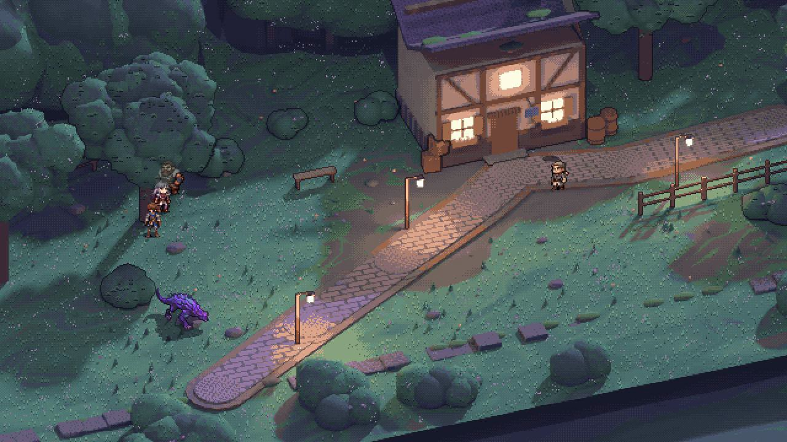
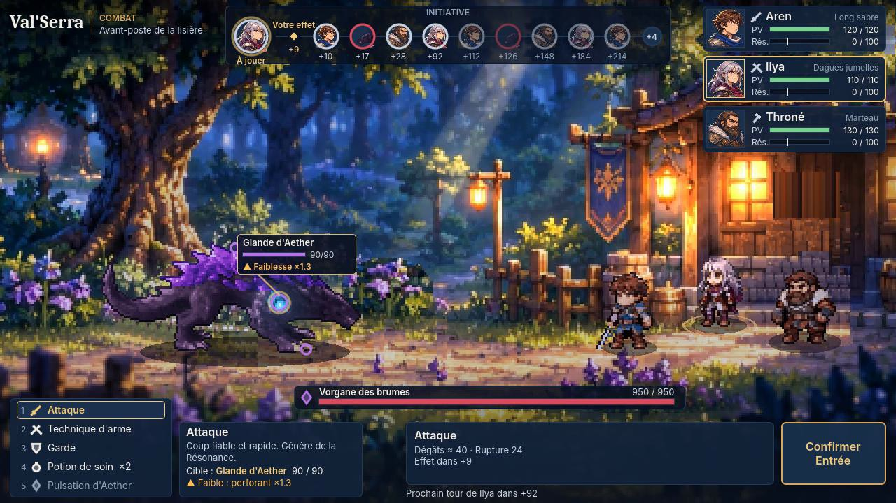
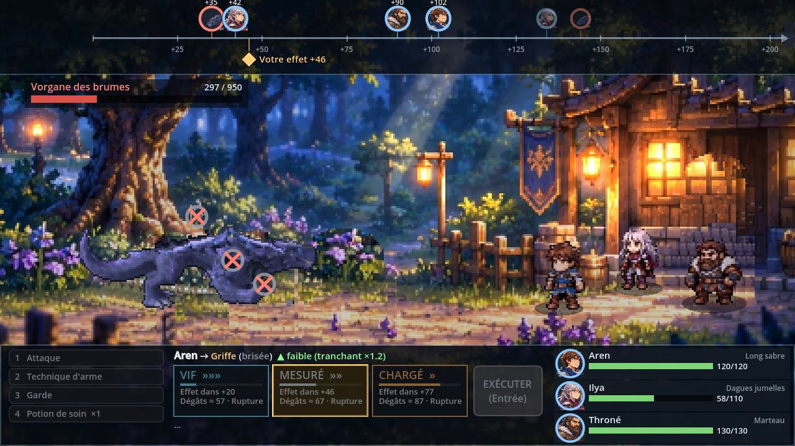
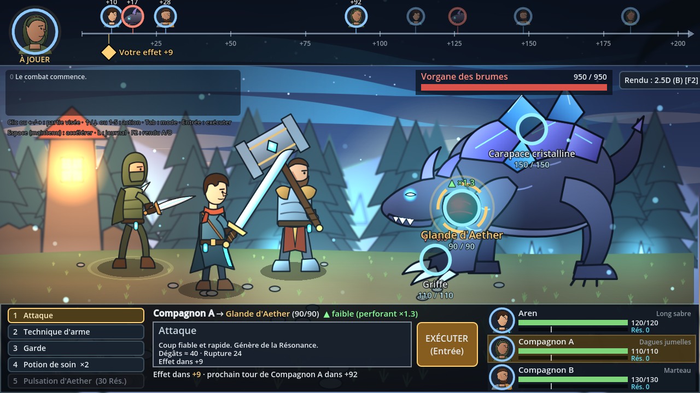

# Val'Serra : Les Larmes d'Aether — prototype MVP

Prototype jouable du RPG narratif au tour par tour **Val'Serra**, réalisé sous **Godot 4**.
Référence : documents 07 (Brief MVP) et 08 (Mission Claude) du dossier Drive du projet.

> Tous les personnages, monstres, illustrations et nombres de ce dépôt sont **provisoires et non canoniques**.
> Ce dépôt est indépendant du système Foundry du JDR (`Warwiren/Val-serra`), qui n'est pas modifié.

## Exploration HD-2D expérimentale — branche `exploration-hd2d`

Petite zone jouable en vue trois-quarts surélevée (plongée 35°, rotation 20°), crépuscule bleu-violet,
indépendante de la boucle F5. Ouvrir `scenes/explore_hd2d/zone_hd2d.tscn` puis **F6**, ou :
`godot --path . -- --start=hd2d-zone` (ajouter `--autoplay` pour la démo, `--autoplay --check-talk` pour la
vérification du dialogue par touches simulées).

- Décor construit dans Blender puis retouché en pixel art (`tools/explore/`) : **fond = terrain seul**, objets
  sur des couches séparées triées par la ligne de leurs pieds, transparence locale autour des personnages cachés.
- Déplacement 8 directions, compagnons qui suivent, collisions, dialogue (distance vérifiée), Vorgane rendu sous
  l'angle de l'exploration, combat au contact.
- Compte rendu et limites : **`docs/EXPLORATION_HD2D.md`** · spécifications des assets à illustrer :
  **`docs/SPEC_ASSETS_EXPLORATION.md`** · vidéo : `docs/media/exploration/exploration_hd2d_demo_v3.mp4`.
- **Locomotion fiabilisée (branche `exploration-hd2d-polish`)** : pas synchronisés sur la distance réelle, orientation
  stable, compagnons à distance constante sur la trace, démo sans micro-arrêts, tri de profondeur devant les murs
  en biais. Parcours clavier mesuré : `godot --path . -- --start=hd2d-zone --course=manuel` (code de sortie 1 si
  un critère n'est pas tenu) ; vidéos : `docs/media/exploration/locomotion/`.
- Tests automatiques : 55 sur 55.



## Dernière passe : correctifs et HUD de combat (brief unifié v1.1) — branche `correctifs-hud`

Clignotement du Vorgane diagnostiqué et corrigé (mesures image par image), Vorgane étalonné sur la référence du pack,
vraies poses de combat pour Aren, HUD de combat refait selon l'annexe A avec les données réelles du moteur, charte
centralisée (`src/presentation/ui_style.gd`). 40 tests réussis sur 40.
Compte rendu, diagnostic, scénarios et limites : **`docs/CORRECTIFS_HUD.md`** ·
vidéo : `docs/media/correctifs/correctifs_hud_demo.mp4`.



## Prototype recentré (pack visuel)

**F5 lance directement la boucle jouable** : avant-poste → dialogue avec le garde → contact avec le Vorgane →
combat dans la même clairière → retour. Aren jouable, Ilya et Throné suivent ; tous les personnages
partagent la même grille de pixels et la même palette (issus du pack visuel).
Commandes : flèches/ZQSD, **E** pour parler, toucher le monstre pour combattre.
Compte rendu (retiré / modifié / conservé / limites) : **`docs/RECENTRAGE.md`** ·
vidéo : `docs/media/recentrage/prototype_recentre.mp4`.



Les sections ci-dessous décrivent les lots précédents, toujours lançables en ligne de commande
(`--start=battle`, `--start=zone`, `--start=hd2d`, `--start=artproto`) ; `--start=proto-battle` lance
directement le combat du prototype.

## Lot B — combat présentable + micro-boucle d'exploration

| Ce qui existe | Où |
|---|---|
| Choix du héros (base masculine / féminine, nom) | `scenes/explore/hero_select.tscn` |
| Zone d'avant-poste : héros + compagnon suiveur, PNJ à dialogue (portraits, accords), ennemi visible | `scenes/explore/zone.tscn` |
| Combat présentable : 3 Chasseurs, monstre à 3 parties brisables, chronologie en portraits, cartes VIF/MESURÉ/CHARGÉ, effets | `scenes/battle/battle_scene.tscn` |
| Deux rendus du même jeu : **A** (2D illustrée) et **B** (2.5D : parallax, profondeur, lumière, particules), touche **F2** | `src/presentation/stage.gd` |
| Moteur de combat déterministe (Lot A, inchangé dans ses règles) | `src/combat/core/` |
| 36 tests automatisés | `tests/unit/` |

Compte rendu, limites et recommandations : **`docs/LOT_B.md`**. Plan général : `docs/PLAN_MVP.md`.



---

## 1. Installer (une seule fois)

1. **Récupérer le projet** : sur GitHub, bouton vert **Code** → **Download ZIP**, puis décompressez.
2. **Récupérer Godot 4.5** (ou plus récent en 4.x), édition **standard** (pas « .NET ») :
   <https://godotengine.org/download>. Décompressez : rien à installer.
3. Lancez Godot → **Importer** → choisissez `project.godot` → **Importer et modifier**.
   *(Si une ancienne version du projet était déjà importée, supprimez-la de la liste et réimportez
   le nouveau dossier.)*

## 2. Vérifier les tests (30 secondes)

Panneau **Système de fichiers** → dossier `tests` → double-clic sur **`test_runner.tscn`** → **F6**.
Attendu : **36 lignes « OK »** et « TOUT EST VERT ».

## 3. Jouer la démo (le vrai test)

Appuyez sur **F5** (ou le bouton ▶ en haut à droite ; sur portable **Fn + F5**, sur Mac **Cmd + B**).

> Depuis le recentrage, F5 ouvre le **prototype recentré** (voir plus haut). Pour retrouver la démo du Lot B
> ci-dessous, ouvrez `scenes/explore/hero_select.tscn` dans Godot et appuyez sur **F6** (lancer la scène courante).

**a. Choix du héros** — cliquez sur la base masculine ou féminine, modifiez le nom si vous voulez,
puis **Commencer**. (« Combat direct » saute l'exploration.)

**b. Avant-poste** — déplacez-vous avec les **flèches** ou **ZQSD**. Le compagnon vous suit.
- Approchez **Maëlle** (à gauche, près de la maison) et appuyez sur **E** (ou Entrée) pour parler.
  Les accords du texte changent selon le héros choisi. Un des choix vous donne une potion.
- À droite rôde le **Vorgane**. Approchez-vous et appuyez sur **E**, ou touchez-le : le combat commence.

**c. Combat**
- **En haut, la chronologie**, à l'échelle du temps : plus une icône est à droite, plus elle est loin.
  - Portraits au-dessus de l'axe : qui va **décider** (et dans combien de temps).
  - Losanges sous l'axe : les **effets** en préparation. **Rouge ⚠** = attaque annoncée du monstre.
    **Or** = l'effet de l'action que vous êtes en train de choisir.
- **Sur le monstre** : trois cercles = ses parties (Griffe, Carapace, Glande). L'anneau montre leur
  intégrité. ▲ = la partie est faible contre votre arme, ▼ = elle résiste. **Cliquez** sur une partie
  pour la viser (ou ←/→).
- **En bas à gauche** : les actions (clic, ↑/↓ ou 1 à 5). **Au centre** : pour la Technique d'arme, trois
  cartes **VIF / MESURÉ / CHARGÉ** avec le délai, les dégâts et la rupture estimés, et, si le monstre a
  annoncé son Souffle, si votre coup tombera **avant ✔** ou **après ✘**. **EXÉCUTER** (ou Entrée) valide.
- **En bas à droite** : PV et Résonance du groupe (le trait blanc = 30, le coût de la Pulsation d'Aether).
- **Espace** maintenu : accélère les animations. **L** : agrandit le journal. **F2** : bascule rendu A / B.
  **F3** : affiche les images par seconde.

**d. Retour** — après la victoire (ou la défaite), revenez à l'avant-poste : les récompenses apparaissent
en haut à gauche, le Vorgane a disparu, et Maëlle a de nouvelles répliques.

### Combat HD-2D : Aren contre le Vorgane (nouveau)

Écran d'accueil → **⚔ Combat HD-2D : Aren vs Vorgane**. Aren est en sprites pixel art (dérivés des planches
de référence), le Vorgane est le modèle Meshy riggé et animé dans Blender puis rendu en sprites ; ses trois
parties changent d'état (intact, endommagé, brisé) selon le CombatCore. Règles, chronologie, modes et
ciblage inchangés. Détails : `docs/AREN_SPRITES.md`, `docs/VORGANE_3D.md`.

### Prototype artistique HD

Sur l'écran d'accueil :
- **✦ Prototype artistique HD** : le même combat, avec le héros et le Vorgane articulés (Skeleton2D),
  l'arène forestière nocturne, la carapace qui éclate, la capacité d'Aether améliorée.
- **✦ Atelier d'animation** : boutons pour déclencher chaque animation du héros et du monstre, briser les
  parties une à une, lancer la capacité d'Aether, afficher le squelette. « Réinitialiser » remet le monstre intact.

Détails, évaluation et fiche pour l'illustrateur : `docs/PROTO_ARTISTIQUE.md` et `docs/FICHE_DECOUPE.md`.

### Scénario conseillé (15 minutes)

1. Jouez la boucle complète une fois avec le héros, une fois avec l'héroïne (vérifiez les accords).
2. En combat, attendez que le monstre **ANNONCE** le Souffle d'Aether, puis comparez les trois cartes de
   la Technique sur la **Glande d'Aether** : brisez-la à temps pour annuler le Souffle.
3. Brisez la **Carapace** avec le marteau (Compagnon B) : elle est faible à l'impact (▲ ×1.3).
4. Appuyez sur **F2** à plusieurs moments (zone et combat) pour comparer **A** et **B**.

### Ce que je vous demande de juger

- Lisibilité : comprend-on la chronologie, les parties visées, les modes, sans lire le journal ?
- Ressenti : les coups ont-ils du poids ? Le choix VIF/CHARGÉ est-il intéressant ?
- Direction visuelle : **A ou B** ? Le style des personnages vous semble-t-il une base acceptable ?
- Boucle : la petite exploration donne-t-elle envie d'aller plus loin ?

## 4. Vidéos et captures

`docs/media/` contient les vidéos de démonstration (boucle complète en B, combat en A),
`docs/captures/` les captures comparatives A/B.

## 5. Ligne de commande (facultatif)

```bash
godot --headless --path . --script res://tests/run_tests.gd
```

```bash
godot --path . -- --start=battle --render=A
```

La première lance les tests ; la seconde ouvre directement le combat en rendu A. Options disponibles après
`--` : `--start=battle`, `--start=zone`, `--start=hd2d`, `--start=artproto`, `--start=rigviewer`, `--render=A`, `--render=B`, `--hero=f`, `--autoplay` (démo automatique).

## Arborescence

```
art/                  Illustrations SVG (personnages, portraits, monstre, décor, accessoires)
data/combat/          Règles, actions, Chasseurs, monstre (JSON)
data/dialogue/        Dialogues (JSON, accords {m:…|f:…})
src/combat/           CombatCore (logique pure) + chargement + politique automatique
src/presentation/     Vues de combat : décor A/B, Chasseurs, monstre, chronologie, interface, effets
src/explore/          Boîte de dialogue
src/game/             État de partie global (GameState)
scenes/               Choix du héros, zone, combat, écran de débogage (Lot A)
tests/                Tests automatisés
tools/                Simulation console, générateurs de décor
docs/                 Plan, comptes rendus de lots, registre des assets, captures, vidéos
```
