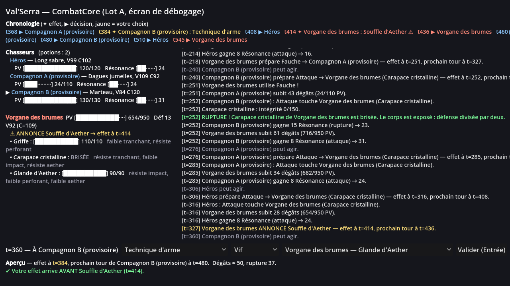

# Val'Serra : Les Larmes d'Aether — prototype MVP

Prototype jouable du RPG narratif au tour par tour **Val'Serra**, réalisé sous **Godot 4**.
Référence : documents 07 (Brief MVP) et 08 (Mission Claude) du dossier Drive du projet.

> Tous les personnages, monstres et nombres de ce dépôt sont **provisoires et non canoniques**.
> Ce dépôt est indépendant du système Foundry du JDR (`Warwiren/Val-serra`), qui n'est pas modifié.

## État actuel : Lot A (simulation de combat), testé

| Ce qui existe | Où |
|---|---|
| Moteur de combat déterministe (horloge commune, VIF/MESURÉ/CHARGÉ, garde, Résonance, sérum, parties brisables, interruption, IA ennemie) | `src/combat/core/` |
| Données de combat modifiables (règles, actions, 3 Chasseurs, 1 monstre) | `data/combat/*.json` |
| 28 tests automatisés (28/28 réussis sous Godot 4.5.1) | `tests/unit/` |
| Écran de combat de **débogage** (texte, sans graphismes : c'est voulu à ce stade) | `scenes/debug/combat_debug.tscn` |

Plan et architecture : `docs/PLAN_MVP.md`. Compte rendu du lot : `docs/LOT_A.md`.



---

## 1. Installer (une seule fois, environ 5 minutes)

1. **Récupérer le projet.** Sur la page GitHub du dépôt, cliquez sur le bouton vert **Code**, puis
   **Download ZIP**. Décompressez l'archive où vous voulez (par exemple `Documents\Val-Serra-Game`).
   *(Si vous utilisez Git ou GitHub Desktop, clonez simplement le dépôt.)*
2. **Récupérer Godot.** Allez sur <https://godotengine.org/download>, téléchargez **Godot 4.5**
   (ou une version 4.x plus récente) en édition **standard** — **pas** la version « .NET ».
   C'est une archive ZIP : décompressez-la. Il n'y a rien à installer.
   Sous Windows, vous obtenez deux fichiers : `Godot_v4.5.x-stable_win64.exe` (celui qu'on utilise)
   et `..._console.exe` (le même, avec une fenêtre de texte en plus ; utile pour voir les erreurs).
3. **Ouvrir le projet.** Lancez Godot. Dans la fenêtre « Gestionnaire de projets », cliquez sur
   **Importer**, sélectionnez le fichier `project.godot` du dossier décompressé, puis cliquez sur
   **Importer et modifier**. L'éditeur s'ouvre ; il prépare le projet quelques secondes la première fois.
   *(Si Godot propose de convertir le projet vers une version plus récente, acceptez.)*

## 2. Vérifier que tout fonctionne : les tests (30 secondes)

1. Dans l'éditeur, panneau **Système de fichiers** (en bas à gauche), ouvrez le dossier `tests`.
2. Double-cliquez sur **`test_runner.tscn`**.
3. Appuyez sur **F6** (ou le bouton « Lancer la scène actuelle », en haut à droite, icône ▶ avec un clap).
4. Une fenêtre s'ouvre et liste les tests. Résultat attendu : **28 lignes « OK »** et en bas
   **« TOUT EST VERT »**. Fermez la fenêtre.

Si une ligne est rouge (« ÉCHEC »), faites une capture de la fenêtre et du panneau **Sortie** en bas de
l'éditeur, et envoyez-la : c'est une information utile, pas une erreur de votre part.

## 3. Jouer un combat (le vrai test : votre ressenti)

Appuyez sur **F5** (bouton ▶ « Lancer le projet »). L'écran de combat de débogage s'ouvre.

**Lire l'écran**

- **En haut, la chronologie** : l'ordre de ce qui va se passer, de gauche à droite, avec l'instant `t`.
  - `▶ Nom` = ce personnage va **choisir** une action à cet instant.
  - `✦ Nom : Action` = une action déjà choisie **produit son effet** à cet instant.
  - En **jaune** : l'action que vous êtes en train de préparer (elle bouge quand vous changez de mode).
  - `⚠` = attaque **annoncée** par le monstre.
- **À gauche** : les trois Chasseurs (PV, Résonance, vitesse V et cycle C : plus C est petit, plus on joue
  souvent), puis le monstre et ses **trois parties** avec leur intégrité et leurs faiblesses.
- **À droite** : le journal de tout ce qui se passe.
- **En bas** : à qui c'est le tour, puis trois menus (**action**, **mode**, **cible**), le bouton
  **Valider** (ou touche Entrée) et **Recommencer**. Sous la barre, l'**Aperçu** donne la date de l'effet,
  les dégâts et la rupture prévus *avant* que vous confirmiez.

**Les actions**

| Action | À quoi elle sert |
|---|---|
| Attaque | Rapide et fiable ; donne **+8 Résonance** |
| Technique d'arme | Plus puissante, au choix **Vif** (effet tôt, plus faible), **Mesuré**, **Chargé** (effet tard, plus fort, brise mieux). Ne donne pas de Résonance. Votre tour suivant arrive au même moment dans les trois cas. |
| Garde | La prochaine attaque reçue fait −40 % ; +10 Résonance si elle a servi |
| Potion de soin | +60 PV à un allié (2 potions par combat) |
| Pulsation d'Aether | Capacité de sérum (coûte 30 Résonance) : dégâts et **retarde** le tour du monstre |

**Scénario de test conseillé (10 minutes)**

1. Jouez quelques tours en attaquant différentes parties. Observez dans le journal l'intégrité qui baisse.
2. Brisez la **Carapace** (le marteau du Compagnon B est le plus efficace) : la défense du monstre baisse.
3. Tous les trois tours environ, le monstre **ANNONCE** le *Souffle d'Aether* (texte jaune, ⚠), qui touche
   tout le groupe. Choisissez alors *Technique d'arme* sur la **Glande d'Aether** et comparez **Vif** et
   **Chargé** : l'aperçu vous dit en vert ou en rouge si votre effet arrivera **avant** ou **après** le Souffle.
   Si vous brisez la Glande à temps, le Souffle est **annulé** (et ne reviendra plus).
4. Essayez aussi la **Garde** pendant un Souffle annoncé, et la **Pulsation d'Aether** dès que vous avez
   30 de Résonance (regardez le tour du monstre reculer dans la chronologie).
5. Finissez le combat (victoire ou défaite), lisez les récompenses, puis **Recommencer**.

**Ce que je vous demande de juger** (répondez simplement oui / non / pourquoi)

- Comprend-on la chronologie : qui joue ensuite, quand tombent les effets ?
- Le choix entre **Vif** et **Chargé** change-t-il vraiment votre décision ?
- Le marteau (lent) reste-t-il intéressant face aux dagues (rapides) ?
- La garde vaut-elle parfois mieux qu'une attaque ?
- Le combat est-il trop facile, trop dur, trop long ?

## 4. Modifier l'équilibrage (facultatif)

Les nombres sont dans `data/combat/` : `rules.json` (règles générales), `actions.json`, `hunters.json`
(Chasseurs, armes, armures), `monster_vorgane.json` (monstre). Double-cliquez sur un fichier dans Godot
(ou ouvrez-le avec le Bloc-notes), changez une valeur, enregistrez, puis **F5**. Exemple : passer
`"hp": 950` à `1300` dans `monster_vorgane.json` rend le monstre plus résistant.
Attention à garder les virgules et guillemets. Relancez ensuite les tests (étape 2) : quelques tests
vérifient les exemples chiffrés du GDD et peuvent signaler un changement de règle, c'est normal.

## 5. En ligne de commande (facultatif, pour développeurs)

```bash
godot --headless --path . --script res://tests/run_tests.gd
```

```bash
godot --headless --path . --script res://tools/simulate_battle.gd
```

La première commande lance les tests (code de sortie 0 si tout passe) ; la seconde joue un combat entier
automatiquement et affiche le journal horodaté. `godot` désigne l'exécutable Godot (sous Windows, le
chemin complet du fichier `..._console.exe`).

## Arborescence

```
data/combat/          Données JSON (règles, actions, Chasseurs, monstre)
src/combat/core/      CombatCore : logique pure, aucun affichage
src/combat/           Chargement des données et fabrique de combats
scenes/debug/         Écran de combat de débogage (Lot A)
tests/                Tests automatisés + lanceurs
tools/                Outils console
docs/                 Plan, architecture, comptes rendus de lots, captures
```
