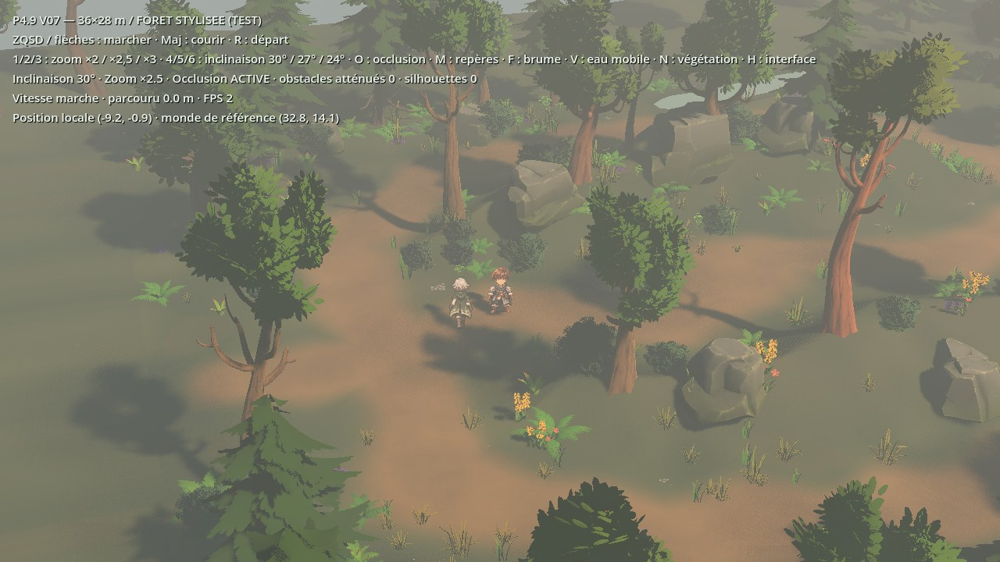
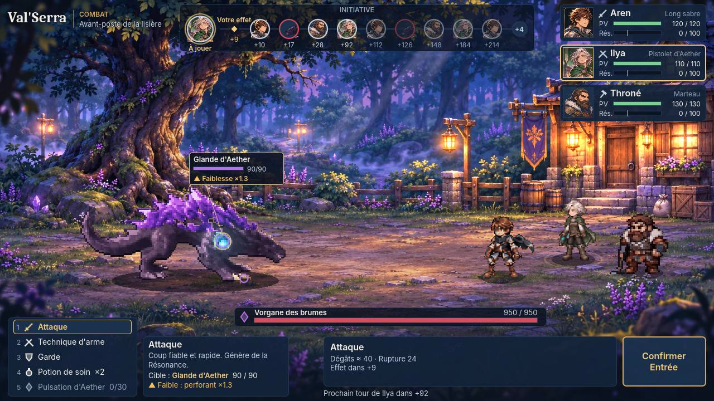

# Val'Serra : Les Larmes d'Aether — démo jouable

Démo jouable du RPG narratif au tour par tour **Val'Serra**, réalisée sous **Godot 4.7.2**.

> Tous les personnages, monstres, illustrations et nombres de ce dépôt sont **provisoires et non canoniques**.
> Ce dépôt est indépendant du système Foundry du JDR (`Warwiren/Val-serra`), qui n'est pas modifié.



## Ce qui est jouable

**F5 : la forêt stylisée V07B** (décision du créateur du 15/11/2026, étape P4.9 V08A) — terrain de 36 × 28 m,
modèles Quaternius stylisés, ruisseau, nouvelle direction HD-2D en cours d'essai :

1. **Exploration libre** avec **Aren** (cheveux bruns, armure et cape grises) et **Ilya** (cheveux courts argentés,
   cape verte, pistolet d'Aether) : chemins, clairières et butte se traversent hors des sentiers ; troncs, rochers,
   eau et vraies fortes pentes arrêtent les personnages (marche 2,2 m/s, course 3,6 m/s avec Maj, cycle de marche à
   8 images).
2. **Caméra P30** (perspective, azimut 20°, champ 30°) avec **trois inclinaisons à comparer** — 30°, 27°, 24° — et
   trois zooms.
3. **Occlusion dynamique** : un feuillage ou un buisson qui cache Aren ou Ilya s'efface en trame ; derrière un tronc
   ou un rocher, une silhouette discrète les montre.
4. **Diagnostic des collisions** (touche C) : obstacles, eau, bords et pentes du terrain.

C'est un **banc d'essai** (interface de test visible, pas de quête ni de combat). La **démo complète de l'avant-poste**
— exploration, dialogue avec le garde, combat au tour par tour contre le Vorgane (475 PV de démonstration), retour —
reste jouable en **F6** (`scenes/p4/avant_poste.tscn`, voir « Autres scènes »).

| Avant-poste (F6) : combat | Avant-poste (F6) : plaine |
|---|---|
|  |  |

Étape en cours : **P4.9** — forêt V07B, inclinaisons et occlusion, navigation libre (V08A), locomotion V09A en essai
([comparaison V08 / V09A](docs/media/p4_9/v09a/comparaison_v08_v09a.mp4)). Rapport
[`docs/P4_9_V07B.md`](docs/P4_9_V07B.md) ; vidéos : [exploration libre](docs/media/p4_9/v08a/exploration_libre_forwardplus.mp4),
[inclinaisons et occlusion](docs/media/p4_9/cameras_occlusion/videos/angles_et_occlusion_forwardplus.mp4) ;
[comparatif 30° / 27° / 24°](docs/media/p4_9/cameras_occlusion/comparatif_6_captures_forwardplus.jpg),
[masque de collision avant / après](docs/media/p4_9/v08a/masque_avant_apres.jpg).
Étapes précédentes : `docs/HISTORIQUE.md`.

## Lancer le jeu (Godot 4.7.2 obligatoire)

> **Version du moteur : Godot 4.7.2, et elle seule.** La ligne `config/features=PackedStringArray("4.5")` de
> `project.godot` est un reliquat historique, laissé tel quel volontairement.

1. Télécharger le projet (GitHub : choisir la branche **`p4-9-v07-test`**, puis **Code → Download ZIP** ; le
   dossier s'appelle `Val-Serra-Game-p4-9-v07-test`) et le décompresser.
2. Récupérer **Godot 4.7.2** (édition standard, pas « .NET ») : <https://godotengine.org/download/archive/4.7.2-stable/>.
3. Godot → **Importer** → choisir `project.godot` → **Importer et modifier** (une minute environ la première fois).
4. **F5** lance la **forêt V07B** (`ValSerra_P49_V07B_PREFLIGHT_GODOT/godot/P49_V07_Foret_Test.tscn`), avec les
   corrections de navigation V08A et la locomotion V09A en essai (touche L pour revenir à V08). La **démo de l'avant-poste** s'ouvre en **F6** depuis `scenes/p4/avant_poste.tscn`.

### Commandes — forêt V07B (F5)

| Touche | Action |
|---|---|
| Flèches / ZQSD | se déplacer ; **Maj** maintenue : courir |
| **1 / 2 / 3** | zoom ×2 / ×2,5 (défaut) / ×3 |
| **4 / 5 / 6** | inclinaison de la caméra : 30° (défaut) / 27° / 24° |
| **O** | occlusion dynamique : active (défaut) / coupée |
| **L** | locomotion : V09A, essai **non validé** (inertie légère, Ilya suit la trace d'Aren ; défaut) / V08 (déplacement précédent) |
| **C** | diagnostic des collisions : obstacles (orange), eau (turquoise), bords (violet), pentes 35°–45° (jaune), > 45° (rouge) |
| **N** | masquer la végétation (et ses collisions) ; **M** : repères des parcours |
| **V** | eau animée (shader candidat) ; **F** : brume ; **H** : interface ; **R** : retour au départ |

### Commandes — démo de l'avant-poste (F6)

| Touche | Action |
|---|---|
| Flèches / ZQSD | se déplacer (8 directions) ; **Maj** maintenue : courir |
| **Molette** (ou PgPréc / PgSuiv) | zoom ×2 / ×2,5 (défaut) / ×3 |
| **E** / Entrée / Espace | parler au garde, examiner ; faire avancer le dialogue |
| ↑ / ↓ puis Entrée (dialogue) | choisir une réponse ; **Échap** : fermer |
| Marcher sur le seuil de la porte | entrer dans le bâtiment ; le seuil sud de la salle en fait ressortir |
| Toucher le Vorgane | lancer le combat |
| En combat : clic, ↑/↓ ou 1 à 5 | choisir une action ; ←/→ ou clic sur une partie : changer de cible |
| En combat : Tab | changer de mode (VIF / MESURÉ / CHARGÉ) ; **Entrée** : confirmer |
| **C** | caméra de comparaison : P30 (défaut) / B28 (orthographique 28°) / P38 |
| **T** | personnages : rendu net / ancien rendu bilinéaire (comparaison) |
| **R** | revenir à l'entrée de la zone ; **F1** : informations ; **F2** : couches et collisions |

### Autres scènes (ouvrir dans l'éditeur, puis **F6**)

| Scène | Contenu |
|---|---|
| `scenes/p4/avant_poste.tscn` | **démo complète de l'avant-poste** (F5 jusqu'en P4.8) : exploration, dialogue, combat, retour |
| `scenes/p4/comparaison_camera_B28.tscn` | la démo de l'avant-poste avec l'ancienne caméra orthographique 28° (B28), pour comparer |
| `scenes/battle/battle_scene.tscn` | combat seul (avec `--start=proto-battle --arena=lisiere` en ligne de commande) |
| `tests/test_runner.tscn` | tests automatiques dans l'éditeur |

## Vérifications

```bash
godot --headless --path . --script res://tests/run_tests.gd
```

```bash
godot --headless --path . --script res://tests/e2e_p4_retour.gd
```

```bash
godot --headless --path . res://scenes/p4/avant_poste.tscn -- --route=p4 --quit --out=user://p4
```

```bash
godot --headless --path . res://scenes/p4/avant_poste.tscn -- --route=p4_sondes --quit --out=user://p4
```

```bash
godot --headless --path . --fixed-fps 60 --script res://tools/p49/traversees_v08.gd -- --out=/tmp/v08
```

```bash
godot --headless --path . --fixed-fps 60 --script res://tools/p49/occlusion_v07.gd -- --out=/tmp/occ
```

```bash
godot --headless --path . --script res://tests/v09_locomotion_smoke.gd
```

```bash
godot --path . res://scenes/p4/avant_poste.tscn -- --autoplay --route=p4_demo --route_retour=p4_retour
```

Dans l'ordre : tests automatiques (71), rencontre de bout en bout de l'avant-poste (déclenchement, PV de démo,
victoire, défaite, bâtiment), parcours complet au clavier simulé (29 étapes ; `--camera=B28` ou `P38` pour
comparer), sondes de collision (20), forêt V07B : 18 traversées hors des chemins (marche et course) et 12 scénarios
d'occlusion, test de locomotion V09A, démonstration automatique de l'avant-poste (dialogue et combat joués seuls).

## Où trouver quoi

| Sujet | Fichiers |
|---|---|
| Forêt V07B (F5) : scène, modèles, manifeste | `ValSerra_P49_V07B_PREFLIGHT_GODOT/` (`godot/`, `assets/`, `docs/V07_WORLD.json`) ; occlusion `src/occlusion/` ; diagnostic des collisions `src/diag/` ; outils de test `tools/p49/` |
| Avant-poste (F6) : scène et habillage | `scenes/p4/avant_poste.gd` ; données `data/p4/` ; shaders `src/p4/` |
| Socle d'exploration 2.5D | `src/explore25/` (monde, session, caméra, acteurs, parcours), `scenes/explore25/explore_3d.gd` |
| Personnages (exploration, combat, portraits) | `art/p45/` (`SOURCES.md`), outil `tools/p45/build_p45.py` ; Vorgane d'exploration `art/p45/chars/vorgane/` |
| Décor de la zone | `art/p4/` (`SOURCES.md`), décor nettoyé `art/p41/decor/` ; outils `tools/p4/`, `tools/p41/` |
| Combat | `scenes/battle/`, règles `src/combat/`, données `data/combat/`, présentation `src/presentation/`, `src/proto/` |
| Arène de combat | `art/arena/lisiere/`, `src/presentation/arena_layers.gd`, outils `tools/arena/` |
| Dialogues | `data/p4/dialogue_garde.json`, `data/dialogue/` ; portraits : `src/proto/portraits.gd` |
| Tests | `tests/` |

## Documentation

| Document | Contenu |
|---|---|
| `docs/P4_9_V07B.md` | **P4.9** : forêt V07B (intégration, Forward+), inclinaisons 30° / 27° / 24° et occlusion, navigation libre V08A (18 traversées, corrections, F5) |
| `docs/HISTORIQUE.md` | où retrouver les rapports et médias des étapes précédentes (branches Git) |
| `docs/ASSETS.md` | registre des ressources et de leurs conditions d'usage |
