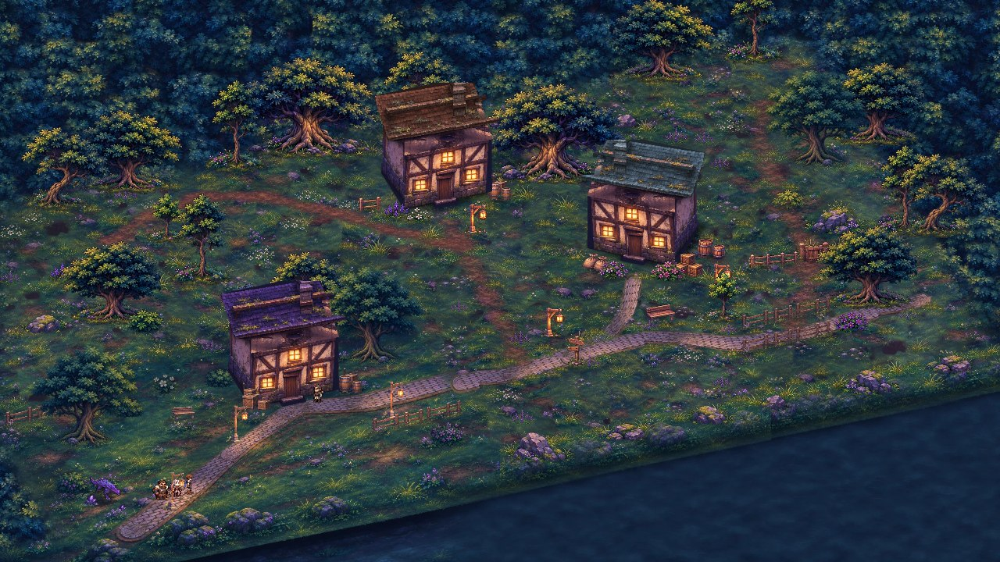
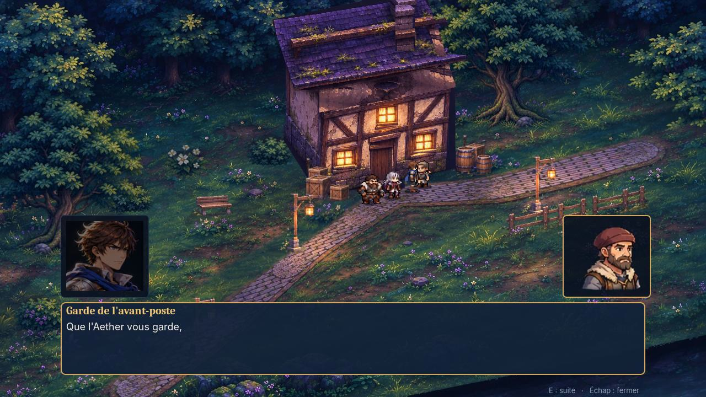
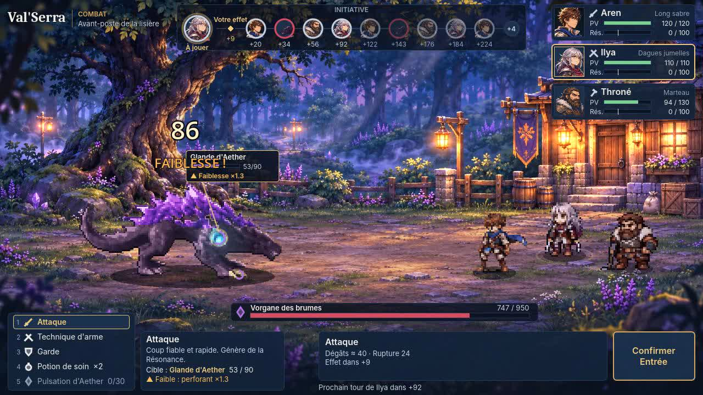

# Val'Serra : Les Larmes d'Aether — prototype MVP

Prototype jouable du RPG narratif au tour par tour **Val'Serra**, réalisé sous **Godot 4**.

> Tous les personnages, monstres, illustrations et nombres de ce dépôt sont **provisoires et non canoniques**.
> Ce dépôt est indépendant du système Foundry du JDR (`Warwiren/Val-serra`), qui n'est pas modifié.



## Ce qui est jouable

Une boucle complète dans l'**avant-poste de la lisière**, au crépuscule :

1. **Exploration HD-2D** en vue trois-quarts surélevée (plongée 35°, rotation 20°) : Aren et ses deux compagnons,
   Ilya et Throné, qui suivent sa trace ; décor illustré (sol peint, maison à colombages, arbres, buissons,
   lanternes) avec passage devant et derrière les éléments.
2. **Dialogue** avec le garde, à portraits et à choix.
3. **Combat au tour par tour** contre le Vorgane sur une **arène illustrée** : initiative dynamique commune aux
   alliés et au monstre, modes VIF / MESURÉ / CHARGÉ, ciblage de parties destructibles (griffe, carapace, glande),
   Résonance et Pulsation d'Aether.
4. **Retour** dans la zone : après une victoire, le Vorgane a disparu et le garde change de répliques ; après une
   défaite, le groupe revient au point de départ.

| Dialogue | Combat |
|---|---|
|  |  |

Vidéo de démonstration : [`docs/media/decor_final/demo_zone_definitive.mp4`](docs/media/decor_final/demo_zone_definitive.mp4)

## Lancer le jeu (Godot 4.5 à 4.7)

1. Télécharger le projet (GitHub : choisir la branche **`p2-environnements`**, puis **Code → Download ZIP** ; le dossier
   s'appelle `Val-Serra-Game-p2-environnements`) et le décompresser.
2. Récupérer **Godot 4.5 ou plus récent** (édition standard, pas « .NET ») : <https://godotengine.org/download>.
3. Godot → **Importer** → choisir `project.godot` → **Importer et modifier**. La première ouverture réimporte
   les images (quelques secondes).
4. **F5** : la dernière version, sans aucun réglage : la **carte d'exploration v2**
   (`scenes/explore_hd2d/zone_exploration.tscn`, voir `docs/EXPLORATION_V2.md`), caméra A par défaut (touches
   1 / 2 / 3 ou C pour comparer B et C). L'avant-poste d'origine s'ouvre avec `scenes/explore_hd2d/zone_hd2d.tscn`
   puis **F6**.

### Commandes

| Touche | Action |
|---|---|
| Flèches / ZQSD | se déplacer (8 directions) |
| **E** / Entrée | parler au garde quand l'invite « E  Parler » s'affiche |
| Toucher le Vorgane | lancer le combat |
| En combat : clic, ↑/↓ ou 1 à 5 | choisir une action ; ←/→ ou clic sur une partie : changer de cible |
| En combat : Tab | changer de mode (VIF / MESURÉ / CHARGÉ) ; **Entrée** : confirmer |
| Espace (maintenu) | accélérer les animations ; **F3** : images par seconde |
| **1 / 2 / 3** ou **C** (exploration) | caméra A (actuelle, par défaut) / B / C — essai P1, voir `docs/P1_CAMERA.md` |

### Autres scènes (ouvrir dans l'éditeur, puis **F6**)

| Scène | Contenu |
|---|---|
| `scenes/explore_hd2d/zone_hd2d.tscn` | avant-poste d'origine (`--start=hd2d-zone`), référence des tests ; F5 lance la carte v2 |
| `scenes/dev/essai_combat_lisiere.tscn` | combat direct sur l'arène illustrée |
| `scenes/dev/essai_parcours_clavier.tscn` | parcours de locomotion au clavier simulé ; verdict dans le panneau « Sortie » |
| `scenes/proto/proto_zone.tscn` | ancien avant-poste (prototype recentré, décor du pack) |
| `scenes/explore/hero_select.tscn` | première boucle (choix du héros, Lot B) |

## Vérifications

```bash
godot --headless --path . --script res://tests/run_tests.gd
```

```bash
godot --headless --path . --script res://tests/e2e_zone_retour.gd
```

```bash
godot --path . -- --autoplay
```

```bash
godot --path . -- --start=hd2d-zone --course=manuel
```

```bash
godot --path . -- --start=hd2d-zone --course=pnj
```

```bash
godot --path . --script res://tests/perf_probe.gd
```

Dans l'ordre : tests automatiques (61), retour de combat (victoire et défaite), démo complète (zone, dialogue,
combat, retour), parcours de locomotion au clavier, approches du garde, mesures de performances.
Dans l'éditeur, les tests se lancent aussi avec `tests/test_runner.tscn` puis **F6**.

## Où trouver quoi

| Sujet | Fichiers |
|---|---|
| Zone d'exploration (code) | `scenes/explore_hd2d/zone_hd2d.gd` |
| Carte d'exploration v2 (F5) | `art/explore_hd2d/v2/` (sol, `zone.json`, `decor.json`) + sprites `art/explore_hd2d/pack/` ; générée par `tools/explore/build_exploration_v2.py` (pack découpé par `tools/explore/pack_extract_v2.py`) |
| Avant-poste validé (base de la carte v2) | `art/explore_hd2d/illustre/` + `decor.json` ; géométrie de jeu : `art/explore_hd2d/zone.json` |
| Arène de combat illustrée | `art/arena/lisiere/peint/`, `src/presentation/arena_layers.gd` |
| Moteur de combat (règles, déterministe) | `src/combat/core/`, données `data/combat/` |
| Dialogues | `data/dialogue/` |
| Sources graphiques et gabarits | `art/source/`, `docs/media/gabarits_exploration/` |
| Outils de production (Blender, découpe, sol, maison) | `tools/explore/`, `tools/arena/` |
| Tests | `tests/` |

## Documentation

| Document | Contenu |
|---|---|
| `docs/P2_LOT_A_GABARITS.md` | **P2, lot A** : gabarits techniques des bâtiments pilotes (habitation, remise), composition de référence ; jeu inchangé |
| `docs/EXPLORATION_V2.md` | **carte d'exploration v2** (version par défaut) : changements visuels, vérifications |
| `docs/P1_CAMERA.md` | **P1** : zone de test agrandie, caméras A / B / C, mesures, recommandation (en attente de validation) |
| `docs/DECOR_EXPLORATION.md` | décor définitif, toiture, défauts connus |
| `docs/EXPLORATION_HD2D.md` | locomotion, suivi du groupe, collisions, dialogue, interaction avec le garde |
| `docs/GABARITS_EXPLORATION.md`, `docs/INTEGRATION_SOL.md` | gabarits et importation des illustrations |
| `docs/ARENE_COMBAT.md` | arène de combat |
| `docs/PERFORMANCES.md` | mesures, poids du projet, points à surveiller |
| `docs/INVENTAIRE_PURGE.md` | purge du 7 novembre 2026 et bilan de poids |
| `docs/ASSETS.md` | registre des ressources et de leurs conditions d'usage |
| `docs/PLAN_MVP.md`, `docs/LOT_A.md`, `docs/LOT_B.md`, `docs/RECENTRAGE.md`, `docs/CORRECTIFS_HUD.md`, `docs/P1_SUITE.md`, `docs/PROTO_ARTISTIQUE.md` | historique des lots précédents |

Les vidéos et captures des lots précédents ont été retirées de la branche active pour alléger le projet ; elles
restent disponibles dans la branche **`sauvegarde-avant-purge`** (certains anciens comptes rendus y renvoient).

## Ligne de commande (facultatif)

Options après `--` : `--start=hd2d-zone` (zone d'exploration), `--start=proto-battle` (combat du prototype),
`--arena=lisiere` ou `--arena=ancien` (décor de combat), `--autoplay` (démo automatique) ; anciens lots :
`--start=battle`, `--start=zone`, `--start=hd2d`, `--start=artproto`, `--start=rigviewer`, `--render=A|B`, `--hero=f`.
