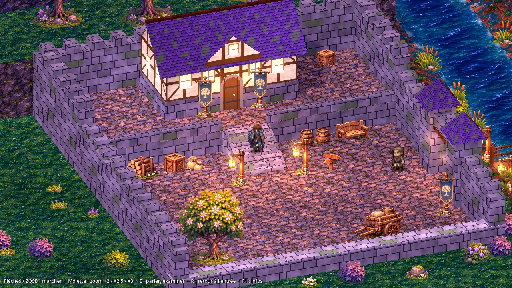
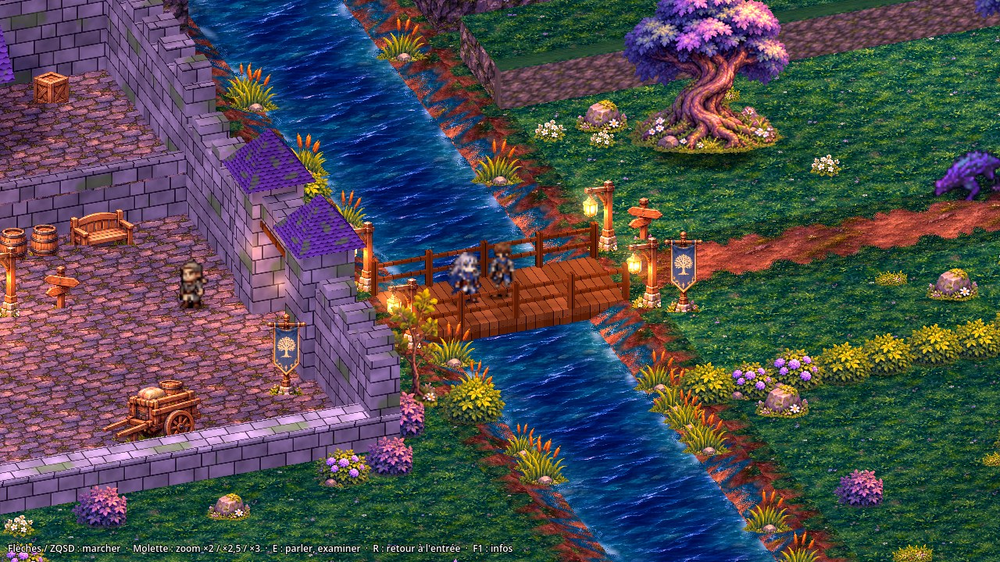
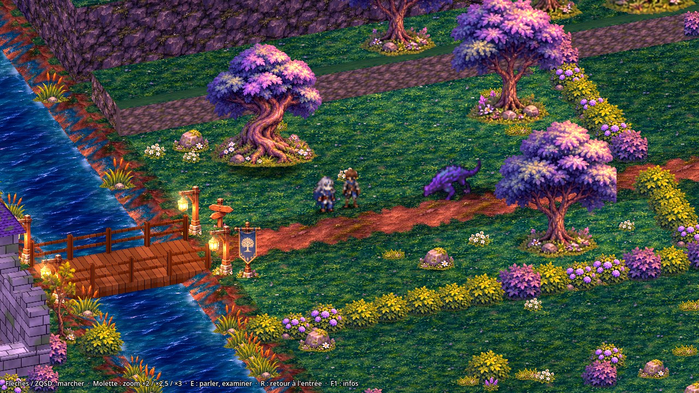

# Val'Serra : Les Larmes d'Aether — prototype MVP

Prototype jouable du RPG narratif au tour par tour **Val'Serra**, réalisé sous **Godot 4**.

> Tous les personnages, monstres, illustrations et nombres de ce dépôt sont **provisoires et non canoniques**.
> Ce dépôt est indépendant du système Foundry du JDR (`Warwiren/Val-serra`), qui n'est pas modifié.



## Ce qui est jouable

Une boucle complète dans l'**avant-poste de la lisière** (P4), au crépuscule, en **HD-2D / 2.5D** :

1. **Exploration** en vue trois-quarts (Camera3D orthographique, plongée 28°, azimut 20°, rotation fixe, zooms
   ×2 / ×2,5 / ×3 à la molette) : Aren et sa compagne Ilya dans la **cour** pavée d'un petit avant-poste fortifié,
   l'**escalier** de pierre et la **terrasse**, le **bâtiment principal** dans lequel on entre, la **porte
   fortifiée**, le **pont** de bois sur une rivière animée, puis la **plaine** (herbe, chemin, arbres, rochers, relief).
2. **Dialogue** à portraits et à choix avec le garde ; panneaux à examiner.
3. **Combat au tour par tour** contre le Vorgane, qui rôde dans la plaine : initiative dynamique, modes
   VIF / MESURÉ / CHARGÉ, parties destructibles, Résonance et Pulsation d'Aether, sur l'arène illustrée.
4. **Retour** dans la zone : après une victoire, le Vorgane a disparu et le garde change de répliques ; après une
   défaite, le groupe revient dans la cour.

| Pont et rivière | Plaine et Vorgane |
|---|---|
|  |  |

Vidéo du parcours complet (exploration, dialogue, bâtiment, pont, combat, retour) :
[`docs/media/p4/parcours_complet_p4.mp4`](docs/media/p4/parcours_complet_p4.mp4). Rapport : `docs/P4_AVANT_POSTE.md`.

## Lancer le jeu (Godot 4.7.2 obligatoire)

> **Version du moteur : Godot 4.7.2, et elle seule**, pour ouvrir, tester et valider le projet (décision du
> 7 novembre 2026). La ligne `config/features=PackedStringArray("4.5")` de `project.godot` est un reliquat
> historique, laissé tel quel volontairement : le projet s'importe et passe tous ses tests sous 4.7.2.

1. Télécharger le projet (GitHub : choisir la branche **`p4-avant-poste`**, puis **Code → Download ZIP** ; le
   dossier s'appelle `Val-Serra-Game-p4-avant-poste`) et le décompresser. Les branches précédentes
   (`p3-validation-camera`, etc.) restent disponibles telles quelles.
2. Récupérer **Godot 4.7.2** (édition standard, pas « .NET ») : <https://godotengine.org/download/archive/4.7.2-stable/>.
3. Godot → **Importer** → choisir `project.godot` → **Importer et modifier**. La première ouverture réimporte
   les images (une minute environ).
4. **F5** lance l'**avant-poste P4** (`scenes/p4/avant_poste.tscn`). Promotion décidée par le brief P4 du
   12 novembre 2026 (« faire pointer F5 vers la nouvelle exploration P4 si elle est jouable et passe ses
   vérifications ») ; état exact dans `docs/P4_AVANT_POSTE.md` § 8.
5. L'ancienne exploration stable, les prototypes P3 et les scènes de diagnostic s'ouvrent dans l'éditeur puis
   **F6** — voir le tableau « Autres scènes ».

### Commandes

| Touche | Action |
|---|---|
| Flèches / ZQSD | se déplacer (8 directions) |
| **Molette** (ou PgPréc / PgSuiv) | zoom ×2 / ×2,5 (défaut) / ×3 |
| **E** / Entrée / Espace | parler au garde, examiner un panneau ; faire avancer le dialogue |
| ↑ / ↓ puis Entrée (dialogue) | choisir une réponse ; **Échap** : fermer |
| Marcher sur le seuil de la porte | entrer dans le bâtiment ; le seuil sud de la salle en fait ressortir |
| Toucher le Vorgane | lancer le combat |
| En combat : clic, ↑/↓ ou 1 à 5 | choisir une action ; ←/→ ou clic sur une partie : changer de cible |
| En combat : Tab | changer de mode (VIF / MESURÉ / CHARGÉ) ; **Entrée** : confirmer |
| **R** | revenir à l'entrée de la zone |
| **F1** | informations de débogage (position, surface, zoom, images par seconde) ; **F2** : couches et collisions |
| **F3** | limite d'images par seconde (aucune / 30 / 60 / 144) ; **P** : parcours automatique |

### Autres scènes (ouvrir dans l'éditeur, puis **F6**)

| Scène | Contenu |
|---|---|
| `scenes/explore_hd2d/zone_exploration.tscn` | **ancienne exploration stable** (carte v2, F5 jusqu'à P3) : Aren, Ilya, Throné, garde, Vorgane — voir `docs/EXPLORATION_V2.md` |
| `scenes/explore25/camera_variante_A.tscn`, `_B`, `_C` | **P3-07** : variantes de caméra A (35°) / B (28°, retenue pour P4) / C sur le blockout, avec paysage ; V et L en jeu — `docs/P3_CAMERA_PROFONDEUR.md` |
| `scenes/explore25/scene_temoin.tscn` | **P3** : scène témoin grise 32 × 24 m — `docs/P3_PROTOTYPE_25D.md` |
| `scenes/explore25/demo_a_2d.tscn`, `demo_b_3d.tscn`, `scene_temoin_2d.tscn` | **P3** : micro-test comparatif Camera2D / Camera3D (diagnostic) |
| `scenes/explore_hd2d/zone_hd2d.tscn` | avant-poste d'origine (`--start=hd2d-zone`), référence des anciens tests |
| `scenes/dev/essai_combat_lisiere.tscn` | combat direct sur l'arène illustrée |
| `scenes/dev/essai_parcours_clavier.tscn` | parcours de locomotion au clavier simulé (ancienne zone) |
| `scenes/proto/proto_zone.tscn`, `scenes/explore/hero_select.tscn` | prototypes historiques |
| `tests/test_runner.tscn` | tests automatiques dans l'éditeur |

## Vérifications

```bash
godot --headless --path . --script res://tests/run_tests.gd
```

```bash
godot --headless --path . --script res://tests/e2e_p4_retour.gd
```

```bash
godot --headless --path . res://scenes/p4/avant_poste.tscn -- --route=p4 --quit --out=user://p4
```

```bash
godot --headless --path . res://scenes/p4/avant_poste.tscn -- --route=p4_sondes --quit --out=user://p4
```

```bash
godot --path . -- --autoplay --route=p4_demo --route_retour=p4_retour
```

```bash
godot --headless --path . --script res://tests/e2e_zone_retour.gd
```

Dans l'ordre : tests automatiques (99 sous Godot 4.7.2), rencontre P4 de bout en bout (déclenchement du combat,
victoire, défaite, entrée et sortie du bâtiment), parcours complet au clavier simulé (28 étapes), sondes de collision
(20), démonstration filmable (le dialogue et le combat se jouent seuls), retour de combat de l'ancienne zone.
Les résultats des parcours sont écrits dans `P4_<parcours>_mesures.json`. Dans l'éditeur, les tests se lancent aussi
avec `tests/test_runner.tscn` puis **F6**.

## Où trouver quoi

| Sujet | Fichiers |
|---|---|
| **Avant-poste P4 (F5)** | scène et habillage : `scenes/p4/avant_poste.gd` ; données : `data/p4/` ; shaders : `src/p4/` ; ressources : `art/p4/` (`SOURCES.md`) ; outils : `tools/p4/` |
| Socle d'exploration 2.5D (P3, réutilisé par P4) | `src/explore25/` (monde, session, caméra, acteurs, parcours), `scenes/explore25/explore_3d.gd` |
| Ancienne zone d'exploration (code) | `scenes/explore_hd2d/zone_hd2d.gd` |
| Carte d'exploration v2 (ancien F5) | `art/explore_hd2d/v2/` (sol, `zone.json`, `decor.json`) + sprites `art/explore_hd2d/pack/` ; générée par `tools/explore/build_exploration_v2.py` (pack découpé par `tools/explore/pack_extract_v2.py`) |
| Avant-poste validé (base de la carte v2) | `art/explore_hd2d/illustre/` + `decor.json` ; géométrie de jeu : `art/explore_hd2d/zone.json` |
| Arène de combat illustrée | `art/arena/lisiere/peint/`, `src/presentation/arena_layers.gd` |
| Moteur de combat (règles, déterministe) | `src/combat/core/`, données `data/combat/` |
| Dialogues | `data/dialogue/` |
| Sources graphiques et gabarits | `art/source/`, `docs/media/gabarits_exploration/` |
| Outils de production (Blender, découpe, sol, maison) | `tools/explore/`, `tools/arena/` |
| Tests | `tests/` |

## Documentation

| Document | Contenu |
|---|---|
| `docs/P4_AVANT_POSTE.md` | **P4** : avant-poste de la lisière — audit, plan mesuré, construction, ressources provisoires, tests, limites, état de F5 (branche `p4-avant-poste`) |
| `docs/P3_VALIDATION_CAMERA.md` | **Validation caméra A / C** : audit de reprise, vérifications sous Godot 4.7.2, mesures de cadrage et d'occultation, rapport avant verrouillage (branche `p3-validation-camera`, F5 inchangé) |
| `docs/PROTOCOLE_VALIDATION_CAMERA_GPU.md` | Protocole de test manuel et de mesure GPU sur PC Windows (`tools/perf/mesure_gpu.bat`) |
| `docs/P3_CAMERA_PROFONDEUR.md` | **P3-07** : comparatif caméra A/B/C, paysage non jouable, mesures, recommandation (branche `p3-camera-profondeur`, F5 inchangé) |
| `docs/P3_PROTOTYPE_25D.md` | **P3** : prototype d'exploration HD-2D / 2.5D sous Godot 4.7.2 — audit, démonstrations A et B, scène témoin, tests, recommandation (branche `p3-prototype-25d`, F5 inchangé) |
| `docs/P2_LOT_A_INTEGRATION.md` | **P2, lot A** : habitation et remise validées intégrées à la carte V2 (F5), gabarits adaptés, vérifications |
| `docs/P2_LOT_A_GABARITS.md` | **P2, lot A** : gabarits techniques des bâtiments pilotes (habitation, remise), composition de référence ; jeu inchangé |
| `docs/EXPLORATION_V2.md` | **carte d'exploration v2** (version par défaut) : changements visuels, vérifications |
| `docs/P1_CAMERA.md` | **P1** : zone de test agrandie, caméras A / B / C, mesures, recommandation (en attente de validation) |
| `docs/DECOR_EXPLORATION.md` | décor définitif, toiture, défauts connus |
| `docs/EXPLORATION_HD2D.md` | locomotion, suivi du groupe, collisions, dialogue, interaction avec le garde |
| `docs/GABARITS_EXPLORATION.md`, `docs/INTEGRATION_SOL.md` | gabarits et importation des illustrations |
| `docs/ARENE_COMBAT.md` | arène de combat |
| `docs/PERFORMANCES.md` | mesures, poids du projet, points à surveiller |
| `docs/INVENTAIRE_PURGE.md` | purge du 7 novembre 2026 et bilan de poids |
| `docs/ASSETS.md` | registre des ressources et de leurs conditions d'usage |
| `docs/PLAN_MVP.md`, `docs/LOT_A.md`, `docs/LOT_B.md`, `docs/RECENTRAGE.md`, `docs/CORRECTIFS_HUD.md`, `docs/P1_SUITE.md`, `docs/PROTO_ARTISTIQUE.md` | historique des lots précédents |

Les vidéos et captures des lots précédents ont été retirées de la branche active pour alléger le projet ; elles
restent disponibles dans la branche **`sauvegarde-avant-purge`** (certains anciens comptes rendus y renvoient).

## Ligne de commande (facultatif)

Options après `--` : `--start=hd2d-zone` (zone d'exploration), `--start=proto-battle` (combat du prototype),
`--arena=lisiere` ou `--arena=ancien` (décor de combat), `--autoplay` (démo automatique) ; anciens lots :
`--start=battle`, `--start=zone`, `--start=hd2d`, `--start=artproto`, `--start=rigviewer`, `--render=A|B`, `--hero=f`.
