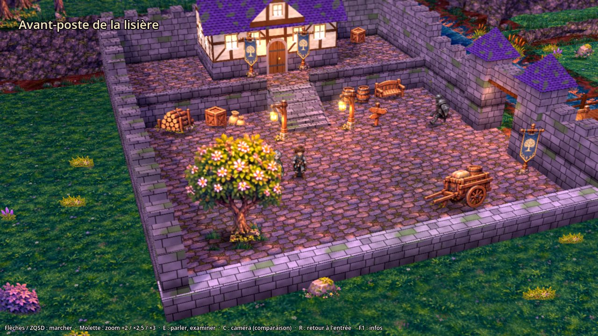
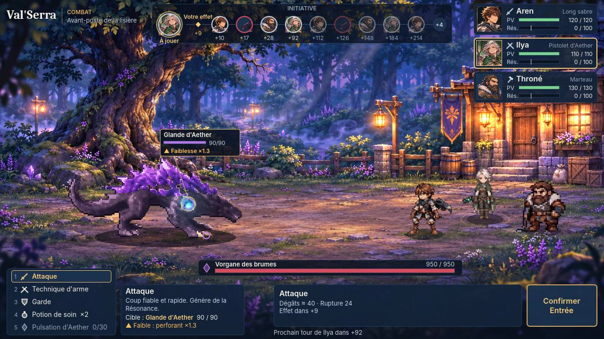
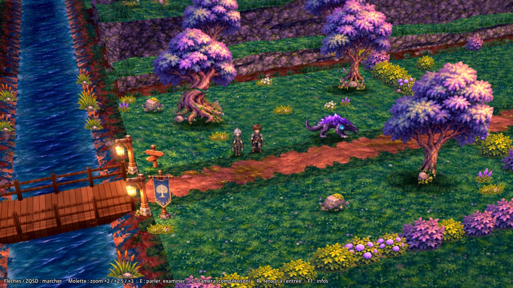

# Val'Serra : Les Larmes d'Aether — démo jouable

Démo jouable du RPG narratif au tour par tour **Val'Serra**, réalisée sous **Godot 4.7.2**.

> Tous les personnages, monstres, illustrations et nombres de ce dépôt sont **provisoires et non canoniques**.
> Ce dépôt est indépendant du système Foundry du JDR (`Warwiren/Val-serra`), qui n'est pas modifié.



## Ce qui est jouable

Une boucle complète dans l'**avant-poste de la lisière**, au crépuscule, en **HD-2D / 2.5D** :

1. **Exploration** en vue trois-quarts (caméra **P30** : perspective, plongée 30°, azimut 20°, rotation fixe, zooms
   ×2 / ×2,5 / ×3 à la molette) : **Aren** (cheveux bruns, armure et cape grises) et sa compagne **Ilya** (cheveux
   courts argentés, cape verte, pistolet d'Aether) dans la **cour** fortifiée, l'**escalier** et la **terrasse**, le
   **bâtiment principal** dans lequel on entre, la **porte fortifiée**, le **pont** sur une rivière animée, la
   **plaine** et ses falaises.
2. **Dialogue** à portraits et à choix avec le **garde** en armure (bouclier et masse), qui fait sa ronde dans la cour ;
   panneaux à examiner. Les personnages respirent à l'arrêt et marchent dans les quatre directions.
3. **Combat au tour par tour** contre le **Vorgane** (475 PV dans cette rencontre de démonstration) : Aren à la lame,
   Ilya au **pistolet d'Aether** (tir, tir chargé), Throné au marteau ; initiative dynamique, modes
   VIF / MESURÉ / CHARGÉ, parties destructibles, Résonance.
4. **Retour** : après une victoire, le Vorgane a disparu et le garde change de répliques ; après une défaite, le
   groupe revient dans la cour.

| Combat | Plaine |
|---|---|
|  |  |

Vidéos : [marche et arrêt à ×3, taille constante](docs/media/p4_6/videos/marche_arret_taille_constante_x3.mp4),
[actions de combat, Ilya de face](docs/media/p4_6/videos/combat_ilya_de_face.mp4).
Rapport de l'étape : [`docs/P4_6_CORRECTIONS.md`](docs/P4_6_CORRECTIONS.md) (étapes précédentes : `docs/HISTORIQUE.md`).

## Lancer le jeu (Godot 4.7.2 obligatoire)

> **Version du moteur : Godot 4.7.2, et elle seule.** La ligne `config/features=PackedStringArray("4.5")` de
> `project.godot` est un reliquat historique, laissé tel quel volontairement.

1. Télécharger le projet (GitHub : choisir la branche **`p4-6-corrections`**, puis **Code → Download ZIP** ; le
   dossier s'appelle `Val-Serra-Game-p4-6-corrections`) et le décompresser.
2. Récupérer **Godot 4.7.2** (édition standard, pas « .NET ») : <https://godotengine.org/download/archive/4.7.2-stable/>.
3. Godot → **Importer** → choisir `project.godot` → **Importer et modifier** (une minute environ la première fois).
4. **F5** lance la **démo de l'avant-poste** (`scenes/p4/avant_poste.tscn`, caméra P30) avec les corrections P4.6 :
   taille des personnages constante à l'arrêt et en marche, Ilya de face en combat.

### Commandes

| Touche | Action |
|---|---|
| Flèches / ZQSD | se déplacer (8 directions) |
| **Molette** (ou PgPréc / PgSuiv) | zoom ×2 / ×2,5 (défaut) / ×3 |
| **E** / Entrée / Espace | parler au garde, examiner ; faire avancer le dialogue |
| ↑ / ↓ puis Entrée (dialogue) | choisir une réponse ; **Échap** : fermer |
| Marcher sur le seuil de la porte | entrer dans le bâtiment ; le seuil sud de la salle en fait ressortir |
| Toucher le Vorgane | lancer le combat |
| En combat : clic, ↑/↓ ou 1 à 5 | choisir une action ; ←/→ ou clic sur une partie : changer de cible |
| En combat : Tab | changer de mode (VIF / MESURÉ / CHARGÉ) ; **Entrée** : confirmer |
| **C** | caméra de comparaison : P30 (défaut) / B28 (orthographique 28°) / P38 |
| **T** | personnages : rendu net / ancien rendu bilinéaire (comparaison) |
| **R** | revenir à l'entrée de la zone ; **F1** : informations ; **F2** : couches et collisions |

### Autres scènes (ouvrir dans l'éditeur, puis **F6**)

| Scène | Contenu |
|---|---|
| `scenes/p4/comparaison_camera_B28.tscn` | la même démo avec l'ancienne caméra orthographique 28° (B28), pour comparer |
| `scenes/battle/battle_scene.tscn` | combat seul (avec `--start=proto-battle --arena=lisiere` en ligne de commande) |
| `tests/test_runner.tscn` | tests automatiques dans l'éditeur |

## Vérifications

```bash
godot --headless --path . --script res://tests/run_tests.gd
```

```bash
godot --headless --path . --script res://tests/e2e_p4_retour.gd
```

```bash
godot --headless --path . res://scenes/p4/avant_poste.tscn -- --route=p4 --quit --out=user://p4
```

```bash
godot --headless --path . res://scenes/p4/avant_poste.tscn -- --route=p4_sondes --quit --out=user://p4
```

```bash
godot --path . -- --autoplay --route=p4_demo --route_retour=p4_retour
```

Dans l'ordre : tests automatiques (65), rencontre de bout en bout (déclenchement, PV de démo, victoire, défaite,
bâtiment), parcours complet au clavier simulé (29 étapes ; `--camera=B28` ou `P38` pour comparer), sondes de
collision (20), démonstration automatique (dialogue et combat joués seuls).

## Où trouver quoi

| Sujet | Fichiers |
|---|---|
| Démo (F5) : scène et habillage | `scenes/p4/avant_poste.gd` ; données `data/p4/` ; shaders `src/p4/` |
| Socle d'exploration 2.5D | `src/explore25/` (monde, session, caméra, acteurs, parcours), `scenes/explore25/explore_3d.gd` |
| Personnages (exploration, combat, portraits) | `art/p45/` (`SOURCES.md`), outil `tools/p45/build_p45.py` ; Vorgane d'exploration `art/p41/chars/vorgane/` |
| Décor de la zone | `art/p4/` (`SOURCES.md`), décor nettoyé `art/p41/decor/` ; outils `tools/p4/`, `tools/p41/` |
| Combat | `scenes/battle/`, règles `src/combat/`, données `data/combat/`, présentation `src/presentation/`, `src/proto/` |
| Arène de combat | `art/arena/lisiere/`, `src/presentation/arena_layers.gd`, outils `tools/arena/` |
| Dialogues | `data/p4/dialogue_garde.json`, `data/dialogue/` ; portraits : `src/proto/portraits.gd` |
| Tests | `tests/` |

## Documentation

| Document | Contenu |
|---|---|
| `docs/P4_6_CORRECTIONS.md` | **P4.6** : taille constante entre l'arrêt et la marche, Ilya de face en combat, tests, éléments provisoires |
| `docs/HISTORIQUE.md` | où retrouver les rapports et médias des étapes précédentes (branches Git) |
| `docs/ASSETS.md` | registre des ressources et de leurs conditions d'usage |
