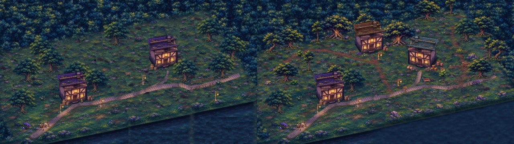
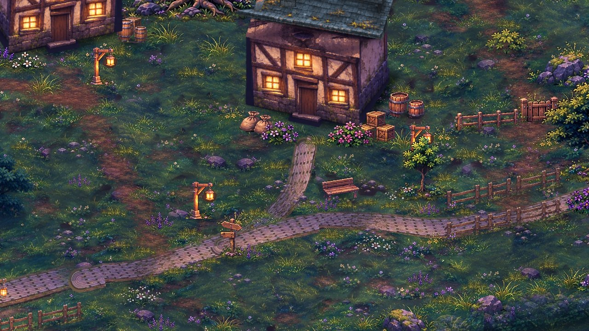
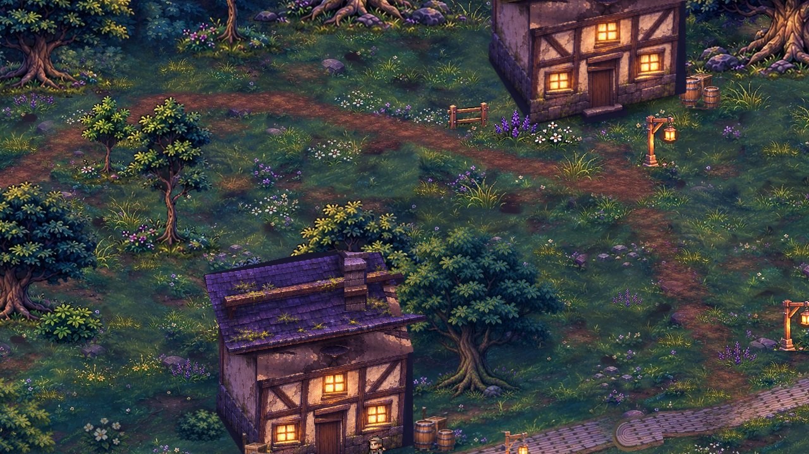
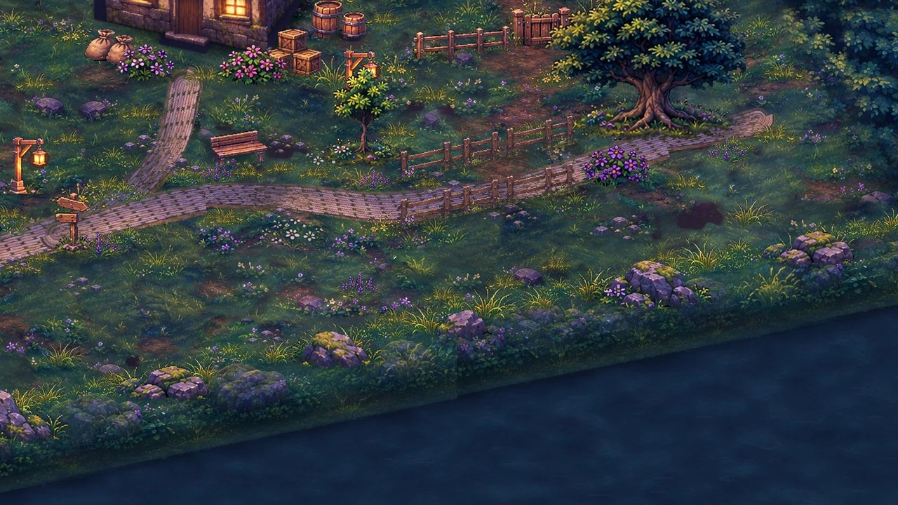

# Carte d'exploration v2 — version par défaut (F5)

Branche **`exploration-v2`** (partie de `p1-camera-hd2d`). Scène : `scenes/explore_hd2d/zone_exploration.tscn`,
**scène principale du projet** : F5 la lance directement, sans argument. Ligne de commande : `--start=exploration`.

*À gauche : zone de test P1 (copies d'éléments). À droite : carte v2.*

## Changements visuels

- **Pack d'assets du 2026-11-07** : la planche fournie est découpée en 40 sprites détourés
  (`tools/explore/pack_extract_v2.py`, `art/source/pack_2026-11-07/`). Le jeu n'importe que les **28 sprites réellement
  utilisés** (`art/explore_hd2d/pack/`) ; les 12 autres (accents peints dans le sol, variantes non retenues) restent dans `art/source` (ignoré par Godot).
- **Arbres** : 5 essences du pack (dont un grand arbre qui sert de repère) en plus des 3 arbres validés de
  l'avant-poste. Une partie est retournée pour éviter les doublons. La **lisière** est bordée de 9 arbres posés
  sur ses bords arrière et droit.
- **Végétation** : 10 sortes de buissons et massifs fleuris, et 240 accents de sol semés au hasard (herbes, touffes
  fleuries, terre nue, cailloux), en évitant les chemins et les emprises.
- **Rochers** : 5 sortes (pierres, rochers moussus, formations), sur la terre ferme et le long de la rive.
- **Bâtiments** : il n'y a plus de maison copiée. La maison du hameau est retournée avec un **toit d'ardoise**,
  celle du haut a un **toit de tuiles**, et l'avant-poste garde son toit violet. Seul le toit est recoloré ; les
  murs et les fenêtres éclairées sont inchangés.
- **Accessoires** : réverbères (avec lumière), panneau indicateur au carrefour, sacs, caisses, tonneaux, banc,
  clôture et portillon.
- **Chemins** : les chemins pavés suivent des **courbes continues** (plus d'angles aux raccords) et leurs bords
  sont semés de touffes et de cailloux. Trois **sentiers de terre** mènent à la maison du haut, à la lisière et au
  fond de la prairie.
- **Sol** : les taches d'ombre recopiées dans l'herbe sont retouchées, et une variation lente de teinte rompt
  l'uniformité de l'herbe recomposée.
- **Eau et talus** : plus de raccords verticaux. Deux recopies du muret sont fondues en évitant leurs raccords,
  l'eau profonde est recomposée sans damier, et une ombre du talus marque nettement la limite. La rive est
  dressée de rochers et d'herbes hautes.
- **Ombres de contact** sous chaque nouvel élément : aucun objet ne flotte.
- L'avant-poste d'origine (décor validé, garde, Vorgane) est conservé à l'identique en bas à gauche.

## Intégration Godot

- Même script que l'avant-poste (`zone_hd2d.gd`). Un calque peut maintenant être un chemin `res://` (pack ou
  variante générée) : c'est la seule modification du code de zone.
- Chaque élément a une emprise au sol : collision pour 40 éléments solides (troncs, rochers, maisons,
  accessoires), traversables pour les buissons et les fleurs. Il a aussi une **ligne de tri au pied du tronc**
  (pas au bas de la touffe d'herbe) et la transparence locale quand un personnage passe derrière.
- Tout se régénère avec `python3 tools/explore/build_exploration_v2.py` (graine fixe).
- Remplacées et retirées de la branche : zone de test P1 (`zone_p1.tscn`, `art/explore_hd2d/p1/`,
  `p1_zone_test.py`). L'ancien `--start=p1-zone` ouvre la carte v2.

## Vérifications

| Vérification | Résultat |
|---|---|
| F5 (scène principale) charge la carte v2 sans erreur ; démo lancée sans argument de scène : dialogue, combat, victoire, retour | **réussi** |
| Tests automatiques | **69/69** (dont un nouveau : aucune poche inaccessible, aucun élément dans l'eau ou hors carte, aucun sprite inutilisé) |
| Parcours au clavier (8 directions, derrière la maison d'ardoise, couloir étroit, bosquet, limites, dialogue, Vorgane), caméras A/B/C, 30/60/144 i/s | **réussi** : 0 position interdite, toutes les étapes atteintes |
| Retour de combat (victoire et défaite) par caméra | **réussi** |
| Avant-poste d'origine : retour de combat, locomotion, garde 11/11, dialogue au clavier | **réussi** |
| Performances (rendu logiciel, 1280×720, caméra A) | 72 i/s (P1 : 75), 36 objets dessinés, textures 33 Mo (P1 : 28 Mo), chargement 170 ms |

Un défaut de jeu a été trouvé et corrigé par le parcours à 144 i/s : un coin de 4 px entre les tonneaux et la
clôture du hameau, où le héros restait coincé. La clôture a été décalée, ce qui laisse un passage de 23 px.

## Limites connues

- Les clôtures et accessoires du pack sont dessinés de face. Ils sont un peu moins inclinés que le sol (rotation
  de 20°), ce qui se voit sur la longue clôture du hameau.
- L'eau est statique, sans reflets animés.
- La forêt de fond reste recomposée par morceaux. Les arbres de la lisière en masquent l'essentiel, mais des motifs
  se répètent encore dans les angles hauts.
- Il reste quelques taches sombres isolées dans l'herbe.

