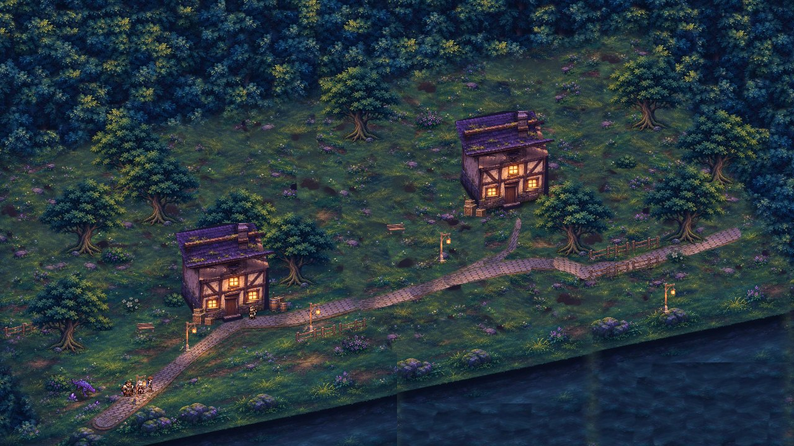
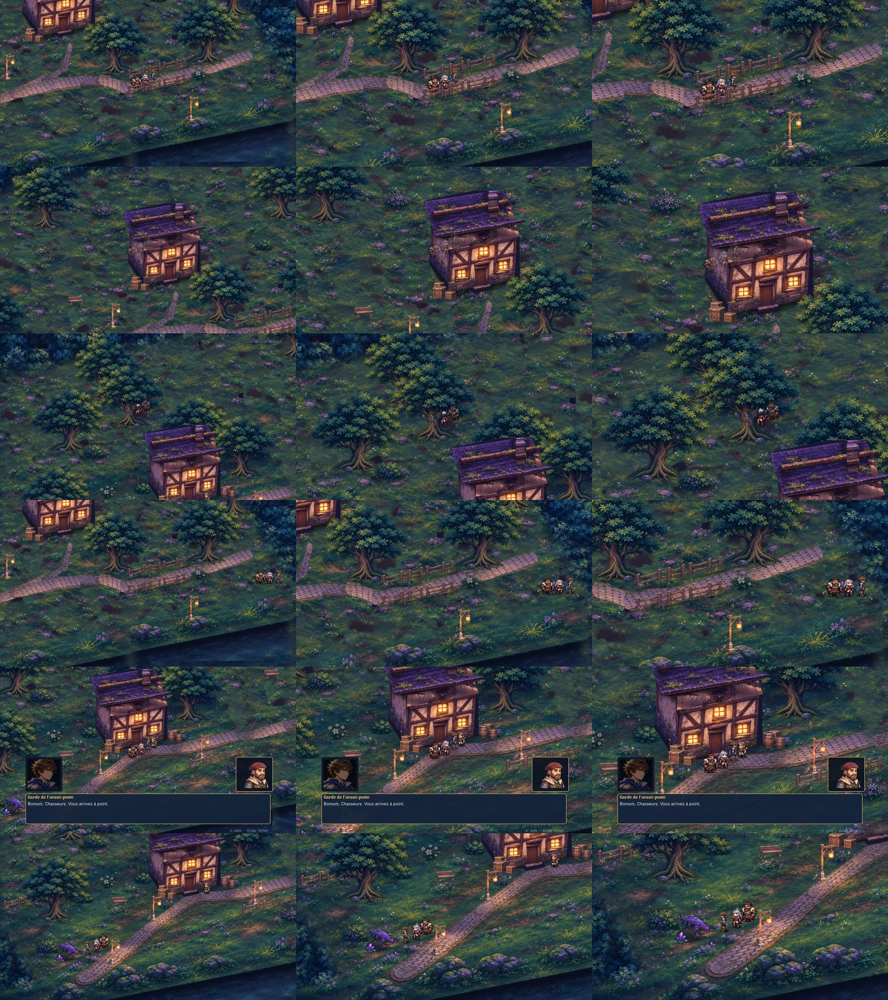

# P1 — Prototype de caméra HD-2D (comparaison A / B / C)

Branche **`p1-camera-hd2d`**, partie de `main` (dernier état du décor validé). Aucune caméra n'est validée :
**A reste la caméra par défaut** en attendant la décision.

## Lancer

```bash
godot --path . -- --start=p1-zone
```

Dans l'éditeur : ouvrir `scenes/explore_hd2d/zone_p1.tscn`, puis **F6**.

En jeu : touches **1 / 2 / 3** pour choisir la caméra A / B / C, ou **C** pour passer à la suivante. Le changement
se fait sans rechargement. La caméra choisie est conservée après un combat. `--cam=B` choisit la caméra au
lancement ; `--cam-hud` affiche son nom en permanence. Les mêmes touches fonctionnent dans l'avant-poste (F5).

## Zone de test agrandie (prototype, pas une nouvelle région)



- La carte fait **1408 × 800 px natifs**, soit **4 fois** la surface de l'avant-poste. La zone praticable est
  4,4 fois plus grande. L'échelle du monde (20 px/m), la projection (plongée 35°, rotation 20°) et la densité du
  sol (2 px d'écran par px natif) ne changent pas.
- **Sol** (`tools/explore/p1_zone_test.py`, graine fixe) : le sol peint de l'avant-poste est recopié tel quel en
  bas à gauche. Autour, l'herbe, la lisière et l'eau sont recomposées avec des morceaux du même sol, sans
  étirement ; le muret est prolongé le long de sa propre pente. Les nouveaux chemins sont faits avec un tronçon
  droit du chemin peint, et les nouveaux éléments reçoivent une ombre de contact.
- **Éléments** : ce sont des copies déplacées des éléments validés (mêmes calques illustrés, emprises,
  collisions, lignes de tri et transparence locale) : 41 éléments au lieu de 17. On y trouve un hameau avec une
  2e maison, des caisses, des tonneaux et des lanternes. Il y a aussi un bosquet de 4 arbres serrés, un
  **couloir étroit** entre deux clôtures (environ 1,5 m), une prairie ouverte, et des limites sur l'eau, la
  lisière droite et l'angle haut.
- Données : `art/explore_hd2d/p1/` (`zone_p1.json`, `decor_p1.json`, `sol_p1.webp`, 1,3 Mo). La scène
  `scenes/explore_hd2d/zone_p1.tscn` utilise **le même script** que l'avant-poste ; seuls deux chemins de
  fichiers changent.

## Les trois configurations (`src/explore/camera_hd2d.gd`)

| | A — actuelle | B — intermédiaire | C — rapprochée |
|---|---|---|---|
| Échelle | ×2 | ×2,5 | ×3 |
| Cadrage | pieds du héros | 8 px au-dessus des pieds | buste (14 px au-dessus) |
| Suivi | lissage natif de Camera2D (vitesse 4), cible arrondie au pixel | lissage exponentiel (vitesse 5), sans dépassement | lissage exponentiel (vitesse 6) et anticipation de 22 px dans le sens de la marche, conservée à l'arrêt |
| Zone morte | aucune | 18 × 10 px natifs | 8 × 5 px natifs |
| Limites | limites franches | limites lissées, cadre borné à la carte | limites lissées, cadre borné à la carte |

Le contrôleur est réutilisable sur toute carte : `set_bounds()`, `apply()`, `snap_to()` (apparition et retour de
combat), puis `follow()` à chaque image.

## Comparaison (même parcours au clavier simulé, 1280 × 720)

Captures : `media/p1_camera/captures/` (7 lieux × 3 caméras), planche `media/p1_camera/comparatif_ABC.jpg`
(colonnes A, B, C).
Vidéos (même parcours au clavier simulé, 66 s par caméra) : `media/p1_camera/p1_cameras_ABC.mp4` (A, puis B,
puis C) et `media/p1_camera/p1_cameras_cote_a_cote.mp4` (les trois synchronisées image par image).



| Critère | A | B | C |
|---|---|---|---|
| Monde visible (px natifs) | 640 × 360 | 512 × 288 | 427 × 240 |
| Hauteur d'Aren à l'écran | 58 px | 73 px | 87 px |
| **Lisibilité** des personnages à 1280 × 720 | correcte, petits | bonne | très bonne (visages, armes, Vorgane) |
| Pixels des sprites | réguliers (×2) | **irréguliers** (×2,5 : alternance de 2 et 3 px) | réguliers (×3) |
| Sol peint | net (1:1) | légèrement adouci (agrandi ×1,25) | adouci (agrandi ×1,5) |
| Écart moyen héros–centre de l'écran | 118 px | 112 px | 48 px |
| À-coups de caméra à 30 / 60 / 144 i/s ¹ | 0 / 2 / 10 | 0 / 0 / 0 | 0 / 0 / 0 |
| Accélération maximale (60 i/s) | 8 198 px/s² | 1 100 px/s² | 2 677 px/s² |
| Inversions de sens de la caméra (60 i/s) | 2 | 1 | 2 |
| Temps de pose après un arrêt, moyen / maximal ² | 0,28 / 0,90 s | 0,20 / 0,78 s | 0,21 / 0,68 s |
| **Confort** | stable, mais la caméra bouge en permanence | très calme : la caméra ne bouge pas pour les petits pas | immersif ; l'anticipation montre ce qui arrive, mais déplace un peu le cadre dans les virages |
| Exploration d'une grande carte | meilleure vue d'ensemble | bon compromis | on voit moins loin (2,25 fois moins de surface que A) |
| Obstacles et chemins visibles | oui | oui | oui ; le couloir et les arbres restent lisibles, et l'anticipation compense le champ réduit |
| Images/s (rendu logiciel, même marche) ³ | 74,9 | 78,6 | 77,3 |
| Objets dessinés par image | 36 | 31 | 26 |
| Mémoire textures / vidéo | 28,1 / 34,2 Mo | identique | identique |

¹ Un à-coup est une variation de vitesse de plus de 100 px/s d'une image à l'autre. Pour A, ils se produisent en
marche ordinaire, pas aux limites. La cible est arrondie au pixel avant le lissage, donc à haute fréquence
d'images la caméra reçoit des sauts de 1 px et repart par saccades.
² Temps entre l'arrêt du groupe et le moment où la caméra bouge à moins de 3 px/s, mesuré à 60 i/s.
³ Rendu logiciel (llvmpipe, sans carte graphique) : seules les différences entre colonnes comptent. La zone P1
coûte 13 Mo de textures de plus que l'avant-poste (15,0 Mo), à cause du sol agrandi. Le temps de chargement
est de 191 à 215 ms, contre 309 ms pour l'avant-poste.

## Vérifications

| Vérification | Résultat |
|---|---|
| Tests automatiques (`tests/run_tests.gd`) | **68/68** (61 existants + 7 P1 : caméra par défaut A identique à l'origine, changement sans rechargement, zone morte, lissage sans dépassement et indépendant de la fréquence d'images, vue dans la carte, zone 3 à 4 fois plus grande avec assets validés, points clés accessibles et couloir étroit) |
| Parcours clavier P1 (A, B, C ; 30, 60 et 144 i/s) : 8 directions, derrière la 2e maison, couloir, bosquet, limites droite, basse et haute, dialogue, approche du Vorgane | **réussi** : toutes les étapes atteintes, **0 position interdite**, écart du groupe de 19 px en moyenne, dialogue ouvert pour les trois caméras |
| Démo complète `--start=p1-zone --autoplay --cam=A/B/C` : marche, dialogue, contact du Vorgane, **vrai combat**, victoire, retour dans la zone P1 | **réussi** pour A, B et C |
| Retour de combat (`tests/e2e_p1_retour.gd`), victoire et défaite, pour chaque caméra | **réussi** : caméra conservée, vue recentrée sur le groupe dès le retour, groupe sur des positions libres, pas de nouveau combat |
| Non-régression avant-poste, caméra A par défaut : retour de combat (`e2e_zone_retour.gd`), parcours de locomotion (`--course=manuel`), approches du garde (`--course=pnj`), dialogue au clavier (`--check-talk`) | **réussi** : 11/11 approches du garde |
| Performances (`tests/p1_perf_probe.gd`) | voir tableau ; aucune différence notable entre A, B et C |

Reproduction : `tools/explore/record_p1_cameras.sh` produit les vidéos et les mesures.

## Problèmes identifiés

1. **A, micro-saccades** : cible arrondie au pixel avant le lissage, donc des à-coups à 60 et surtout 144 i/s.
   C'est le comportement actuel ; il n'est pas corrigé dans A, qui reste la référence.
2. **B, pixels irréguliers** : l'échelle ×2,5 n'est pas entière. Les sprites en pixel art alternent des pixels de
   2 et 3 px d'écran, ce qui se voit à l'arrêt et papillote légèrement en mouvement.
3. **Limites de carte** : la zone praticable s'arrête à environ 17 px natifs du bord de la carte. C'est déjà le cas
   dans l'avant-poste. Aux bords, la caméra est bloquée et le héros arrive à 70–100 px du bord de l'écran, quelle
   que soit la caméra. Règle à prévoir pour les futures cartes : garder au moins une demi-vue de décor
   non praticable au-delà des bords (160 px natifs pour A, 107 pour C).
4. **C, champ réduit** : on voit 2,25 fois moins de surface qu'avec A. Sur une grande carte, il faut plus de
   repères (chemins, lumières), et la vue est plus courte vers le haut de l'écran : la lisière apparaît tard.
5. **Sol de la zone de test** (prototype seulement) : raccords visibles dans l'eau profonde et dans la bande du
   muret, quelques taches d'ombre recopiées dans l'herbe, raccords de chemins anguleux. Ce n'est pas un asset
   définitif.
6. Mesure : sans écran (`--headless`), la fenêtre virtuelle de Godot est carrée (1280 × 1280). Le parcours fixe
   donc 1280 × 720 lui-même ; les mesures « écran » sont identiques avec et sans rendu.

## Recommandation (à valider, rien n'est figé)

Retenir **C comme base**, avec deux réglages à décider après ton retour :

- C offre la meilleure lisibilité (Aren mesure 87 px de haut, soit +50 % par rapport à A) et le cadrage le plus
  proche de l'esprit HD-2D recherché (personnages et matières mis en valeur). Ses pixels restent réguliers
  (×3 entier), il n'a aucun à-coup mesuré à 30, 60 et 144 i/s, et le héros reste près du centre (48 px en
  moyenne).
- Ses limites sont le champ visuel réduit et un léger déplacement du cadre dans les virages. Selon ton ressenti
  en jeu, on pourra : (a) réduire l'anticipation (22 à 12 px) si le cadre bouge trop ; (b) prévoir un dézoom
  ponctuel vers ×2,5 dans les grands espaces, mais l'échelle non entière abîme les pixels, comme pour B.
- **B** ne me semble pas un bon compromis tel quel, à cause de l'échelle ×2,5. Une variante de B en ×2 avec zone
  morte et lissage critique corrigerait les micro-saccades de A sans perdre de champ, mais elle ne rapproche pas
  les personnages.

En attendant ton choix, **A reste la caméra par défaut** (`GameState.camera_preset = "A"`).
