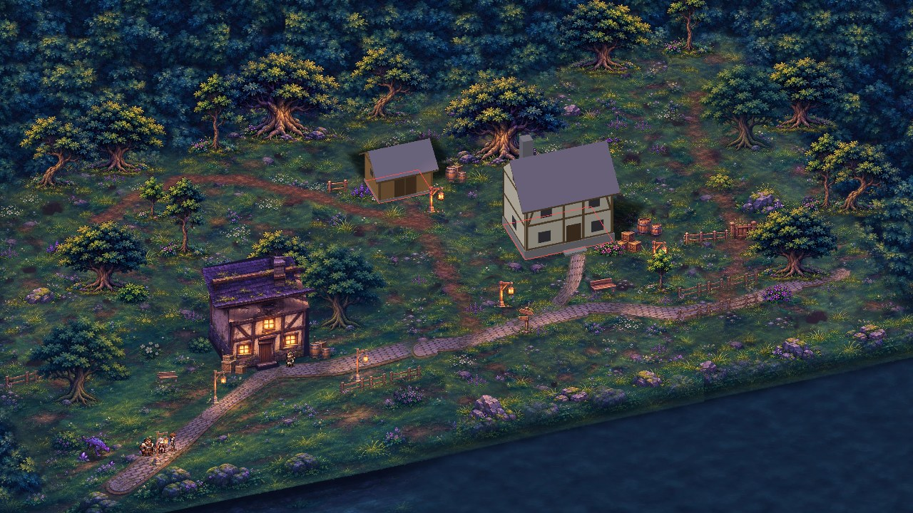

# P2 — Lot A : gabarits techniques des bâtiments (pilotes)

> **Mise à jour** : les gabarits de l'habitation et de la remise ont depuis été **adaptés aux illustrations validées**
> (dimensions ci-dessous remplacées) et les bâtiments sont intégrés au jeu : voir `P2_LOT_A_INTEGRATION.md`.

Branche **`p2-environnements`**. **Aucun bâtiment du jeu n'est modifié** : F5 lance toujours la carte V2 avec ses maisons
actuelles, et l'avant-poste validé reste la référence.

Générateur : `python3 tools/explore/gabarits_batiments.py`. Il est écrit en Python seul (sans Blender) et utilise la
projection exacte du jeu (`docs/media/gabarits_exploration/gabarits.json` : 20 px natifs/m au sol, 1 m de hauteur =
16,38 px natifs, plongée 35°, rotation 20°).

## Fichiers (`docs/media/gabarits_batiments/`)

| Fichier | Usage |
|---|---|
| `<bâtiment>/gabarit.png` | volumes ombrés neutres, fond transparent. **Support de l'illustration**, au même cadre et à la même taille que la texture du jeu |
| `<bâtiment>/zones.png` | carte des matières (légende dans `gabarits.json`) |
| `<bâtiment>/trait.png` | arêtes et contours des ouvertures |
| `<bâtiment>/reperes.png` | emprise (collision, en rouge), ligne de tri et pied (bleu), point de porte (jaune), Aren à l'échelle du jeu |
| `gabarits.json` | dimensions, taille de texture, pivot, emprise et point de porte (px natifs relatifs au pied), quadrilatères des ouvertures (px de texture). Ces données vont directement dans `decor.json` / `zone.json` |
| `composition/` | composition de référence dans la carte V2, avec vérifications (`composition_v2.json`) |

## Pilotes

| | Habitation de village | Remise / annexe | Avant-poste (référence) |
|---|---|---|---|
| Volume | 7,2 × 5,0 m, soubassement 0,8 m, murs 5,4 m, faîtage 7,8 m | 4,4 × 3,2 m, seuil 0,25 m, murs 2,7 m, faîtage 4,0 m | 6,4 × 4,6 m, murs 4,6 m |
| Logique | un étage habitable : plus haute que l'avant-poste | bâtiment bas, sans étage | — |
| Ouvertures | porte 1,2 × 2,2 m sur marche ; 2 fenêtres au rez-de-chaussée (1,0 m) et 2 à l'étage (0,9 m) en façade ; 1 au pignon, 1 sur le côté | double porte 1,8 × 2,1 m ; lucarne latérale | — |
| Texture | 434 × 439 px, pivot (217 ; 412,2) | 296 × 252 px, pivot (148 ; 225,8) | 403 × 381 px |
| Collision | emprise des murs (débords de toit et marche non bloquants) | idem | — |

Les toits ont deux pans avec débords. Les pignons sont sur les côtés, et le côté gauche est visible avec la caméra du
jeu, comme sur le concept. La cheminée de l'habitation est côté gauche, derrière le faîtage. Les accessoires du concept
(lanterne, bûcher, tonneaux, bancs, jardinières, bannière) sont **séparés** et n'apparaissent pas dans les gabarits.

## Composition de référence (carte V2, aperçu seulement)

| | Habitation | Remise |
|---|---|---|
| Emplacement proposé | à la place de la maison d'ardoise (hameau), pied (861 ; 405) | à la place de la maison de tuiles, pied (615 ; 318) |
| Emprise dans la zone praticable | oui | oui |
| Porte libre et accessible depuis le départ | oui : (891 ; 400), au bout du chemin pavé | oui : (629 ; 316), au bout du sentier |
| Chevauchements **à traiter à l'intégration** (aucun n'est déplacé ici) | `sacs_1` (solide), `massif_1` (traversable) | `fleurs_3` (traversable) |

## Pour les illustrations définitives
- Peindre **sur `gabarit.png`, au même cadre** : la silhouette, la base au sol et les ouvertures doivent coïncider
  (`trait.png` sert de calque de contrôle). Pas de sol, pas d'accessoires, pas de personnage. Fond transparent.
- Respecter l'éclairage du jeu : lune en haut à gauche, fenêtres chaudes.
- Livrer en PNG à la taille de `gabarit.png`. L'intégration ne demande alors aucune retouche géométrique.
- Les trois autres bâtiments (maison de garde, habitation orientée à l'opposé, maison à deux niveaux) se font avec le
  même générateur, une fois les pilotes validés.
