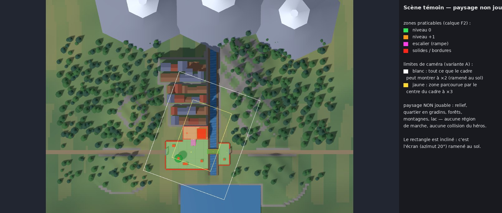
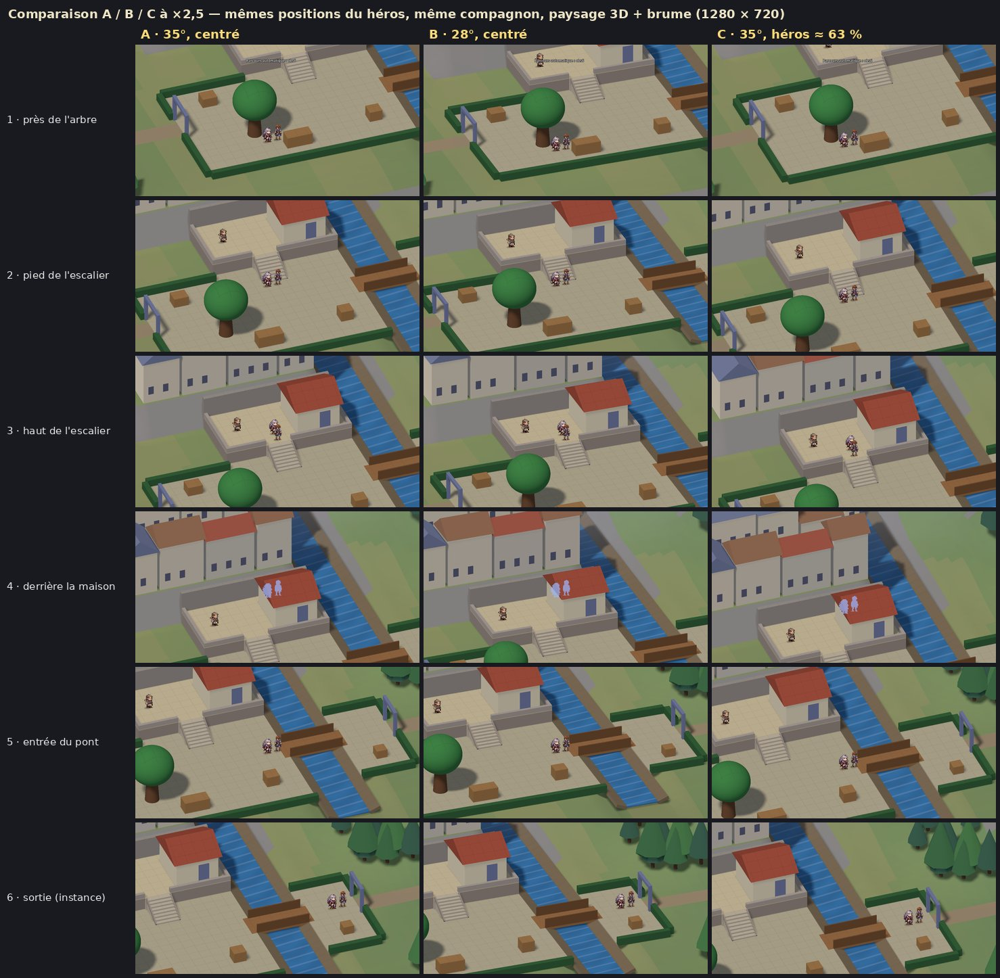

# P3-07 — Test comparatif caméra, profondeur perçue et paysage (Godot 4.7.2)

Branche **`p3-camera-profondeur`**, partie de `p3-prototype-25d` (le prototype P3 reste intact pour la comparaison).
Référence : document 07 du dossier de préproduction. **F5 n'est pas modifié** (consigne du doc 07 §05 ; `CLAUDE.md`
demande l'inverse à chaque branche : la consigne explicite du créateur a été suivie). Aucun asset définitif : le
paysage est un blockout de volumes et de silhouettes.

Tout a été exécuté avec **Godot 4.7.2** (`4.7.2.stable.official.ed1daf0bf`) sur une machine **sans carte
graphique** (rendu logiciel llvmpipe) : les images/s ci-dessous ne valent pas mesure de performance (voir § Performances).

## Lancer (F6, sans argument)

| Scène | Contenu |
|---|---|
| `scenes/explore25/camera_variante_A.tscn` | **A** — référence : plongée 35°, azimut 20°, héros centré (cadrage P3) |
| `scenes/explore25/camera_variante_B.tscn` | **B** — plongée **28°** (valeur de test), azimut 20°, héros centré |
| `scenes/explore25/camera_variante_C.tscn` | **C** — plongée 35°, héros vers **63 %** de la hauteur de l'écran |
| `scenes/explore25/scene_temoin.tscn` | prototype P3 inchangé (sans paysage) |

En jeu : **V** passe à la variante suivante, **L** change le traitement du paysage (3D + brume → plans 2D → aucun),
sur place, au même zoom. Les autres commandes sont celles de P3 (molette ×2 / ×2,5 / ×3, F1, F2…).

Les trois variantes sont des **presets réversibles** (`src/explore25/variantes25.gd`) d'une même scène : règles de
déplacement, collisions, hauteurs, compagnon, dialogues et instances sont strictement partagés.

## Ce qui change réellement dans la caméra

| | A | B | C |
|---|---|---|---|
| Plongée | 35° | **28°** : Camera3D réellement réorientée ; projection, limites et décor recalculés | 35° |
| Azimut | 20° | 20° | 20° |
| Cadrage vertical | visée P3 (8 px au-dessus des pieds) | idem | visée P3 + **décentrage de 10 % de la hauteur d'écran** : héros à 62,8 % (mesuré) |
| Suivi, zone morte, lissage | P3 | P3 | P3 ; le décentrage est **ramené à 0 pendant un dialogue** (transition 0,3 s) |
| Taille des personnages à l'écran | 29 px natifs (Aren) | **29 px** : la carte est mise à l'échelle 1/cos(28°) au lieu de 1/cos(35°) — correction explicite, aucun sprite rééchantillonné | 29 px |

Conséquences géométriques de B à ×2,5 (calculées par la projection, identiques en jeu) :

| Grandeur à l'écran (×2,5) | A et C (35°) | B (28°) |
|---|---|---|
| 1 m de sol en profondeur | 28,7 px | 23,5 px (sol plus « écrasé ») |
| 1 m de hauteur | 41,0 px | 44,1 px |
| giron d'une marche (0,32 m) | **9,2 px** | **7,5 px** |
| contremarche (0,15 m) | 6,1 px | 6,6 px |
| façade de la terrasse (1,2 m) | 49 px | 53 px |
| hauteur « monde » de la carte d'Aren | 1,77 m | 1,64 m (taille écran conservée : le rapport personnage / décor change d'environ 8 %) |

## Paysage non jouable (doc 07 §04)

Données : `data/explore25/paysage_p3_07.json` (une entrée par instance). Construction : `src/explore25/paysage25.gd`.



- **Scène témoin** : quartier en **trois gradins** derrière le mur de soutènement (3,2 m, 6,6 m, 10 m ; 31 bâtiments,
  une tour), collines, **forêts** (539 arbres simplifiés), trois **montagnes** au nord, rivière prolongée dans une gorge
  au nord et jusqu'à un **lac en contrebas** au sud, routes vers l'ouest et l'est au-delà des portes.
- **Instance fictive** : placette entourée de façades sur deux gradins, maisons sur les côtés, collines et forêts.
- La grande plaque verte uniforme a disparu : relief en grille d'1 m, couleurs par pente, altitude et parcelles.
- **Rien n'est praticable** : aucune région de marche ajoutée, aucun calque de collision du héros ; le relief est
  forcé sous les sols jouables (vérifié par test). La collision de bord de P3 est conservée sous le relief : les
  limites restent les haies, murets et berges visibles.
- **Limites de caméra** : le cadre peut désormais monter jusqu'au premier gradin du quartier (6 m au nord de la zone)
  pour que le paysage soit montrable ; le décor couvre toutes les vues permises, aux trois zooms, centrées ou
  décentrées (vérifié par test et par mesure : 0 image hors décor).

Deux traitements à coût faible ([planche](media/p3_07/traitements_paysage_A.jpg)) :

| | 3D simplifiée + brume | Plans 2D illustratifs |
|---|---|---|
| Principe | volumes simples + brume de profondeur commençant juste derrière le point jouable le plus éloigné | relief proche en 3D, quartiers / forêts / montagnes remplacés par des plans verticaux à silhouettes générées, éclaircis avec la distance, posés dans le monde (pas collés à la caméra) |
| Paysage dans le tiers supérieur (A, ×2,5, moyenne des 6 points) | 48,1 % | 49,5 % |
| Lecture | volumes, ombres et étagement cohérents avec la scène ; le relief se lit | découpes plates qui flottent au-dessus des gradins ; ne couvrent que là où on les a posés |
| Recommandation | **à retenir pour la suite des tests** | à réserver aux fonds très lointains (montagnes) |

## Comparaison A / B / C à ×2,5 (six points identiques, 1280 × 720)



Points (doc 07 §05) : près de l'arbre, pied de l'escalier, haut de l'escalier, derrière la maison, entrée du pont,
sortie vers l'instance. Même position du héros, même trace du compagnon, même zoom, paysage 3D + brume.

| Mesure (×2,5) | A | B | C |
|---|---|---|---|
| Héros à l'écran (hauteur, depuis le haut) | 52,8 % (59,7 % près de l'arbre, cadre en butée) | 52,8 % (65,5 % près de l'arbre) | **62,8 %** partout |
| Sol visible **devant** le héros (vers le haut de l'écran) | 13,3 m | **16,2 m** | 15,8 m |
| Sol visible **derrière** le héros (vers le bas) | 11,9 m | **14,5 m** | **9,3 m** |
| Largeur visible | 25,6 m | 25,6 m | 25,6 m |
| **Paysage non jouable dans le tiers supérieur** (moyenne des 6 points) | 48,1 % | 54,0 % | **57,9 %** |
| — au pied de l'escalier | 31,3 % | 37,3 % | 43,5 % |
| — au haut de l'escalier | 58,3 % | 64,8 % | 73,5 % |
| — à l'entrée du pont | 29,8 % | 38,3 % | 45,5 % |
| Marches visibles (sur 8) | 8 aux 6 points | 8 | 8 ; **5** derrière la maison (le bas de la volée sort du cadre) |
| Sol praticable masqué par le décor (toute la scène) | 22,5 % | **23,3 %** | 22,5 % |
| Héros caché, durée continue max (parcours complet) | 2,3 s | **2,85 s** | 2,3 s |

Le sol masqué tient surtout aux haies de bord et au feuillage (≈ 1 m derrière chaque haie) ; la baisse de plongée
l'augmente un peu, derrière la maison et les murets.

Aux trois zooms (moyenne des 6 points, [A](media/p3_07/zooms_A.jpg) · [B](media/p3_07/zooms_B.jpg) ·
[C](media/p3_07/zooms_C.jpg)) :

| Paysage dans le tiers supérieur / sol visible devant | ×2 | ×2,5 | ×3 |
|---|---|---|---|
| A | 62,9 % / 17,2 m | 48,1 % / 13,6 m | 37,6 % / 11,2 m |
| B | 70,1 % / 21,3 m | 54,0 % / 16,8 m | 43,4 % / 13,8 m |
| C | 72,4 % / 19,8 m | 57,9 % / 15,8 m | 46,6 % / 13,3 m |

À ×3, le gameplay reste prioritaire dans les trois variantes (personnages, marches, PNJ lisibles) ; à ×2, le paysage
occupe la majorité du tiers supérieur.

**Instance fictive** ([×2,5](media/p3_07/instance_ABC_x2-5.jpg), [×2](media/p3_07/instance_ABC_x2.jpg),
[vue d'ensemble](media/p3_07/vue_ensemble_paysage_instance.jpg)) : la placette (10 × 7 m) est plus petite que le
cadre. La caméra y est donc centrée par ses limites et **C n'y a aucun effet** (même image que A). Les façades
remplissent le haut du cadre ; aucune vue ne sort du décor.

## Vidéos (marche continue, zooms ×3 → ×2 → ×2,5 visibles)

Parcours identique : place, arbre, escalier, terrasse, derrière la maison, pont, sortie, arrivée dans l'instance.
Movie Maker de Godot, 30 i/s fixes, 1280 × 720, ≈ 24 s chacune :
[A](media/p3_07/p307_variante_A.mp4) · [B](media/p3_07/p307_variante_B.mp4) · [C](media/p3_07/p307_variante_C.mp4) ·
[A, B et C côte à côte](media/p3_07/p307_ABC_cote_a_cote.mp4).

## Non-régression (Godot 4.7.2)

| Vérification | A | B | C |
|---|---|---|---|
| Parcours complet P3 (`--route=temoin`, 26 étapes : escalier, PNJ, maison, arbre, pont, sortie, instance, retour) | 26/26 | 26/26 | 26/26 |
| Collisions ciblées (`--route=sondes`) | 15/15 | 15/15 | 15/15 |
| Sauts d'altitude / positions hors surface (héros, compagnon) | 0 / 0 / 0 | 0 / 0 / 0 | 0 / 0 / 0 |
| Images montrant du vide hors décor (parcours, captures, instance) | 0 | 0 | 0 |
| Molette ignorée pendant le dialogue · zoom conservé à l'aller-retour d'instance | oui · oui | oui · oui | oui · oui |

Tests automatiques : `godot --headless --path . --script res://tests/run_tests.gd` → **89/89** (82 existants + 7 P3-07 :
un seul levier par variante, projection 28° = caméra 3D, taille écran des sprites conservée, C à 60–65 % et recentré
en dialogue, paysage jamais praticable et toujours sous les sols jouables, cadre élargi sans vide à 35° et 28°, scènes
F6 chargeables et F5 inchangé). Non-régression P3 : `e2e_zone_retour.gd` réussi ; scène F5 chargée sans erreur.

## Performances — à compléter sur PC avec GPU

Mesures **logicielles uniquement**, à ne pas extrapoler (doc 07 §06) : parcours complet avec paysage 3D + brume ≈ 11 i/s
(frametime moyen 86 ms, p95 97 ms), contre 17,5 i/s sans paysage en P3 ; jusqu'à 250 000 primitives par image (ombres
comprises), contre 14 700. Le paysage a donc un coût réel à budgéter (ombres portées du relief et des 539 arbres en MultiMesh,
grille de relief de 38 000 triangles).

Mesure à faire sur le PC de test (le fichier écrit contient `fps_avg`, `frametime_ms.moyen / p95 / max`, appels de
dessin et mémoire vidéo) :

```bash
godot --path . res://scenes/explore25/camera_variante_A.tscn -- --route=temoin --quit --out=mesures_gpu
```

Répéter avec `camera_variante_B.tscn` et `camera_variante_C.tscn`, puis avec `--paysage=2d` et `--paysage=aucun`.

## Limites de la projection orthographique (constat)

- **Pas de diminution avec la distance** : un objet lointain a la même taille à l'écran qu'un objet proche. La
  distance ne se lit que par l'étagement (gradins), la superposition, la brume et une échelle de détail plus petite.
- **Le cadre ne voit qu'une bande de sol fixe** derrière le héros (13 m à 35° et ×2,5) : un paysage placé plus loin
  ou plus haut sort du haut de l'écran, quelle que soit sa taille. Il faut donc composer le paysage **à portée du
  cadre**, dans les 6 à 15 m derrière les zones jouables, et élargir les limites de caméra en conséquence. Un vrai
  horizon n'est pas atteignable sans changer de projection.
- Baisser la plongée (B) montre plus loin mais **écrase le sol** et les girons ; décentrer (C) montre plus loin
  devant sans toucher aux volumes, mais **réduit la vue derrière** et ne fonctionne pas dans une instance plus petite
  que le cadre.

## Recommandation (à valider avec le créateur avant P4)

**Retenir C comme base**, avec le paysage **3D simplifiée + brume**, sous réserve du ressenti en main :

1. C donne le plus de paysage lisible (57,9 % du tiers supérieur à ×2,5, contre 48,1 % pour A) **sans modifier aucun
   volume** : marches, façades, sprites et occultation sont exactement ceux de A (même sol masqué, 22,5 %).
2. Il montre plus de chemin devant le héros (15,8 m contre 13,3 m), ce qui aide à anticiper les obstacles et sorties.
3. Il reste compatible avec les quartiers instanciés : c'est un réglage de cadrage, pas une contrainte de production
   des assets (B obligerait à rendre toutes les illustrations à 28°).

Limites de C à surveiller :
- Il y a 2,6 m de sol de moins derrière le héros (9,3 m) : à juger en marchant vers le bas de l'écran.
- Le bas de l'escalier sort du cadre quand on est derrière la maison (5 marches visibles sur 8).
- C est sans effet dans une instance plus petite que le cadre.
- Il dépend des limites de caméra : près d'un bord, le décentrage cède à la butée.

**B n'est pas recommandé tel quel** : il montre plus de sol dans les deux sens et +6 points de paysage, mais les
girons perdent 18 % de hauteur à l'écran (9,2 → 7,5 px), le sol paraît plus écrasé, le héros reste caché plus
longtemps derrière la maison (2,85 s contre 2,3 s), et le rapport personnage / décor change d'environ 8 %. Une
plongée intermédiaire (31–32°) combinée à C serait un test ultérieur, avec un seul levier à la fois.

## Problèmes ouverts

1. Performances GPU non mesurées (aucun GPU disponible ici).
2. Le rendu Compatibility (OpenGL) n'a pas été revérifié avec le paysage.
3. Plans 2D : couverture partielle et aspect de découpe ; à réserver aux lointains.
4. La rivière s'arrête net au bord du plateau, au-dessus du lac (pas de cascade dans le blockout).
5. Sur les premières captures de chaque série (point 1, et quelques images de la planche « traitements »), le bandeau
   « Parcours automatique » est encore visible ; corrigé pour les prochains lots (il est masqué en `--nodebug`).
6. La mesure « sol praticable masqué » compte aussi la bande de ≈ 1 m cachée derrière chaque haie de bord.

## Reproduire

```bash
godot --path . res://scenes/explore25/camera_variante_C.tscn -- --route=obs6 --quit --nodebug --out=/tmp/p307/obs6
```

Parcours disponibles :

| Parcours | Option | Contenu |
|---|---|---|
| `obs6` | `--route=obs6` | six points à ×2,5, avec les mesures |
| `obs6_zooms` | `--route=obs6_zooms` | les mêmes points aux trois zooms |
| `video` | `--route=video` | marche des vidéos |
| `temoin` | `--route=temoin` | parcours complet de non-régression |
| `sondes` | `--route=sondes` | collisions ciblées |

Options :

| Option | Effet |
|---|---|
| `--paysage=3d\|2d\|aucun` | traitement du paysage |
| `--instance=res://data/explore25/instance_2_fictive.json` | démarrer dans l'instance fictive |
| `--vue_dessus` | visuel d'ensemble vu de dessus |

Planches :

```bash
python3 tools/explore25/planches_p307.py /tmp/p307 docs/media/p3_07
```
