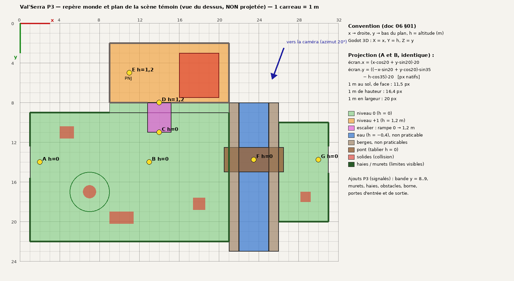
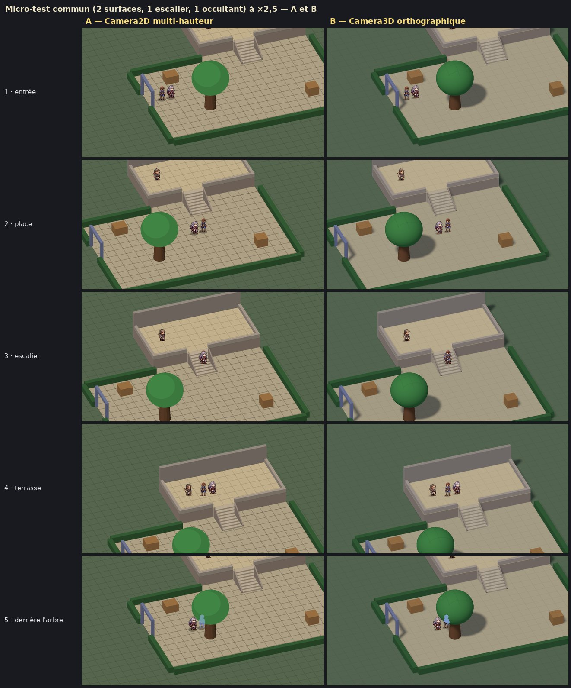
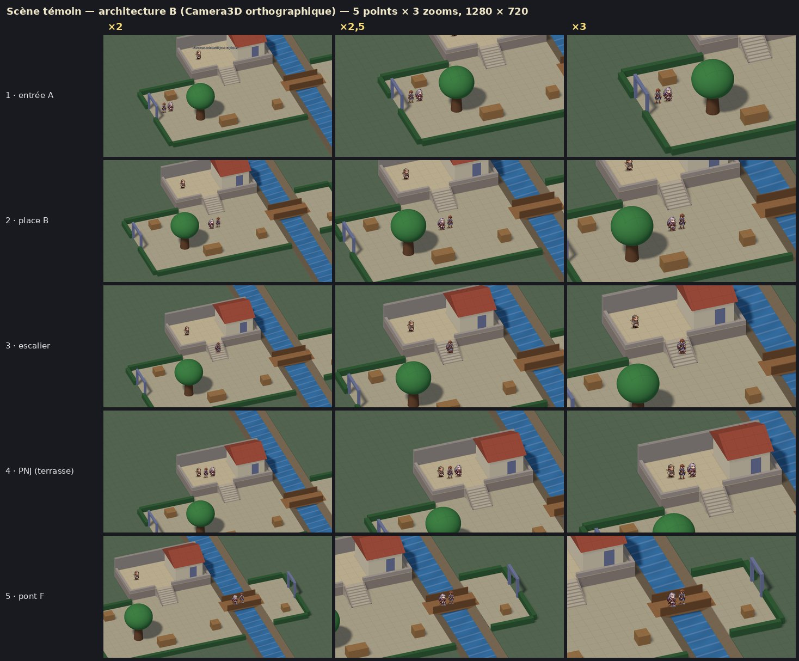

# P3 — Prototype d'exploration HD-2D / 2.5D (Godot 4.7.2)

Branche **`p3-prototype-25d`**, créée depuis `p2-environnements` (commit `3b6ee15`). Prototype **indépendant** :
la scène lancée par **F5 n'est pas modifiée** (`run/main_scene` reste `scenes/explore_hd2d/zone_exploration.tscn`),
aucun fichier du combat n'est touché, aucune texture définitive n'est produite (blockout en couleurs unies ; les
sprites existants d'Aren, Ilya et du garde sont réutilisés tels quels, proportions conservées).

Sources : documents 04 (charte caméra), 05 (scène témoin) et 06 (gabarits, plan et JSON) du dossier de préproduction.

## Lancer

Ouvrir le projet dans **Godot 4.7.2**, ouvrir une scène puis **F6** :

| Scène | Contenu |
|---|---|
| `scenes/explore25/scene_temoin.tscn` | **Scène témoin** 32 × 24 m, architecture **B** (Camera3D orthographique) |
| `scenes/explore25/demo_a_2d.tscn` | Démonstration **A** (Camera2D multi-hauteur) — micro-test : 2 surfaces, 1 escalier, 1 arbre |
| `scenes/explore25/demo_b_3d.tscn` | Démonstration **B** — même micro-test, mêmes données, même caméra |
| `scenes/explore25/scene_temoin_2d.tscn` | La scène témoin complète en **A**, à titre de diagnostic comparatif |

Commandes (identiques dans les quatre scènes) :

| Touche | Action |
|---|---|
| Flèches / ZQSD | marcher (8 directions) |
| **Molette** (ou PgPréc / PgSuiv) | zoom ×2 / **×2,5** (défaut) / ×3, par crans, transition de 0,3 s ; ignorée pendant un dialogue |
| E / Entrée | parler au PNJ, examiner la borne ou le panneau |
| F1 | infos : x, y, h, niveau, surface, zoom, i/s |
| F2 | calque couches / collisions / niveaux |
| G | grille de 1 m · **O** : aide d'occultation (aucune / silhouette / silhouette + transparence) |
| T | filtre des sprites (linéaire / nearest) · **N** : animation de l'eau · **F3** : limite d'images/s |
| P | parcours automatique · **R** : retour à l'entrée |

Ligne de commande (après `--`) : `--route=temoin|micro|sondes|limites|captures`, `--quit`, `--out=<dossier>`,
`--zoom=0|1|2`, `--filter=nearest`, `--occ=0|1|2`, `--layers`, `--nodebug`, `--fps=N`, `--noshadow` (B).

---

## Phase 1 — Audit

### Compatibilité Godot 4.7.2 (exécuté avec `Godot_v4.7.2-stable_linux.x86_64`, version `4.7.2.stable.official.ed1daf0bf`)

| Vérification | Commande | Résultat |
|---|---|---|
| Import complet du projet | `godot --headless --path . --import` | OK, aucune erreur |
| Tests existants | `godot --headless --path . --script res://tests/run_tests.gd` | **70/70** |
| Retour de combat (victoire/défaite) | `godot --headless --path . --script res://tests/e2e_zone_retour.gd` | **RÉUSSI** |
| Scène principale (F5) | `godot --headless --path . --quit-after 60` | se charge sans erreur |

Constats :
- `project.godot` déclare `config/features=PackedStringArray("4.5")`. **Non modifié** (consigne du doc 04) : 4.7.2
  ouvre le projet sans avertissement bloquant. À mettre à jour volontairement quand 4.7.2 sera officialisé.
- L'importeur 4.7.2 ajoute trois clés par défaut à `art/3d/vorgane_rig.glb.import` (modèle du combat). Changement
  **non conservé** (combat non touché) ; il réapparaîtra à chaque import 4.7.2, sans effet sur le rendu.
- Aucun moteur de rendu n'est fixé : Forward+ par défaut, repli automatique sur Compatibility (OpenGL) sans Vulkan.
- Physique 3D : moteur par défaut du projet (non modifié).

### Architecture existante

- **Une seule altitude.** La scène d'exploration (`zone_hd2d.gd`, ~1 000 lignes) est une `Camera2D` sur un sol
  peint ; la plongée 35° et l'azimut 20° sont « cuits » dans les illustrations rendues sous Blender. Le praticable est
  un polygone unique, les collisions des emprises au sol, le tri des personnages compare leurs pieds au **bord avant**
  de chaque emprise, et l'occultation est une transparence locale par shader.
- **Caméra** (`src/explore/camera_hd2d.gd`) : presets A (×2), B (×2,5, zone morte, lissage critique), C (×3,
  anticipation) ; limites rectangulaires ; `snap_to` / `follow`. Pas de molette, pas de gestion d'altitude.
- Métrique : 20 px natifs par mètre, référence 1280 × 720.

Conclusion de l'audit : rien dans le code actuel ne gère deux niveaux. L'architecture A est donc **à construire**
(prolongement du système actuel) au même titre que B.

### Conflit de consignes signalé

`CLAUDE.md` demande que F5 lance la dernière version à chaque branche ; la mission demande de **ne pas modifier la
scène d'exploration lancée par F5**, et le doc 05 « sans modifier le comportement de F5 ». J'ai suivi la mission : F5
est inchangé, les scènes P3 s'ouvrent avec F6 et sont listées dans le README.

---

## Conception commune — conditions de comparaison égales

Les deux démonstrations partagent **tout sauf le rendu, le tri/l'occultation et la physique du héros** :

| Module (`src/explore25/`) | Rôle |
|---|---|
| `world25.gd` | Modèle de monde unique lu depuis le JSON du doc 06 : surfaces par niveau, rampe d'escalier, solides, sorties ; **projection** commune |
| `cam25.gd` | Caméra : 3 zooms, molette, transition, suivi (preset B de P1), limites par zoom, couverture du décor |
| `session25.gd` | Entrées, compagnon sur la trace du héros, dialogue, sorties d'instance, pilote automatique, **mesures**, HUD |
| `actor25.gd` | Animation des sprites existants (mêmes images, mêmes règles) |
| `routes25.gd` | Parcours automatiques identiques pour A et B |



**Repère monde** (doc 06 §01) : `x` vers la droite, `y` vers le bas du plan, `h` altitude en mètres. En 3D : X = x,
Y = h, Z = y. **Projection**, identique pour A et B (vérifiée par test) :

```
écran.x = (x·cos20 + y·sin20) · 20
écran.y = ((−x·sin20 + y·cos20)·sin35 − h·cos35) · 20      [px natifs ; ×zoom à l'écran]
```

1 m de largeur = 20 px natifs, 1 m de profondeur au sol = 11,5 px, 1 m de hauteur = 16,4 px. Aren mesure 29 px,
soit 1,77 m. En B, la Camera3D orthographique a exactement ce repère (taille = 720 / (20 × zoom) m) et les sprites
sont des cartes verticales mises à l'échelle pour garder leur taille en pixels : **les deux démonstrations cadrent à
l'identique** (voir planches).

**Navigation** (A) : une position est tenable si le disque du personnage (r = 0,28 m) repose sur des surfaces
continues dont l'altitude ne varie pas de plus de **25 cm** (pas franchissable), sans toucher de solide. Un même
point du plan peut porter deux niveaux : l'altitude courante du héros lève l'ambiguïté. **Physique** (B) :
`CharacterBody3D` contre `StaticBody3D`, rampe continue pour l'escalier, et rayons verticaux : on ne descend jamais
de plus de 25 cm et l'eau, les berges et le décor sont des sols « non praticables ». Même règle de glissement le long
des obstacles dans les deux cas.

---

## Phase 2 — Démonstrations A et B (micro-test commun)

Micro-test (doc 05 §06, doc 06 §08) : `terrain_bas`, `terrasse_haute` (+1,2 m), `escalier`, `arbre_test`, avec les
bordures visibles et le PNJ.



| | **A — Camera2D multi-hauteur** | **B — Camera3D orthographique** |
|---|---|---|
| Décor | éléments 2D (ici volumes projetés en polygones ; demain illustrations découpées) | géométrie simple (boîtes, rampe, cylindres) ; illustrations possibles en textures/cartes |
| Profondeur | **calculée** : bande « sols » + tri topologique des éléments (emprises, altitude) + insertion des personnages à chaque image | **tampon de profondeur** : aucune règle de tri |
| Collisions | modèle logique (x, y, h) | physique Godot + règle de rebord |
| Occultation | recouvrement de polygones ; silhouette sur tout le sprite | silhouette **seulement** sur la partie cachée (test de profondeur inversé) |
| Lumière / ombres | ombrage de face imitant la lumière de B ; ombres portées à peindre | lumière et ombres portées réelles |

Les deux complètent le même parcours (17 étapes, montée, demi-tour dans l'escalier, terrasse, détour derrière l'arbre)
en **22,8 s (A) et 23,2 s (B)**, sans blocage, sans saut d'altitude, compagnon toujours sur un sol praticable.

**Limite de A observée dès le micro-test** : un conflit de tri (5 à 35 images selon la cadence) quand un personnage
sur la terrasse touche à la fois le haut de l'escalier et l'extrémité du muret : le muret doit passer devant lui,
l'escalier derrière, mais le muret est déjà derrière l'escalier dans l'ordre fixe des éléments. Règle « devant
l'emporte » : ses pieds débordent de quelques pixels sur le muret. Corriger demande de **découper** l'escalier ou le
muret — c'est précisément le coût de maintenance de A. B n'a pas ce problème par construction.

---

## Phase 3 — Scène témoin

`scenes/explore25/scene_temoin.tscn` (B) : zone 32 × 24 m, terrain bas, terrasse +1,2 m avec rebord et muret,
escalier de 8 marches, rivière (eau à −0,4 m) et berges non praticables, pont de 2,5 m avec garde-corps, rive est,
arbre occultant, maison sur la terrasse, PNJ (dialogue), borne derrière l'arbre (détour), 4 obstacles, portes
d'entrée et de **sortie d'instance** vers une instance fictive minimale (`data/explore25/instance_2_fictive.json`)
et retour. Le zoom choisi est conservé d'une instance à l'autre.



Planches : [B, 5 points × 3 zooms](media/p3_25d/temoin_B_5points_3zooms.jpg) ·
[A, 5 points × 3 zooms](media/p3_25d/temoin_A_5points_3zooms.jpg) ·
[A et B côte à côte, 8 points à ×2,5](media/p3_25d/temoin_A_vs_B_x2-5.jpg) ·
[couches / collisions / niveaux](media/p3_25d/couches_collisions_niveaux_x2.jpg) ·
[limites de caméra, 7 bords × 3 zooms](media/p3_25d/limites_camera_B.jpg) ·
[filtre des sprites à ×2,5](media/p3_25d/filtre_sprites_x2-5.jpg).

Vidéos : [`p3_scene_temoin_B.mp4`](media/p3_25d/p3_scene_temoin_B.mp4) (34 s, parcours complet sans coupe, B,
1280 × 720) · [`p3_micro_A_B_cote_a_cote.mp4`](media/p3_25d/p3_micro_A_B_cote_a_cote.mp4) (24 s, A et B
synchronisés). Enregistrées avec le Movie Maker de Godot (`--write-movie`, 30 i/s fixes).

### Ajustements et signalements (aucune spécification modifiée en silence)

Le JSON du doc 06 est copié **sans modification** (`data/explore25/gabarits_blockout_v01.json`, empreinte MD5
vérifiée par test). Tout complément est dans `data/explore25/ajustements_p3_v01.json`, avec son motif :

| # | Sujet | Constat | Ce que fait le prototype | Décision attendue |
|---|---|---|---|---|
| 1 | Bande y = 8..9 (x = 9..21) | non attribuée : ni terrasse (y ≤ 8) ni `terrain_bas` (y ≥ 9) | rendue praticable au niveau 0 (`pied_terrasse`), sinon collision invisible de 1 m au pied du mur | valider ou étendre `terrain_bas` à y = 8 |
| 2 | **Façade de la maison** | 0,5 m entre la maison (y = 7,5) et le rebord (y = 8) : **infranchissable** (personnage 0,56 m) | gardé tel quel ; on contourne par l'ouest et l'arrière (passage de 1 m) | déplacer la maison à y = 3..7 si un passage devant est voulu |
| 3 | Escalier | emprise 3 m pour une volée de 8 × 0,32 = 2,56 m | deux paliers de 0,22 m ; navigation en rampe continue, marches visuelles ; limons de 0,12 m (largeur utile 2,16 m) | valider |
| 4 | Mur du fond | un mur sur la terrasse réduirait le passage derrière la maison à 0,6 m | mur de soutènement posé **à l'extérieur** (y < 2), haut de 3,2 m depuis le sol | valider |
| 5 | Garde-corps du pont | le tablier (x = 20,5..26,5) déborde de 0,5 m sur chaque rive | garde-corps limités à x = 21..26 (au-dessus des berges et de l'eau) | valider |
| 6 | Limites | les bords de l'aire n'ont pas de matérialisation | haies, murets, rebords et berges **visibles** partout : aucune collision invisible | valider le principe |
| 7 | Hauteurs absentes | maison, arbre, murets | murs 2,6 m + toit 1,4 m ; tronc 2,4 m, feuillage à 3,7 m ; muret 0,45 m ; haie 0,7 m | valeurs de test |
| 8 | Décor hors zone | à ×2, une vue de 32 × 18 m ; avec l'azimut, la zone projetée fait **38,3 m × 19,2 m** à l'écran (766 × 384 px natifs) : les coins du cadre tombent loin de la carte | sol de décor non praticable agrandi automatiquement (rivière prolongée) | prévoir ≈ 14 m de décor autour d'un quartier, plus aux angles |
| 9 | Borne, obstacles | doc 05 : « indice ou borne » et « obstacles » sans position | borne au nord de l'arbre (masquée par le feuillage) ; caisses, charrette, tonneaux hors du chemin | — |
| 10 | Azimut 20° et plan orthogonal | « haut » à l'écran part à 20° de l'axe d'un escalier orienté selon y | **assistance d'escalier** : composante latérale réduite à 30 % sur la rampe ; glissement le long des murs | à juger en main ; orienter les escaliers des quartiers selon l'axe écran est une alternative |
| 11 | Vitesse à l'écran | déplacement cohérent au sol : à l'écran, la vitesse verticale vaut 57 % de l'horizontale (l'ancien jeu : 80 %) | gardé physiquement exact (3,6 m/s) | à juger en main |

---

## Phase 4 — Validation (tous les essais ont été exécutés sous Godot 4.7.2)

Machine de test : conteneur Linux, 4 cœurs, **sans carte graphique** (rendu logiciel llvmpipe : Vulkan/lavapipe pour
Forward+, OpenGL pour Compatibility). Les images/s mesurées ici **ne représentent pas** une machine de jeu ; seules les
comparaisons entre A et B ont un sens, et encore avec prudence (le rendu logiciel pénalise fortement la 3D et les ombres).

### Tests automatiques

```bash
godot --headless --path . --script res://tests/run_tests.gd
```

**82/82** : les 70 tests existants + 12 tests P3 (`tests/unit/test_p3_explore25.gd`) : JSON du doc 06 inchangé,
projection identique en 2D et 3D, points A à G tenables à leur altitude, **terrasse accessible uniquement par
l'escalier** (diffusion sur grille de 25 cm, avec et sans escalier), **rivière infranchissable sauf par le pont**,
continuité d'altitude dans l'escalier (≤ 3 cm / 5 cm), deux personnages à deux niveaux superposés à l'écran, zooms et
molette bloquée en dialogue, **aucune vue ne sort du décor** (toutes positions × 3 zooms, scène témoin et instance
fictive), défauts de dimensions signalés, micro-test, F5 inchangé et scènes P3 chargeables.

Non-régression : `e2e_zone_retour.gd` **RÉUSSI** ; scène principale chargée sans erreur (`--quit-after 60`).

### Parcours complet de la scène témoin (`--route=temoin`)

Entrée A → place B → escalier (zoom ×3 **pendant la montée**) → D → PNJ E (dialogue ; une molette pendant le
dialogue **ignorée**) → ouest et **derrière la maison** → descente → zoom ×2,5 → détour **derrière l'arbre**
(borne examinée) → pont F (zoom ×2 **sur le pont**) → sortie G → instance fictive (panneau) → retour → zoom ×2,5.

| Mesure (rendu Forward+, sans limite d'i/s) | A (diagnostic) | **B (scène témoin)** |
|---|---|---|
| Étapes atteintes | 26/26 | **26/26** |
| Durée | 33,5 s | 34,0 s |
| Sauts d'altitude (> 10 cm en une image) | 0 | 0 |
| Positions hors surface praticable (héros / compagnon) | 0 / 0 | 0 / 0 |
| Niveaux traversés | 0 → +1 → 0 | 0 → +1 → 0 |
| Sorties d'instance | aller + retour | aller + retour |
| Interactions | PNJ, borne, panneau | PNJ, borne, panneau |
| Molette ignorée pendant le dialogue | 1/1 | 1/1 |
| Zoom conservé après instance et dialogue | oui (×2,5 final) | oui |
| Images montrant du vide hors décor | 0 | 0 |
| Héros caché, durée continue maximale (avec silhouette) | 2,4 s (derrière la maison) | 2,3 s |
| Conflits de tri | 18 images | — (sans objet) |
| i/s moyennes (rendu logiciel) | 57,8 | 17,5 |
| Appels de dessin max / primitives max | 170 / 3 373 | 138 / 14 666 |
| Mémoire vidéo / statique | 76 / 48 Mo | 137 / 55 Mo |

### Collisions ciblées (`--route=sondes`) — poussée au clavier contre chaque limite

| Essai | A | B |
|---|---|---|
| rebord avant de la terrasse, rebord ouest | reste à h = 1,2 | reste à h = 1,2 |
| façade de la terrasse depuis le bas | arrêté au pied du mur | idem |
| côté de l'escalier depuis le sol / depuis les marches | arrêté par le limon / aucune chute | idem |
| passage de 0,5 m devant la maison | infranchissable (attendu) | idem |
| berge ouest, berge est (vers l'eau) | jamais dans l'eau | jamais dans l'eau |
| garde-corps avant / arrière du pont | reste sur le tablier | idem |
| tronc de l'arbre, haie, limite d'entrée | arrêté (glisse autour) | idem |
| demi-tour dans l'escalier (montée puis descente) | continu | continu |
| **Total** | **15/15**, 0 saut, 0 hors modèle | **15/15**, 0 saut, 0 hors modèle |

### Cadences 30 / 60 / 144 i/s

Le rendu logiciel ne permet pas d'afficher 60 ou 144 i/s : brider la cadence n'aurait rien testé. Les cadences sont
donc **simulées** en pas de temps fixe, sans rendu (même logique, même physique, même interpolation) :
`godot --headless --resolution 1280x720 --fixed-fps N --path . <scène> -- --route=<parcours> --quit`.

| Parcours | Cadence | Étapes A / B | Sauts h | Vue hors décor | À-coups caméra¹ A / B | Conflits de tri A |
|---|---|---|---|---|---|---|
| micro | 30 | 17/17 · 17/17 | 0 · 0 | 0 · 0 | 5 · 2 | 5 |
| micro | 60 | 17/17 · 17/17 | 0 · 0 | 0 · 0 | 1 · 3 | 13 |
| micro | 144 | 17/17 · 17/17 | 0 · 0 | 0 · 0 | 1 · 6 | 35 |
| témoin | 30 | **25/26** · 26/26 | 0 · 0 | 0 · 0 | 8 · 10 | 7 |
| témoin | 60 | 26/26 · 26/26 | 0 · 0 | 0 · 0 | 5 · 5 | 20 |
| témoin | 144 | 26/26 · 26/26 | 0 · 0 | 0 · 0 | 2 · 8 | 48 |

¹ variation de vitesse de la caméra de plus de 100 px d'écran/s d'une image à l'autre (même définition qu'en P1),
mesurée au rythme de l'affichage (caméra interpolée en B), hors transitions de zoom. Les quelques à-coups restants
sont des arrêts et demi-tours du parcours automatique. En A à 30 i/s, le pilote reste une fois bloqué contre la borne
derrière l'arbre (« retour place ») : le glissement de A se fait par pas d'image, B (physique à 60 Hz) passe.

Le centre de caméra arrondi au pixel d'écran provoquait, à 144 i/s, des pas de 0 ou 1 pixel irréguliers (1 046
à-coups en A) : l'arrondi n'est désormais actif qu'avec le filtre nearest, où il évite le scintillement.

### Rendu Compatibility (OpenGL)

Les deux démonstrations fonctionnent avec `--rendering-method gl_compatibility` (micro-test 17/17, silhouette
comprise ; en A, une variation d'altitude de plus de 10 cm sur une image lente de 70 ms dans l'escalier, sans saut
visible). En B, les couleurs y sont nettement plus claires qu'en Forward+ : un réglage par moteur de rendu serait
nécessaire pour garantir un rendu homogène.

### Zooms, filtre et limites

- Les trois zooms et la molette fonctionnent en marche, à l'arrêt, dans l'escalier, sur le pont et près des bords ;
  les limites sont recalculées à chaque image pendant la transition (parcours « limites », transitions douces aux 7
  bords : aucune vue hors décor). Vue : 32 × 18 m (×2),
  25,6 × 14,4 m (×2,5), 21,3 × 12 m (×3) dans le plan de l'écran. À ×3, vérifier sur les planches la lisibilité de
  l'entrée, de l'escalier, du PNJ et de la sortie (jugement visuel à confirmer en main).
- **×2,5 et pixel art** : comme en P1, l'échelle non entière donne des pixels de 2 et 3 px en nearest ; le linéaire
  (réglage du projet) adoucit. Identique en A et en B ([comparaison](media/p3_25d/filtre_sprites_x2-5.jpg)).
- **Limites** : 7 positions de bord × 3 zooms, aucune vue vide (planche « limites »).

---

## Recommandation : architecture **B** (Camera3D orthographique + géométrie simple + éléments 2D)

### Pourquoi

1. **La profondeur est exacte par construction.** Terrasses, escaliers, ponts, passages au-dessus ou derrière un
   élément : le tampon de profondeur tranche au pixel. En A, chaque cas impose une règle ou un découpage ; le
   micro-test le plus simple produit déjà un conflit de tri, et un pont au-dessus d'un chemin praticable obligerait à
   découper le pont en plusieurs éléments triés.
2. **Les collisions suivent la géométrie visible.** En B, ce qu'on voit est ce qui bloque (boîtes, rampe, limons) ;
   en A, il faut maintenir deux descriptions parallèles (l'image et ses métadonnées : emprises, altitudes, lignes de
   tri) et les garder cohérentes à chaque retouche.
3. **Rendu homogène entre régions.** Une même lumière, les mêmes ombres portées et le même brouillard s'appliquent à
   des assets différents : c'est l'exigence « assets différents, rendu commun ». En A, la cohérence repose sur la
   discipline de peinture de chaque asset.
4. **Occultation plus lisible.** La silhouette n'apparaît que sur la partie cachée ; en A, elle recouvre tout le
   sprite.
5. **Même caméra, même ressenti.** Cadrage, zooms, suivi et sprites sont identiques à A (vérifié image par image) :
   choisir B ne change pas le look validé.

### Limites et risques de B

- **Chaîne de production des assets** : il faut des volumes simples (blockout puis maillages bas-poly) sur lesquels
  poser les illustrations (textures projetées, cartes, décalques). Le pipeline actuel (rendu Blender puis peinture)
  reste utilisable pour les textures, pas tel quel pour les volumes.
- **Performance** : sans carte graphique, B tourne 3 fois moins vite que A (17 contre 58 i/s ; 21 i/s sans ombres).
  À mesurer sur le **matériel cible** avant de verrouiller ; budget d'ombres à fixer.
- **Sprites dans un monde 3D** : cartes décalées de 0,4 m vers la caméra pour ne pas s'enfoncer dans les murs
  (invisible en orthographique, mais à surveiller contre les obstacles très proches) ; sprites en passe transparente.
- **Physique** : réglages à garder (rampe d'escalier, règle de rebord, glissement) ; écart de couleurs entre Forward+
  et Compatibility.
- Le zoom ×2,5 garde le problème des pixels non entiers, quelle que soit l'architecture.

### Coût de maintenance (estimation)

| | A | B |
|---|---|---|
| Code propre à l'architecture (prototype) | 828 lignes (`explore_2d.gd`) | 811 lignes (`explore_3d.gd`) |
| Par élément de décor | image + emprise + altitudes + règles de tri ; découpage si chevauchement | volume simple + matériau ; collision dérivée du volume |
| Ajout d'un niveau, d'un pont, d'un passage inférieur | règles de tri nouvelles, risques de conflits | aucun code de tri |
| Contrôle qualité | revue des conflits de tri à chaque quartier | revue des collisions physiques et du budget de rendu |
| Pour des dizaines d'instances | coût croissant avec le nombre de cas de recouvrement | coût porté surtout par la production des volumes |

Le code commun (`world25`, `cam25`, `session25`, `actor25`) — environ 1 500 lignes — reste valable quel que soit le
choix : modèle de données, caméra, interactions, mesures.

### Prochaine décision

Valider (ou ajuster) : l'architecture B, les signalements 1 à 11 ci-dessus, le preset de suivi, puis tester le
ressenti en main (vitesse verticale, assistance d'escalier, ×2,5). Ensuite seulement : gabarits d'assets à l'angle
réel et mesures sur le matériel cible.

## Problèmes ouverts

1. Conflit de tri de A au coin muret / haut d'escalier (documenté, non corrigé : c'est un résultat du comparatif).
2. A à 30 i/s : un blocage du pilote contre la borne (glissement par pas d'image).
3. La maison laisse 0,5 m devant elle (infranchissable) — spécification non modifiée.
4. Performances non mesurées sur matériel réel ; B nettement plus coûteux en rendu logiciel.
5. Couleurs plus claires en Compatibility (B).
6. Le pilote automatique simule un clavier en 8 directions (alternance de touches) : utile pour la reproductibilité,
   pas un substitut au ressenti en main.
7. Les murets bordant la terrasse réduisent la largeur utile de 0,3 m ; la règle d'occultation des toitures reste à
   juger (silhouette seule, ou transparence locale avec `O`).

## Reproduire

```bash
godot --path . res://scenes/explore25/scene_temoin.tscn -- --route=temoin --quit --out=/tmp/p3
```

```bash
godot --path . res://scenes/explore25/scene_temoin.tscn -- --route=captures --quit --nodebug --out=/tmp/p3
```

```bash
python3 tools/explore25/planches.py /tmp/p3 docs/media/p3_25d
```

```bash
python3 tools/explore25/plan_repere.py
```

Les mêmes options valent pour `demo_a_2d.tscn`, `demo_b_3d.tscn` et `scene_temoin_2d.tscn` (préfixe `A_` / `B_`
des fichiers). Les planches attendent les dossiers `temoin/`, `micro/`, `couches/` (`--layers`), `nearest/`
(`--filter=nearest`) et `limites/` (`--route=limites`).
