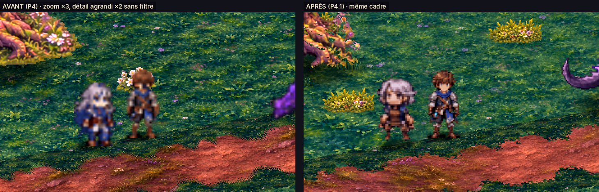
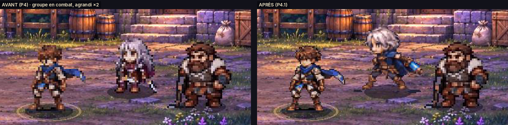
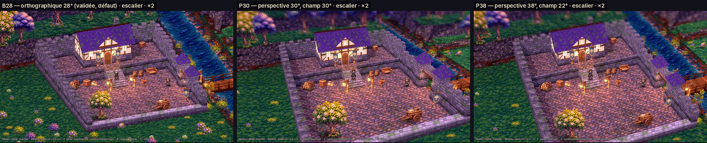
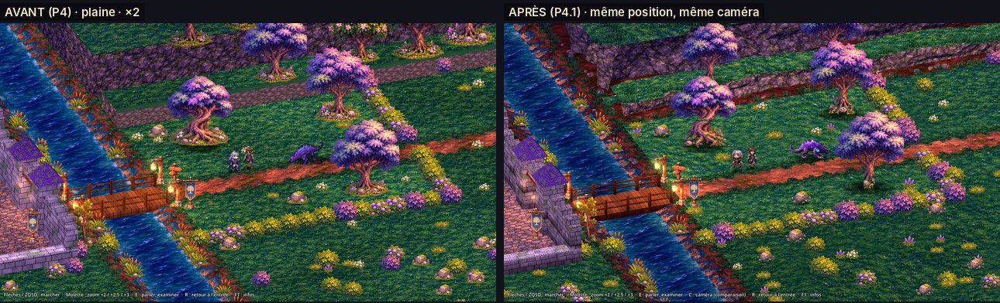
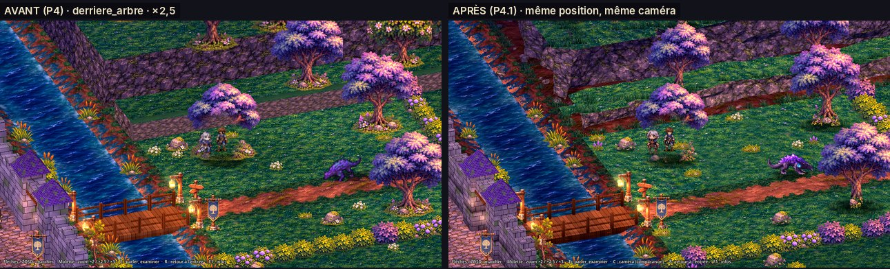

# P4.1 — Finitions visuelles et consolidation de la démo (Godot 4.7.2)

Branche **`p4-1-finitions`**, partie de `p4-avant-poste` (`f5485ab`, laissée intacte). Date : 12 novembre 2026.
La carte, le gameplay, les dialogues, l'intérieur et les transitions de P4 sont conservés. Toutes les images de ce
rapport sont rendues en OpenGL **logiciel** (aucune carte graphique ici) : Forward+ et performances restent à voir
sur PC.

## 1. Résumé

| Demande | Fait | Où le voir |
|---|---|---|
| Personnages nets (exploration **et** combat), designs cohérents | Aren et Ilya réextraits des planches validées ; rendu « pixel net » ; Ilya canonique partout (exploration, combat, portraits) ; Vorgane d'exploration = images du combat | `media/p4_1/personnages_avant_apres_*.png`, `combat_*` |
| Origine du flou identifiée | oui (§ 2) | — |
| Caméra comparée à l'image de référence | 3 variantes testées, captures A/B à positions identiques ; **B28 reste par défaut** | `media/p4_1/camera/AB_*.jpg`, touche **C**, scènes F6 |
| Reliefs naturels | falaises procédurales irrégulières (strates, corniches, talus, roches, herbe) à la place des boîtes lisses ; roches sur les berges | `avant_apres_plaine_*`, `avant_apres_derriere_arbre_*` |
| Arbres intégrés au terrain | plaques de sol peintes retirées des sprites, ombres de contact, touffes aux couleurs du sol | idem |
| Harmonisation | anti-répétition herbe / terre / roche, salissures des pavés et murs, pied des murs assombri, eau désaturée et reflets adoucis, berges moins orangées | `avant_apres_*` |
| PV du monstre ÷ 2 pour la démo | 475 au lieu de 950, **ce combat seulement** | `tests/e2e_p4_retour.gd` |
| F5 | lance la démo P4.1 (même scène `scenes/p4/avant_poste.tscn`, testée) | § 7 |

Vidéo du parcours complet (exploration, dialogue, bâtiment, pont, combat, retour) :
[`media/p4_1/parcours_complet_p4_1.mp4`](media/p4_1/parcours_complet_p4_1.mp4).

## 2. Origine du flou (diagnostic)

Les réglages d'import n'étaient **pas** en cause (sans perte, sans mipmaps). Trois causes cumulées :

1. **Sources réduites** : les planches d'Aren dessinent le personnage sur une grille d'environ 60 pixels réels ;
   P1 l'avait réduit à 29 px (exploration) et 40 px (combat). Ilya d'exploration (P4) était la réduction d'un
   sprite de 33 px du pack à 26 px ; le Vorgane d'exploration, une réduction à 80 px d'images de 170 px.
2. **Agrandissement filtré** : en exploration, ces petites images étaient agrandies ×2,5 avec le filtre
   **bilinéaire** (`texture_filter` linéaire, choix P3) : chaque pixel s'étale sur 2 à 3 pixels d'écran → flou.
   Le filtre « au plus proche » n'est pas une solution à facteur non entier (×2,5) : pixels irréguliers.
3. **Mauvaise source pour Ilya** : en combat et en portrait, c'était encore l'ancienne Ilya du pack (cheveux longs,
   tenue bordeaux), refusée.

**Corrections** (sans flou ajouté ni retiré par filtre) : réextraction à la résolution réelle des planches
(Aren 57 px en exploration, 60 px en combat) ; les sprites sont maintenant **réduits** à l'écran (×1,2 à ×1,5
selon le zoom, au lieu d'être agrandis ×2,5) avec un shader « pixel net » qui garde des bords francs d'un pixel
(`src/p4/perso_p41.gdshader`) ; en combat, affichage ×2 (entier, net) au lieu de ×3 → même taille, 2,25 fois plus
de pixels. Taille à l'écran **inchangée** : Aren 70 px à ×2,5 comme en P4. Touche **T** : compare avec l'ancien
rendu bilinéaire.

## 3. Caméra

**Analyse de l'image de référence.** Projection en **perspective** (le platelage du pont et le pont de cordes du
fond rapetissent, les lignes de berge convergent) avec un champ étroit, type téléobjectif ; plongée moyenne,
estimée entre 30 et 40° (non mesurable exactement sur une capture) ; personnages petits (≈ 8 % de la hauteur de
l'écran, contre ≈ 10 % chez nous à ×2,5) ; le tiers haut est du paysage lointain ; un **flou de distance** fort
en haut et en bas de l'image (effet « miniature ») sépare le plan de jeu du décor.

**Variantes testées** (même centre de cadre, même taille du héros à l'écran aux trois zooms, rotation fixe) :

| Variante | Projection | Plongée | Giron d'une marche à ×2,5 | Sol caché derrière un mur de 2,6 m |
|---|---|---|---|---|
| **B28** (défaut, validée en P3) | orthographique | 28° | 7,5 px | 4,9 m |
| **P30** | perspective, champ 30° + flou de distance | 30° | ≈ 8 px | ≈ 4,5 m |
| **P38** | perspective, champ 22° + flou de distance | 38° | ≈ 10 px | ≈ 3,3 m |

Les trois passent le parcours complet (29/29), les 20 sondes de collision, sans saut d'altitude ni position hors
surface ; l'occultation et le masquage localisé suivent la vraie position de la caméra en perspective.

**Recommandation (non verrouillée)** : **P30** est la plus proche de la référence tout en restant fidèle à votre
préférence pour 28° : profondeur visible (lointain plus petit, flou de distance), paysage en haut de l'écran,
mêmes repères de jeu. **P38** si l'escalier ou l'occultation gênent en main : marches plus lisibles (+32 %),
moins de sol caché. À trancher en jouant : touche **C** en jeu, ou scènes F6 `comparaison_camera_P30/P38.tscn`.
Points à surveiller : la perspective déforme un peu les bords de l'écran à ×2 ; le flou de distance est une passe
plein écran (coût GPU non mesuré).

## 4. Reliefs, arbres et raccords

- **Falaises** (`_cliff` dans `scenes/p4/avant_poste.gd`) : maillage généré le long de la ligne de pied, bruit
  de recul par strates, corniches, crête irrégulière, talus de terre bombé, roches éboulées, herbe en crête et au
  pied. Remplacent les boîtes du plateau nord et des trois gradins de fond. **Aucune collision ajoutée ni
  déplacée** : la limite praticable (pied du talus) est celle de P4 (test `test_p41_finitions.gd`).
- **Arbres et accessoires** (`tools/p41/decor_p41.py`) : la « plaque » d'herbe, de fleurs et de cailloux peinte
  sous chaque arbre, rocher, lanterne, bannière, clôture… est retirée (seuls les pixels du pied, reliés au sujet,
  restent) ; chaque arbre reçoit deux ombres de contact et des touffes générées **avec les couleurs exactes de
  SOL-01**. Les sprites sont posés à leur vrai pied.
- **Berges** : galets et roches au pied de la pente, calque BER-01 moins orangé, tramage au sol par grains de 5 cm.
- **Matériaux** : herbe, terre et roche mélangent deux échantillonnages pivotés selon un bruit lent (casse la
  répétition) avec des plaques sèches ; pavés et murs reçoivent des salissures / mousses irrégulières ; le pied des
  murs est assombri (contact). Eau : saturation −12 %, reflets −45 %, écume adoucie.
- **Pont et bâtiment** : structure inchangée ; bois un peu moins orangé pour s'accorder à la palette.

## 5. Combat de démonstration

`scenes/p4/avant_poste.gd` écrit `GameState.flags["rencontre_pv_mult"] = 0.5` au déclenchement ; le combat le lit
**puis l'efface** (`scenes/battle/battle_scene.gd`, 8 lignes). Résultat : 475 PV au lieu de 950 dans cette
rencontre ; `data/combat/monster_vorgane.json` et les autres combats sont inchangés. Le combat utilise les
nouveaux sprites d'Aren et d'Ilya et le portrait canonique d'Ilya. Vérifié : déclenchement, victoire, défaite,
retour (e2e) et une partie complète jouée par l'IA de démonstration (vidéo).

## 6. Tests (Godot 4.7.2)

| Vérification | Résultat |
|---|---|
| Import, chargement de F5 | 0 erreur |
| Tests automatiques | **105/105** (99 + 6 pour P4.1) |
| Rencontre de bout en bout (`e2e_p4_retour.gd`) | **25/25** (dont PV ÷ 2 et multiplicateur consommé) |
| Parcours complet `p4`, caméras B28 / P30 / P38 | **29/29** chacune ; 0 saut d'altitude ; 0 position hors surface (héros, compagnon) ; molette ignorée en dialogue |
| Sondes de collision `p4_sondes`, B28 / P30 / P38 | **20/20** chacune |
| Retour de combat de l'ancienne zone | réussi |
| Captures | 10 points de vue × 3 zooms × 3 caméras ; avant/après personnages, combat, décor |

Corrigé en route : un sprite pouvait recevoir une texture nulle quand un personnage passait de la marche au repos
en se tournant (`actor25.gd`), erreur intermittente vue sur un parcours.

## 7. F5 et scènes F6

- **F5** : `scenes/p4/avant_poste.tscn` (inchangé : c'est la démo P4.1, testée), caméra **B28** par défaut.
- **F6** : `scenes/p4/comparaison_camera_P30.tscn`, `comparaison_camera_P38.tscn` (même démo, autre caméra de
  départ) ; l'ancienne exploration et les prototypes P3 comme avant.
- En jeu : **C** fait défiler les caméras, **T** compare l'ancien rendu des personnages.

## 8. Encore provisoire / sprites à refaire

| Élément | Problème | Ce qu'il faudrait |
|---|---|---|
| **Ilya — exploration** | planche source petite et floue : 38 px réels ; yeux verts à peine lisibles | 4 directions × 4 images + repos, **≈ 58 px**, même grille que la planche d'Aren (fond uni, sans rééchantillonnage) |
| **Ilya — combat** | 4 poses seulement (garde, touché, Aether, K.O. manquants : copies d'autres poses) | planche de combat au format de celle d'Aren (repos, avance, préparation, attaque, impact, retour, garde, touché, Résonance) |
| **Garde** | un seul profil, 32 px | 4 directions, ≈ 55 px |
| **Vorgane** | même design qu'en combat, mais images de 170 px affichées ×3 en combat (gros pixels) ; une version 256 px existe (`art/sprites/vorgane`, palette de jour) | nouveau rendu Blender (`art/3d/blender/vorgane_rig.blend`) à la taille d'affichage, palette nuit — Blender n'est pas disponible dans cet environnement |
| **Throné** | sprite du pack (combat uniquement), non retouché | planche au format d'Aren si le personnage est conservé |
| Textures bâtiment / murailles / pont | toujours générées (P4) | textures peintes |
| Intérieur | entouré de noir | décor de coupe ou cadrage resserré |

## 9. Fichiers

**Ajoutés** : `art/p41/` (+ `SOURCES.md`), `tools/p41/` (`sprites_aren.py`, `sprites_ilya.py`,
`build_chars_p41.py`, `decor_p41.py`, `planches_p41.py`), `src/p4/perso_p41.gdshader`,
`src/p4/tilt_shift_p41.gdshader`, `scenes/p4/comparaison_camera_P30.tscn` / `_P38.tscn`,
`tests/unit/test_p41_finitions.gd`, `docs/P4_1_FINITIONS.md`, `docs/media/p4_1/`.

**Modifiés** : `scenes/p4/avant_poste.gd` (personnages, caméras, falaises, raccords, PV de démo),
`src/p4/surface_p4.gdshader`, `carte_p4`, `decal_p4`, `eau_p4`, `src/proto/pack_hunter_view.gd` (poses P4.1 ×2),
`src/proto/portraits.gd` (Ilya), `scenes/battle/battle_scene.gd` (multiplicateur de PV), `src/explore25/actor25.gd`
(correctif), `src/explore25/routes25.gd`, `project.godot` (variable globale de shader), tests, README, CLAUDE.md.

**Supprimés** : aucun. Anciennes ressources conservées et toujours référencées par les anciennes scènes.

## 10. Lancer

1. Branche `p4-1-finitions` → Code → Download ZIP → `Val-Serra-Game-p4-1-finitions`.
2. Godot **4.7.2** → Importer `project.godot` → **F5**.
3. Comparer les caméras : touche **C** (ou F6 sur les scènes `comparaison_camera_*`).
