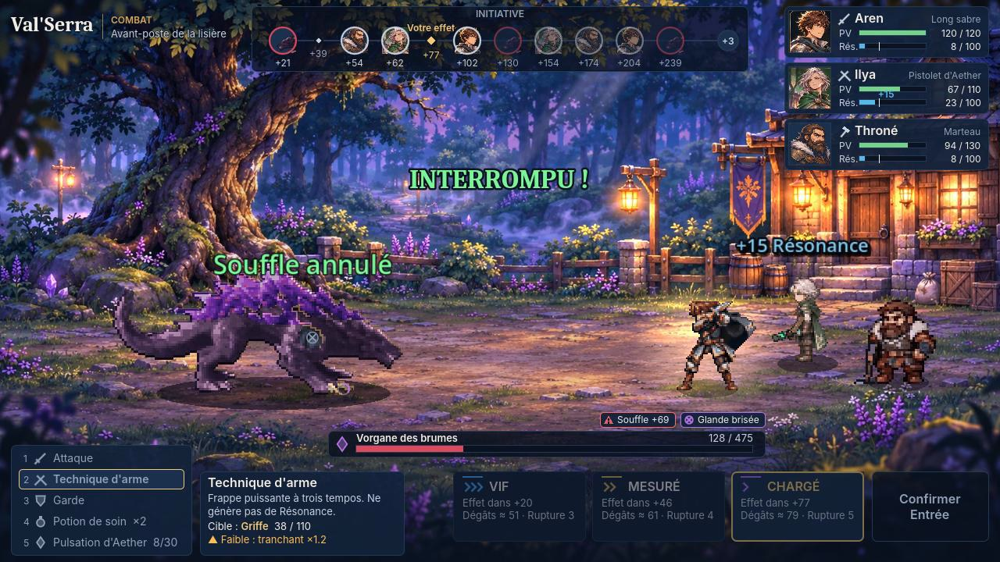

# P4.4 — Personnages, combat d'Ilya au pistolet d'Aether, caméra P30 et nettoyage (Godot 4.7.2)

Branche **`p4-4-personnages`**, partie de `p4-1-finitions` (`ba466f6`, laissée intacte ; c'était la branche P4
jouable la plus récente). Date : 13 novembre 2026. Sources : `BRIEF_CLAUDE_P44.md`, `QA_PERSONNAGES_GODOT.md`,
`README_IMPORT.md` (pack P4.4), README des packs P4.2 et P4.3, `README_GODOT.md` (Aren gris).

**Statut :** la démo est jouable de bout en bout et vérifiée automatiquement. **F5 la lance.** Rendu observé en
OpenGL logiciel uniquement (pas de carte graphique ici) : Forward+ et performances GPU restent à constater sur PC.
Aucune animation n'est déclarée validée artistiquement (§ 3).

Vidéo du parcours complet (cour, dialogue, bâtiment, pont, plaine, combat, victoire, retour) :
[`media/p4_4/parcours_complet_p4_4.mp4`](media/p4_4/parcours_complet_p4_4.mp4).

## 1. Résumé

| Demande | État | Preuve |
|---|---|---|
| Aren : design original, cheveux bruns, tenue grise/noire — exploration, combat, portraits | fait | `comparaisons/personnages_*.png`, `combat_*` |
| Ilya : cheveux courts argentés, tenue verte — exploration, combat, portraits | fait | idem |
| Garde : armure sombre, bouclier, masse | **portrait de dialogue fait ; sprite d'exploration non remplacé** (source inaccessible, § 7) | vidéo (dialogue) |
| Combat d'Ilya : pack P4.4, 7 animations, pistolet d'Aether seul | fait ; animations observées en jeu, une image écartée | `comparaisons/ilya_tir_sequence.png`, vidéo |
| Netteté, échelles, transparence, pieds, portraits, trois zooms | fait (réduction des sources, jamais d'agrandissement filtré) | tests, captures `captures/*_x2|x2-5|x3.jpg` |
| Caméra P30, flou fortement réduit, trois zooms, comparaison B28 | fait : P30 par défaut, B28 en F6 | `comparaisons/cameras_*.jpg`, `flou_p41_p44_*.jpg` |
| Nettoyage du projet actif | fait : 2 750 fichiers retirés, 227,9 → 43,1 Mo | § 5 |
| F5 sur la dernière démo stable et testée | fait | § 6 |
| Non-régression (exploration, garde, intérieur, dialogues, pont, monstre, combat, victoire/défaite, retour ; 475 PV) | fait | § 4 |

## 2. Personnages

| | Exploration | Combat | Portraits |
|---|---|---|---|
| **Aren** | pack P4.3 (gris corrigé), 4 directions × (repos + 4 pas), 56 px | pack P4.2 (gris), 10 animations, 56 px affichés ×2 | pack P4.2, 6 expressions |
| **Ilya** | pack P4.3 (verte), 4 directions × (repos + 4 pas), 52 px | **pack P4.4** (pistolet d'Aether), 7 séquences, 54 px affichés ×2 | pack P4.2, 6 expressions (neutre : grand portrait) |
| **Garde** | ancien sprite du pack (inchangé) | PNJ, pas de combat | pack P4.2 (armure, heaume) |

- **Netteté** : toutes les images sont **réduites** depuis les sources (couleur médiane par pixel), jamais agrandies ;
  exploration avec le shader « pixel net » de P4.1, combat ×2 au plus proche (entier). Tailles à l'écran inchangées
  (Aren 70 px à ×2,5). Palette commune par personnage, pixels isolés retirés, ombre peinte des planches d'Aren
  retirée, contour d'Ilya assombri (cape claire peu lisible sur l'herbe).
- **Pieds** : un point d'ancrage fixe par jeu d'images (pied du pack), même ligne dans les 24 images d'exploration
  (test automatique).
- **Ilya armée d'un pistolet** : l'arme affichée en combat devient « Pistolet d'Aether » (affichage seulement ; les
  statistiques de l'ancienne arme, déjà de type « perforant », ne changent pas : l'équilibrage reste intact).
- **Portraits** : recadrés en carré et réduits à 160 px au plus ; les petites sources (expressions d'Ilya, 80 px)
  gardent leur taille, l'interface les agrandit (léger flou, § 7).

## 3. Combat d'Ilya : les sept animations observées en jeu

Observées dans la vraie vue de combat (diagnostic filmé, puis combat complet de la vidéo) :

| Séquence du pack | Utilisation en jeu | Constat |
|---|---|---|
| `idle` (4) | attente, en boucle | correct, respiration discrète |
| `draw` (5) | préparation du tir | correct |
| `fire` (7) | tir : trait d'Aether vert du canon à la cible, anneau d'impact | **`fire_3` écartée** : le corps change brusquement de posture (jambes écartées) et produit un saut visible ; 6 images gardées |
| `charged_shot` (8) | Pulsation d'Aether : charge (0–4) puis décharge (5–7) et rayon vert épais | correct ; les anneaux de charge sont lisibles |
| `guard` (4) | garde, en boucle | correct |
| `hit` (4) | touchée | correct ; traits rouges du pack |
| `ko` (6) | K.O. : l'animation se termine allongée (plus de retour à la pose « touchée ») | **chute rigide** : c'est la pose debout tournée d'un bloc, le corps ne se plie pas |

Le projectile est un effet séparé du sprite (recommandation du pack) : il part du bout du pistolet et suit la cible
réelle. Ilya ne fait plus de pas vers le monstre (attaque à distance). **Prototypes, non validés** : les bras ne
sont pas redessinés image par image (pack composite) ; la chute du K.O. et le recul sont à redessiner pour une
version finale.

## 4. Tests (Godot 4.7.2)

| Vérification | Résultat |
|---|---|
| Import, chargement de F5 (`--quit-after 60`) | 0 erreur |
| Références `res://` vers des fichiers absents (scan de tout le code et des données) | 0 (hors repli volontaire) |
| Tests automatiques | **63/63** (50 tests des scènes retirées supprimés avec elles ; 8 tests P4.4 ajoutés) |
| Rencontre de bout en bout (`tests/e2e_p4_retour.gd`) | **25/25** : déclenchement, combat chargé, **475 PV** (données à 950), victoire, défaite, dialogue, bâtiment |
| Parcours complet `p4` — P30 / B28 | **29/29** chacun ; 0 saut d'altitude ; 0 position hors surface (héros, compagnon) |
| Sondes de collision `p4_sondes` — P30 / B28 | **20/20** chacun |
| Partie filmée (dialogue et combat joués par l'IA de démonstration) | victoire, retour dans la plaine, Vorgane disparu |
| Diagnostic des actions de combat d'Aren et d'Ilya (vue réelle) | observé ; défaut `fire_3` corrigé (§ 3) |

Non vérifié ici : Forward+, performances GPU, confort en main par une personne.

## 5. Nettoyage

**Taille du projet actif (fichiers suivis par Git)** : **227,9 Mo, 4 327 fichiers** (`p4-1-finitions`) →
**43,1 Mo, 1 939 fichiers** (`p4-4-personnages`, dont 18,4 Mo de documentation et médias de cette étape, 24,1 Mo de ressources graphiques). Le dossier `.godot/`
(cache d'import, non suivi) est régénéré à l'ouverture.

**Historique Git** : `git rm` ne réduit pas l'historique. Un clone complet pèse toujours ≈ 216 Mo (`.git`), car les
anciennes versions restent consultables. Le réduire demanderait de réécrire l'historique (décision distincte,
non faite). Un clone superficiel (`git clone --depth 1 --branch p4-4-personnages …`) ou le ZIP GitHub ne
téléchargent que la version actuelle.

**Retiré** (`git rm`, récupérable par les branches précédentes — `docs/HISTORIQUE.md`) :

| Catégorie | Contenu | Fichiers |
|---|---|---:|
| Anciennes scènes | `scenes/explore` (menu, zone P1), `scenes/proto`, `scenes/explore_hd2d` (ancienne exploration F5), `scenes/explore25/*.tscn` (prototypes P3 et variantes de caméra), `scenes/art`, `scenes/debug`, `scenes/dev`, `scenes/p4/comparaison_camera_P38.tscn`, `src/explore` | ≈ 50 |
| Anciens sprites et portraits | `art/proto` (Aren, Ilya, poses, Vorgane jour/nuit non utilisés, sources), `art/p41` (Aren, Ilya, combat, portraits P4.1), `art/p4/chars` (Ilya provisoire), `art/explore_hd2d` (ancienne exploration) | ≈ 2 140 |
| Sources et planches | `art/source` (concepts, packs, gabarits), `art/3d` (fichiers Blender, GLB Meshy et rig non utilisés), `art/zone` | ≈ 100 |
| Médias et rapports | `docs/media` P1 → P4.1 (vidéos, captures, mesures), 28 comptes rendus d'étapes | ≈ 375 |
| Tests et outils devenus inutiles | tests des scènes retirées (zone, caméras P1/P3, P4.1), sondes de performance de l'ancienne zone ; `tools/art`, `tools/explore`, `tools/explore25`, `tools/perf`, `tools/blender`, outils P4.1 des personnages | ≈ 75 |

**Conservé** : la démo (`scenes/p4`, `data/p4`, `src/p4`, `src/explore25`, `scenes/explore25/explore_3d.gd`), le
combat complet (`scenes/battle`, `src/combat`, `src/presentation`, `src/proto`, `data/combat`, arène, Vorgane de
la démo, Throné, effets), les ressources actives (`art/p4`, `art/p41/decor`, `art/p41/chars/{pnj,vorgane}`,
`art/p44`), les polices, les tests actifs, les outils qui régénèrent les ressources actives (`tools/p4`, `tools/p41/decor_p41.py`,
`tools/p44`, `tools/arena`), `docs/ASSETS.md`, ce rapport et ses médias. Les modes de combat historiques (`--start=battle`,
`--start=artproto`…) gardent leur code ; les scènes qu'ils ouvraient au retour mènent désormais à la démo.

## 6. F5 et F6

- **F5** : `res://scenes/p4/avant_poste.tscn` = démo P4.4 (nouveaux personnages, caméra **P30**, flou réduit).
  Configuration demandée par le brief P4.4 ; la version passe toutes les vérifications du § 4.
- **F6** : `scenes/p4/comparaison_camera_B28.tscn` (même démo, caméra orthographique 28°). En jeu, **C** fait défiler
  P30 / B28 / P38.
- **Caméra P30** : le flou de distance passe de 3,2 px sur le tiers haut et le bas de l'écran (P4.1) à 0,7 px
  (intensité 0,3 × 2,4) sur le cinquième haut uniquement ; jamais sur les personnages (centre de l'écran), le bas ni
  l'interface (calque inférieur à l'interface). `--notilt` le coupe pour comparer (`comparaisons/cameras_*.jpg`).

## 7. Problèmes restants et réserves

1. **Garde en exploration** : ses poses directionnelles (armure, bouclier, masse) ne sont que dans
   `ValSerra_P42_COMBAT_PORTRAITS_v01_A_TESTER.zip` (11,6 Mo), au-dessus de la limite de téléchargement de cet
   environnement (10 Mo). Le portrait de dialogue est intégré, le sprite en jeu est encore l'ancien garde (béret,
   barbe) : incohérence visible. **Besoin** : déposer le dossier `garde/combat/frames/` décompressé (ou un ZIP de
   moins de 10 Mo) sur le Drive ; l'intégration prendra quelques minutes avec `tools/p44/build_chars_p44.py`.
2. **Animations d'Ilya (pack P4.4)** : composites ; K.O. en rotation rigide ; recul du tir sans mouvement des bras.
3. **Marche d'exploration (pack P4.3)** : cycles lisibles, mais tirés d'illustrations générées, pas animés image
   par image (petites variations de cape et de tête d'une image à l'autre).
4. **Aren** : pas de K.O. dans la source (la pose « touché » sert de K.O.) ; « impact » = fin de l'attaque.
5. **Portraits d'Ilya** (sauf neutre) : sources de 80 px, un peu floues une fois affichées à 140 px.
6. **Throné** : sprite et portrait de l'ancien pack, non retouchés.
7. **Rendu** : Forward+ et performances GPU non mesurés.
