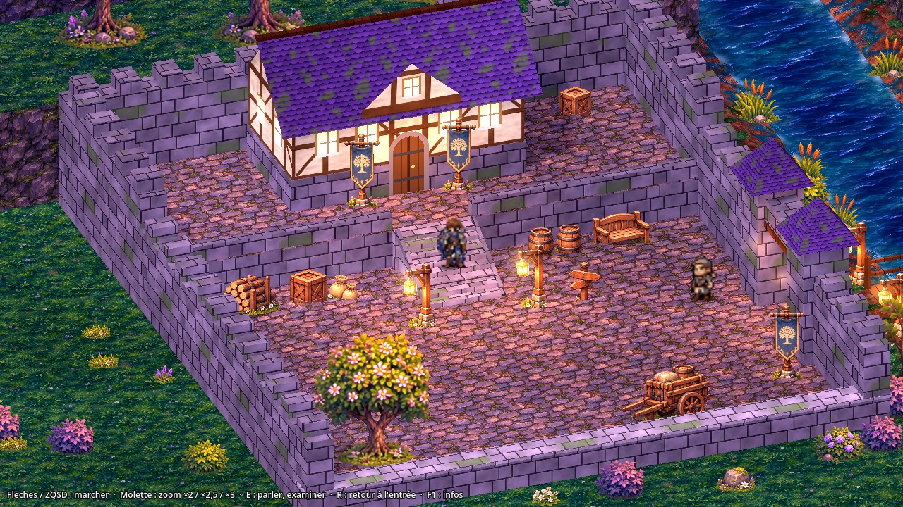
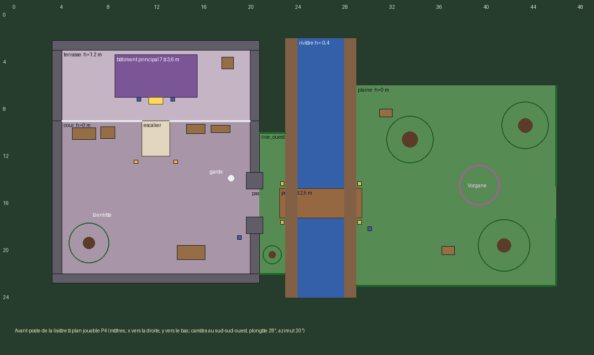

# P4 — Avant-poste de la lisière : première zone d'exploration HD-2D / 2.5D habillée (Godot 4.7.2)

Branche **`p4-avant-poste`**, partie de `p3-validation-camera` (commit `b36d5bb`, laissée intacte).
Date : 12 novembre 2026. Sources : brief P4, documents Drive 03, 12, 13 et README des packs `P4_MAT_v03`,
`P4_ENV_MODULES_v01`, `P4_PILOTES_TECH_v01`, `P4_BAT_ORIENTATIONS_PONTS_SIMPLES_v01`, `P4_PERSONNAGES_EXPLORATION_v01`,
`P4_ILYA_REFERENCE_32POSES_v02` ; rapports P3 du dépôt.

**Statut : zone jouable de bout en bout, vérifiée automatiquement ; F5 la lance.** Le rendu n'a été exécuté ici
qu'en OpenGL logiciel (aucune carte graphique) : les performances GPU et le rendu Forward+ restent à constater sur
le PC du créateur. Plusieurs ressources sont **provisoires** (§ 6). Rien n'est déclaré final.



Vidéo du parcours complet (1 min 55 : cour, dialogue, escalier, bâtiment, pont, plaine, combat, retour) :
[`media/p4/parcours_complet_p4.mp4`](media/p4/parcours_complet_p4.mp4).

## 1. Résumé

| Demande du brief | État | Preuve |
|---|---|---|
| Cour centrale (pavés, murailles, accessoires, PNJ, circulation) | fait | captures `cour_*`, parcours |
| Terrasse supérieure, escalier de pierre, bâtiment principal accessible | fait (intérieur simple, aller et retour) | `escalier_*`, `terrasse_*`, `interieur_*`, e2e |
| Sortie fortifiée, pont de bois droit et sobre, cours d'eau animé | fait (lanternes et bannières indépendantes du pont) | `porte_pont_*`, `pont_*` |
| Plaine (herbe, chemin, arbres, végétation, rochers, relief) | fait | `plaine_*` |
| Rencontre : monstre existant, combat, retour | fait (victoire et défaite) | `tests/e2e_p4_retour.gd`, vidéo |
| Caméra 28° / 20°, rotation fixe, zooms ×2 / ×2,5 / ×3, ×2,5 par défaut | fait | test unitaire, planches comparatives |
| Dialogue, compagnon, combat conservés | fait (code de combat non modifié) | 99 tests, e2e |
| Eau, feuillage, lanternes et lumières animés | fait (shaders) | vidéo |
| F5 sur la scène P4 si elle passe ses vérifications | **fait** | § 8 |
| Performances | **non mesurables ici** (pas de GPU) ; rendu logiciel seulement | § 7 |

## 2. Audit de reprise (phase A)

- **Dépôt** : import sous Godot 4.7.2 sans erreur, 90/90 tests, retour de combat de l'ancienne zone réussi, F5
  (carte v2) chargé sans erreur — rejoué avant toute modification.
- **Socle réutilisable** : le prototype P3 décrit une zone par des données (surfaces par niveau, rampe d'escalier,
  eau, berges, tablier, solides, sorties d'instance) et fournit déplacement, collisions, suivi du compagnon, caméra à
  trois zooms, parcours automatiques et mesures. Il n'avait **ni combat, ni dialogue à portraits, ni habillage** :
  c'est ce que P4 ajoute. La variante B de P3-07 (plongée 28°) y existait déjà comme réglage.
- **Drive — utilisable tel quel** : les 8 matières `P4_MAT_v03` (raccords exacts), les découpes de végétation et
  d'accessoires de `P4_ENV_MODULES_v01` (RGBA propres), l'arbre en calques ARB-01, le GLB REL-01, le shader EAU-01
  (repris et étendu).
- **Drive — à adapter ou écarté** : planches bâtiments / ponts (concepts sur fond peint, vues non concordantes :
  utilisées comme référence, géométrie reconstruite) ; modules `relief/` et `eau/` de P4_ENV (non calibrés) ;
  **atlas de marche « Ilya » de `P4_PERSONNAGES_EXPLORATION_v01` : c'est l'Ilya blonde refusée**, non utilisé ;
  32 poses d'Ilya argentée : proportions « chibi » agrandies et floues, incompatibles avec les sprites en jeu.
- **Limite d'accès** : les deux archives de plus de 10 Mo du Drive n'étaient pas téléchargeables ; leurs fichiers ont
  été pris un par un dans les sous-dossiers. Seules les découpes retenues ont été rapatriées (22 sur 59).

## 3. Plan de la scène (phase B)



Aire 48 × 26 m (la scène témoin P3 faisait 32 × 24 m). Mêmes règles que P3 : pas franchissable 0,25 m, rayon du
personnage 0,28 m, 3,6 m/s, compagnon à 1 m. Données : `data/p4/avant_poste.json`.

| Élément | Emprise (m) | Hauteur | Origine de la dimension |
|---|---|---|---|
| Cour pavée | 16 × 13 | 0 | place P3 élargie pour la circulation et les accessoires |
| Terrasse | 16 × 6 | +1,20 | niveau haut P3 |
| Escalier | 2,40 × 3,00, 8 marches (giron 0,32, hauteur 0,15) | 0 → +1,20 | gabarit P3 inchangé |
| Bâtiment principal | 7,0 × 3,6, murs 3,0, toit 1,7 | sur la terrasse | proche de l'habitation P2 (7,16 × 4,56) ; porte au sud, dans l'axe de l'escalier |
| Passage devant le bâtiment | 2,0 de profondeur | +1,20 | élargi après essai (1,6 m bloquait le parcours) |
| Murailles | épaisseur 0,8 ; 2,6 (cour), 3,6 (derrière la terrasse) ; parapet sud 0,9 | — | parapet bas côté caméra pour ne pas cacher la cour |
| Porte fortifiée | ouverture 2,4, deux tours 1,4 × 1,4 × 3,7 | 0 | largeur de l'escalier |
| Rivière | 4 de large, berges de 1 m | −0,40 | niveau d'eau P3 |
| Pont | 7,0 × 2,5, garde-corps 0,9 | 0 | pont P3 (6 × 2,5) allongé d'1 m pour la rivière plus large |
| Plaine | 17 × 17 | 0 | — |
| Vorgane | cercle 0,9 ; déclenchement à 1,7 m | plaine | à 10 m de la sortie du pont |

Non jouable : sol de décor tout autour, plateau rocheux au nord de la plaine (+1,20 m, bord en modules REL-01),
falaises étagées (3,2 / 5,6 / 8,4 m) avec forêt, gorge de la rivière, végétation basse au sud. Aucun arbre haut au
sud de l'aire de jeu (il la cacherait).

## 4. Construction (phase C)

- **Scène** : `scenes/p4/avant_poste.tscn` + `avant_poste.gd`, qui **hérite** de la scène P3
  (`scenes/explore25/explore_3d.gd`) : déplacement, collisions physiques, caméra et session sont ceux de P3 ; seuls
  l'habillage, le chargement, le dialogue et la rencontre sont redéfinis.
- **Sols et relief** : boîtes texturées en coordonnées monde (herbe, terre, pavés, roche) avec une variation lente
  contre la répétition ; chemin de terre bordé du calque TRS-01 ; berges en pente recouvertes du calque BER-01.
- **Eau** : plan à −0,40 m, shader dérivé de celui du pack (défilement continu, ondulation, reflets), avec
  hauts-fonds EAU-02 près des rives et liseré d'écume.
- **Bâtiment** : volume 3D reconstruit (soubassement de pierre, étage à colombages, toit violet moussu à deux pans,
  pignon d'entrée, cheminée, fenêtres émissives). Une seule orientation, caméra fixe. Collision = emprise des murs.
- **Intérieur** : `data/p4/interieur_poste.json`, salle 8 × 6 m en coupe (mur sud ouvert), table et carte à
  examiner, âtre, mobilier simple. Entrée par le seuil de la porte, sortie par le seuil sud ; fondu au noir.
- **Fortifications** : murailles crénelées, tours à toit violet, linteau ; pierre de taille provisoire.
- **Pont** : tablier plat en planches, poteaux et deux lisses, longerons et pieux. Les 4 lanternes et la bannière
  sont des accessoires séparés, posés à côté du tablier.
- **Végétation et accessoires** : cartes verticales tournées vers la caméra, découpées en passe opaque (elles
  écrivent la profondeur : les personnages passent devant ou derrière), balancement léger par shader. L'arbre
  pilote ARB-01 utilise ses trois calques ; les autres arbres sont des découpes d'une pièce.
- **Occultation** : plus de silhouette bleue. Quand le héros est caché (arbre, toit, muraille, tour), l'occultant
  est **tramé localement** autour de lui (rayon ≈ 1,5 m) ; le reste de l'objet demeure opaque.
- **Lumière** : crépuscule bleu-violet, soleil bas chaud avec ombres, 8 lumières ponctuelles chaudes vacillantes
  (lanternes, porte, tours) et halos, lueur (glow).
- **Rencontre** : le Vorgane (sprites existants) attend dans la plaine ; au contact, le combat existant se lance
  sur l'arène illustrée. Victoire : retour près du lieu du combat, Vorgane disparu, le garde change de répliques.
  Défaite : retour à l'entrée, Vorgane toujours présent.
- **Dialogue** : boîte à portraits et à choix existante (`src/proto/dialogue_box.gd`) ; texte du garde adapté à la
  nouvelle géographie (`data/p4/dialogue_garde.json`).

### Ilya

Les sprites fonctionnels d'Ilya (profil, 6 images) montraient des cheveux longs et une tenue bordeaux. Aucun
visuel récent n'est techniquement intégrable (voir § 2). **Décision provisoire** : dériver les sprites existants —
tenue recolorée en bleu nuit, cuir conservé, mèches longues retirées — dans `art/p4/chars/ilya/`, sans toucher aux
originaux. Ilya reste une silhouette distincte d'Aren (cheveux argentés, autre gabarit). Les yeux verts ne sont pas
lisibles à cette taille (26 px). Un vrai jeu de sprites à 4 directions, aux proportions d'Aren, reste à produire.

## 5. Caméra à 28° : constats techniques

- Personnages : même mécanisme que la variante B de P3-07 (hauteur des cartes corrigée) ; Aren mesure 28 px natifs,
  soit 70 px à ×2,5, comme avant. Place moyenne du héros : 52 à 53 % de la hauteur de l'écran.
- Escalier : giron projeté 3,0 px natifs (7,5 px à ×2,5) contre 3,7 à 35° ; contremarche 2,6 px. Les 8 marches
  restent distinctes aux trois zooms (`comparatif_escalier.jpg`) ; le contraste entre marches est faible avec la
  texture provisoire.
- Occultation : un mur de 2,6 m cache 4,9 m de sol derrière lui (3,7 m à 35°). C'est pourquoi le parapet sud est
  bas et que le masquage localisé est actif sur murailles, tours, toit et arbres. Durée maximale d'occultation
  relevée sur le parcours : 1,0 s (passage de la porte fortifiée).
- **Aucun problème technique n'empêche d'adopter 28°.**

## 6. Éléments provisoires

| Élément | Pourquoi | À produire |
|---|---|---|
| Textures du bâtiment (colombage, toit, porte, fenêtres) | les planches sont des concepts non découpables | textures peintes sur ce gabarit (7,0 × 3,6 m, murs 3,0, toit 1,7) |
| Pierre de taille des murailles et de l'escalier | aucune matière de maçonnerie dans les packs | matière « mur d'avant-poste » bouclable |
| Planches du pont et du plancher | idem | matière bois bouclable |
| Sprites d'Ilya | § 4 | 4 directions × 4 images + repos, au gabarit d'Aren |
| Mobilier intérieur (table, lit, étagère, âtre) | volumes simples | accessoires d'intérieur |
| Garde | sprite du PNJ existant, profil unique | — |
| Arbres d'une pièce (ARB-02/03/04/05) | tronc et feuillage fusionnés | calques comme ARB-01 |

## 7. Tests (phase E)

Tout a été rejoué sous Godot `4.7.2.stable.official.ed1daf0bf`.

| Vérification | Résultat |
|---|---|
| Import du projet (`--headless --import`) | 0 erreur |
| Chargement de la scène F5 (`--quit-after 60`) | 0 erreur |
| Tests automatiques | **99/99** (90 antérieurs + 9 pour P4) |
| Rencontre de bout en bout (`tests/e2e_p4_retour.gd`) | **23/23** : déclenchement au contact (pas à 3 m), scène de combat réellement chargée, arène illustrée, victoire, défaite, dialogue après victoire, entrée et sortie du bâtiment |
| Boucle réelle filmée (`--autoplay`, combat joué par l'IA de démonstration) | exploration → combat → victoire → retour dans la plaine, Vorgane disparu |
| Parcours complet au clavier simulé (`--route=p4`) | **28/28** étapes, 2 changements d'instance, 3 interactions, 4 changements de zoom (dont un en pleine montée), molette ignorée pendant le dialogue, 0 saut d'altitude, 0 position hors surface (héros et compagnon) |
| Sondes de collision (`--route=p4_sondes`) | **20/20** : murets, murailles, tours, parapet, façade de terrasse, limons, murs du bâtiment, berges, garde-corps, plateau, tronc, haies, tonneaux |
| Retour de combat de l'ancienne zone (`tests/e2e_zone_retour.gd`) | réussi (non-régression) |
| Captures aux trois zooms | 10 points de vue × 3 (`docs/media/p4/captures/`, planches `comparatif_*.jpg`) |

Mesures brutes : `docs/media/p4/mesures/`.

**Non vérifié ici**

- **Performances GPU** : aucune carte graphique. Seule mesure disponible, en OpenGL **logiciel** (llvmpipe, 4 cœurs,
  1280 × 720) : 78 ms par image en moyenne sur le parcours (≈ 13 images/s), p95 93 ms. Elle ne dit rien d'un PC
  avec GPU ; à titre de repère, le blockout P3 avec paysage tournait vers 11 images/s dans les mêmes conditions et
  à plus de 900 images/s sur la RX 6750 XT du créateur.
- **Rendu Forward+** (rendu par défaut du projet) : jamais exécuté ici ; toutes les images de ce rapport sont en
  Compatibility. À regarder en priorité sur PC : lueur, ombres, tramage du masquage.
- **Confort en main** : le parcours est simulé au clavier, pas joué par une personne.

Mesure sur PC (écrit `P4_gpu_p4_mesures.json` dans le dossier utilisateur de Godot) :

```bash
godot --path . res://scenes/p4/avant_poste.tscn -- --route=p4 --quit --out=user://p4 --tag=gpu
```

## 8. État exact de F5

- `project.godot` : `run/main_scene = res://scenes/p4/avant_poste.tscn` (auparavant
  `res://scenes/explore_hd2d/zone_exploration.tscn`). Promotion faite parce que le brief la demandait sous condition
  et que la condition est remplie (§ 7).
- Autres changements de `project.godot` : section `[shader_globals]` (position du héros et intensité du masquage),
  description et commentaire d'en-tête. `config/features` **non modifié**.
- L'ancienne exploration reste jouable par **F6** (`scenes/explore_hd2d/zone_exploration.tscn`) ; les trois tests
  qui vérifiaient l'ancien F5 vérifient maintenant le nouveau et la présence de l'ancienne scène.
- Pour revenir en arrière : remettre l'ancienne valeur de `run/main_scene` ; rien d'autre n'en dépend.

## 9. Limites et problèmes connus

1. Répétition visible de l'herbe à ×2 et motif marqué de l'eau (textures du pack, non validées) ; le bord en
   zigzag du calque de berge se répète tous les 4 m.
2. Les cartes de végétation sont plates : pas d'ombre portée (ombre de contact seulement), et le pied d'un grand
   arbre peut passer devant les pieds d'un personnage collé au tronc.
3. Le masquage localisé ne suit que le héros, pas Ilya ; sa trame est visible de près.
4. Ilya et le garde n'ont qu'un profil (retourné selon le sens de marche).
5. L'intérieur est petit à l'écran et entouré de noir (salle de 8 × 6 m, cadrage centré).
6. Le linteau de la porte fortifiée et les tours cachent brièvement le groupe (masquage actif).
7. Bord sud : le parapet cache les pieds d'un personnage qui le longe.
8. Les touches de diagnostic P3 restent actives (F2, G, O, T, N, P) ; elles ne sont pas annoncées à l'écran.
9. Le GLB REL-01 est utilisé tel quel (4 modules bout à bout, puis une boîte de roche) ; ses raccords n'ont pas été
   jugés de près.
10. Le texte « Entrer » s'affiche près de la porte, mais l'entrée se fait en marchant sur le seuil, sans touche.

## 10. Fichiers

**Ajoutés**

| Fichier | Rôle |
|---|---|
| `scenes/p4/avant_poste.tscn`, `avant_poste.gd` | scène F5 et habillage |
| `data/p4/avant_poste.json`, `interieur_poste.json`, `dialogue_garde.json` | zone, intérieur, dialogue |
| `src/p4/surface_p4`, `carte_p4`, `decal_p4`, `eau_p4`, `halo_p4` (`.gdshader`) | matériaux |
| `art/p4/` (47 fichiers + imports, 17 Mo) et `art/p4/SOURCES.md` | ressources et provenance |
| `tools/p4/build_assets.py`, `plan.py` | préparation des ressources, plan mesuré |
| `tests/unit/test_p4_avant_poste.gd`, `tests/e2e_p4_retour.gd` | tests |
| `docs/P4_AVANT_POSTE.md`, `docs/media/p4/` (vidéo, 30 captures, 10 planches, plan, mesures) | rapport et médias |

**Modifiés**

| Fichier | Changement |
|---|---|
| `project.godot` | F5, `[shader_globals]`, description |
| `src/explore25/actor25.gd` | dossier de sprites remplaçable par personnage (Ilya P4) |
| `src/explore25/session25.gd` | la scène peut prendre la main sur l'interaction (dialogue à portraits) |
| `src/explore25/routes25.gd` | parcours `p4`, `p4_demo`, `p4_retour`, `p4_sondes`, `p4_vues`, `p4_vues_int` |
| `tests/test_suite.gd`, `tests/unit/test_p3_explore25.gd`, `test_p307_camera.gd`, `test_validation_camera.gd` | nouveau test ; F5 attendu |
| `README.md`, `CLAUDE.md` | Godot 4.7.2, nouvelle organisation, F5, commandes |

**Archivés / supprimés** : aucun. Les prototypes P3, l'ancienne exploration et leurs ressources sont inchangés et
restent ouvrables par F6. Le combat (`scenes/battle/`, `src/combat/`) et `src/game/game_state.gd` ne sont pas modifiés.

## 11. Lancer et tester

1. Branche `p4-avant-poste` → **Code → Download ZIP** → décompresser (`Val-Serra-Game-p4-avant-poste`).
2. Godot **4.7.2** → Importer → `project.godot` → attendre la fin de l'import.
3. **F5**. Trajet conseillé : parler au garde (E), monter l'escalier, entrer dans le bâtiment (marcher sur le seuil),
   examiner la carte, ressortir par le seuil sud, redescendre, franchir la porte fortifiée et le pont, lire le
   panneau, passer derrière le grand arbre tordu, puis toucher le Vorgane. Essayer les trois zooms à la molette.
4. Touches : voir `README.md`. **F1** affiche position, surface, zoom et images par seconde.
