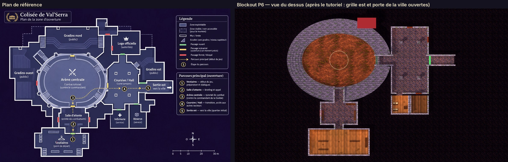
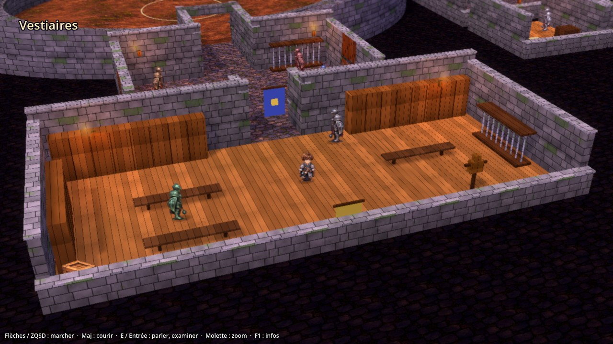
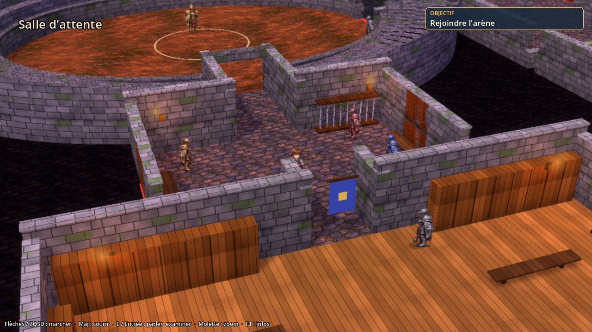
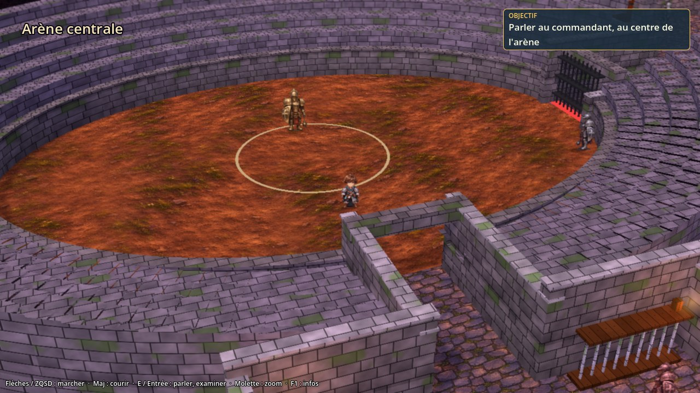
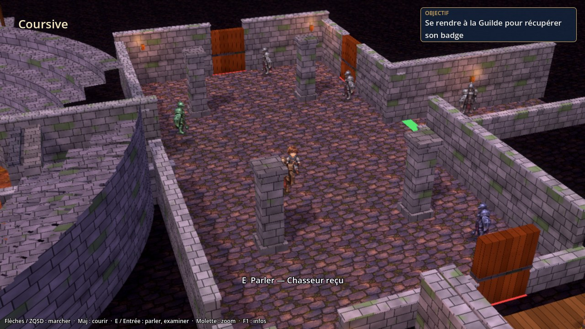
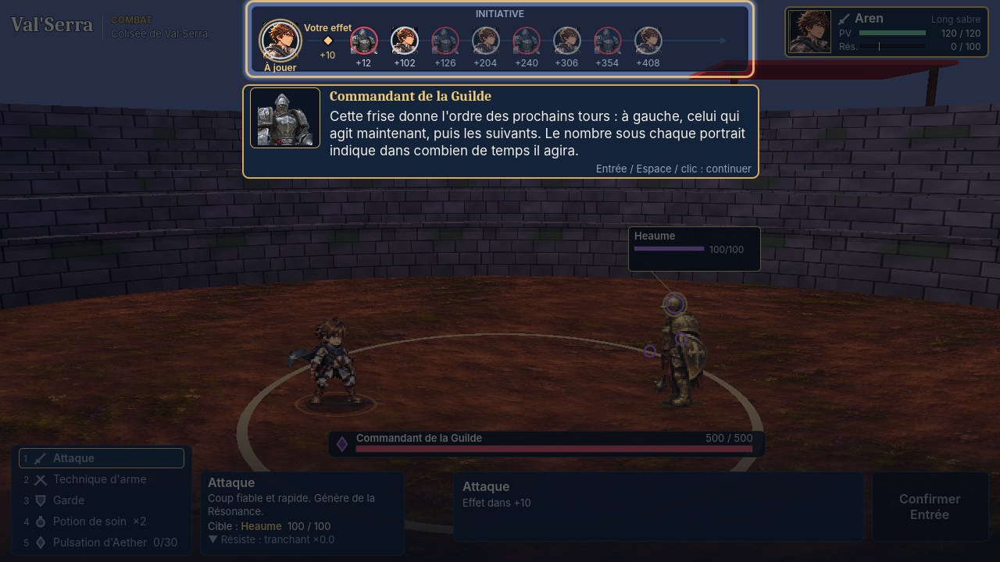
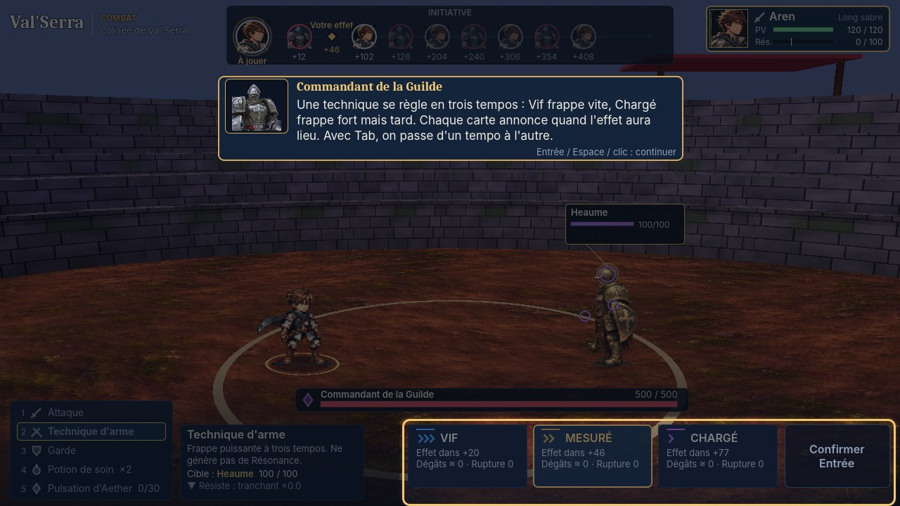
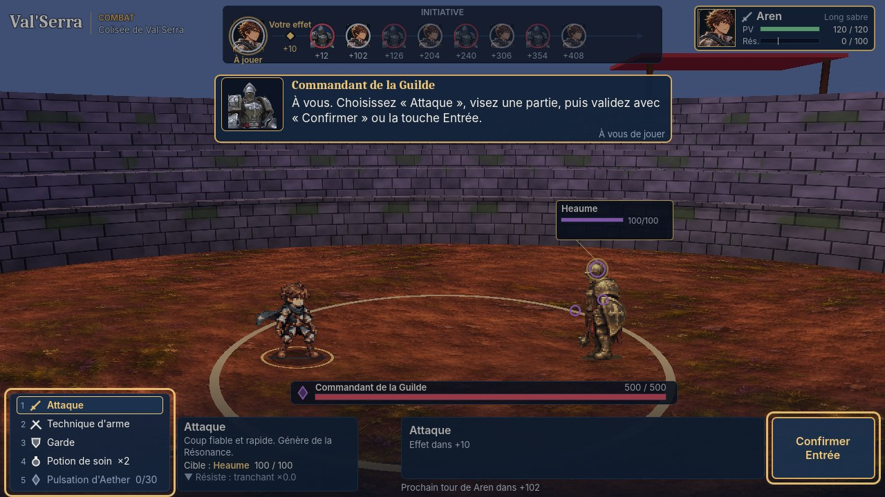
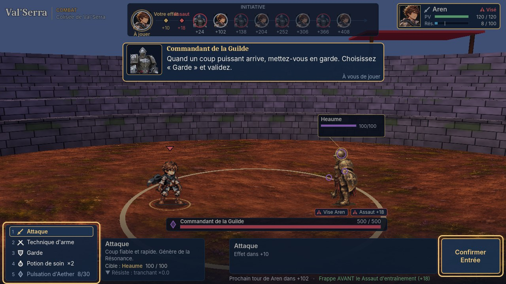

# P6 — Colisée de Val'Serra : ouverture jouable (blockout et tutoriel narratif)

> **P7.2 (nettoyage autorisé par le créateur)** : les médias de ce rapport (`docs/media/…`) ont été retirés du projet
> actif. Ils restent dans l'historique Git : `git checkout d88eac4 -- docs/media/<dossier>`.

Branche **`p6-colisee-ouverture`**, depuis `p5-3b-v3-hybride` @ `1f29e41` (terrain P5.3-B V3 hybride, ombres douces
qualité 4). Godot **4.7.2**. Inventaire et allègement : [`P6_INVENTAIRE.md`](P6_INVENTAIRE.md).

**Lancer** : ouvrir `scenes/p6/colisee.tscn` dans l'éditeur, puis **F6**. F5 reste la forêt V07B (consigne du projet :
la promotion d'une scène sur F5 est une décision du créateur — voir § 8).

## 1. Ce qui est jouable

1. **Vestiaires** (départ) : Aren seul, garde de la Guilde (« Ah, vous voilà enfin ! … »), une recrue, casiers, bancs,
   râtelier, mannequin, bannières de la Guilde ; objets examinables. Le garde donne l'objectif **Rejoindre l'arène**
   (également donné si Aren quitte les vestiaires sans lui parler).
2. **Salle d'attente** : trois Chasseurs (nerveux, confiante, inquiet ; l'un fait les cent pas), répliques d'ambiance ;
   deux portes de service fermées (marques rouges).
3. **Arène centrale** : sable ovale, podium, gradins à cinq rangs (abaissés côté caméra pour garder l'arène lisible),
   loge officielle visible au nord-est, grille est baissée (marque jaune : passage scénarisé), garde de la grille.
   « Approchez, recrue ! » à l'entrée ; le dialogue du commandant s'ouvre seul à 2,6 m (ou avec E à 3 m) :
   **trois réponses au choix**, chacune avec une réplique adaptée, toutes menant au tutoriel.
4. **Combat tutoriel** (§ 3), puis retour dans l'arène devant le commandant : « Votre évaluation est terminée… ».
   Objectif : **Se rendre à la Guilde pour récupérer son badge**. La grille est et la porte de la ville se lèvent.
5. **Coursive** : Chasseur reçu, Chasseuse recalée, Chasseur bavard, gardes de la loge et des gradins (« Les gradins
   sont réservés au public… ») ; loge, gradins est et réserve fermés ; **infirmerie** ouverte (soigneuse).
6. **Sortie est** : garde de la porte, puis **quartier du Colisée** (point de transition provisoire) : rue, fontaine,
   habitant, panneau « Guilde des Chasseurs » (fin de l'introduction). Les portes du Colisée se referment : retour
   bloqué (`coliseum_exited`) ; le drapeau `colisee_rouvert` les rouvrira plus tard.

| Vestiaires | Salle d'attente |
|---|---|
|  |  |
| **Arène (avant le tutoriel, grille baissée)** | **Coursive (après le tutoriel)** |
|  |  |

Vidéo du parcours complet : [`media/p6/parcours_complet.mp4`](media/p6/parcours_complet.mp4).

## 2. Le Colisée (blockout)

* **Données** : `data/p6/colisee.json`, générées par `tools/p6/build_colisee.py` (ne pas éditer à la main). Le socle
  `src/explore25/` ne connaît que des surfaces rectangulaires : l'arène est une surface rectangulaire fermée par un
  **anneau de 170 petits blocs** (podium de 1,4 m) qui suit l'ellipse ; les coins sont inaccessibles (testé).
* **Échelle** : le plan est suivi pour l'organisation, ramené à ≈ 55 % (arène 25 × 18 m, ensemble 66 × 58 m) pour
  des traversées courtes à 2,2 m/s. Vestiaires → arène : ≈ 15 s de marche.
* **Murs** : 3 m au fond des pièces, 2,6 m sur les côtés, **1 m côté caméra (sud)** ; murs hauts avec le « trou de
  visibilité » de l'avant-poste autour d'Aren. **Caméra** : P30 de l'avant-poste, limites calculées sur la carte.
* **Portes** (`p6.portes`) : fermées = solide logique + physique + vantail ou grille ; marque au sol aux couleurs du
  plan (vert ouvert, jaune scénarisé, rouge fermé), examen au contact (« Loge officielle — réservée aux autorités »).
* **Matières** : textures P4 existantes teintées (pavés, planches, pierre de taille, terre pour le sable). Lumière de
  fin d'après-midi, ombres qualité 4. Aucune nouvelle texture.
* **PNJ** (`data/p6/pnj_colisee.json`) : sprite du garde, **teinte et échelle par rôle** (commandant doré et plus
  grand, Chasseurs bronze / vert / bleu / rouge, soigneuse claire) ; aucun ne reprend la silhouette d'Aren ou d'Ilya.
  Présence selon l'état (`a_partir_de`), regard vers Aren quand il approche, une petite ronde.
* **Dialogues** (`data/p6/dialogues_colisee.json`) : variantes selon l'état ; Chasseurs sans portrait (cadre masqué,
  nom affiché).

## 3. Combat tutoriel

`scenes/battle/combat_tutoriel.tscn` hérite de la scène de combat du prototype (HUD, frise, menu, ciblage,
animations). **Aucune règle de CombatCore n'est modifiée.**

* **Groupe** : `heros` seul. **Adversaire** : `data/combat/monster_commandant.json` — un humain (sprite du garde,
  profil, ×2 au plus proche, doré). Parties ciblables : heaume, plastron, bouclier.
* **Le commandant ne perd pas de PV par ses données** : affinités nulles sur toutes ses parties (dégâts et rupture × 0)
  et résistance nulle à l'Aether ; à l'écran, « Paré ! » et un éclat de bouclier au lieu d'un chiffre.
* **Impossible de perdre** : coups retenus (Aren finit le tutoriel à 91 / 120 PV ; 6 attaques sans garde ne le mettent
  pas à terre — testé). Par sécurité, une fin de combat imprévue clôt aussi l'évaluation.
* **Déroulé** (`data/p6/tutoriel_colisee.json`, 13 étapes, 3 tours) :

| Tour | Étapes | Mise en évidence | Attendu |
|---|---|---|---|
| 1 | présentation, tour par tour | — | lecture |
| 1 | initiative | frise d'initiative | lecture |
| 1 | état du groupe (PV, Résonance) | carte d'Aren | lecture |
| 1 | actions (Attaque, Technique, Garde, Potion) | menu d'actions | lecture |
| 1 | tempos (Vif / Mesuré / Chargé, Tab) | cartes de tempo + Confirmer (Technique affichée) | lecture |
| 1 | ciblage (clic ou ← →) | commandant + sa jauge | lecture |
| 1 | **attaque guidée** | menu + Confirmer | **Attaque** validée (les autres actions sont refusées par une réplique) |
| 2 | assaut annoncé (losange rouge de la frise) | frise | lecture |
| 2 | **garde** | menu + Confirmer | **Garde** validée ; l'assaut est absorbé (−40 %, +10 Résonance) |
| 3 | bilan de la garde, potions | carte d'Aren, menu | lecture |
| 3 | « Bien. Je pense que vous êtes prêt… » | — | fin |

* **Fin scénarisée** : résultat `tutorial_completed` (ni victoire ni défaite, pas de mort, pas de récompense, potions
  inchangées), bandeau « Évaluation terminée », retour au Colisée. Échap pendant le tutoriel : « L'évaluation n'est pas
  terminée, recrue… » ; on reste dans le combat.

| Frise d'initiative | Cartes de tempo |
|---|---|
|  |  |
| **Attaque guidée** | **Assaut annoncé → garde** |
|  |  |

### Guide d'interface réutilisable

`src/tutorial/guide_interface.gd` (calque 20, au-dessus du HUD) : voile sombre **découpé** autour des cibles (shader,
coins arrondis, 4 cibles au plus), contour doré pulsé, bulle portrait + nom + texte progressif. Les cibles sont des
**clés** résolues à chaque image en rectangles des composants **réels** (`combat_hud.guide_target(clé)` : `initiative`,
`groupe`, `actions`, `description`, `tempos`, `confirmer`, `pv_adversaire` ; `adversaire` = rectangle du sprite) :
aucune position codée en dur, aucun élément d'interface dupliqué. Deux modes : *suite* (bloque l'interface, Entrée /
Espace / E / clic) et *action* (voile léger, interface utilisable, vérification par la scène). Le guide ne connaît pas le
combat : il servira aux futurs tutoriels.

## 4. Progression

`src/game/progression.gd` — états ordonnés dans `GameState.flags["intro_colisee"]`, objectif dans
`GameState.flags["objectif"]` (valeurs simples, sérialisables : prêtes pour la sauvegarde) :

`intro_not_started` → `tutorial_available` (garde, ou entrée en salle d'attente) → `tutorial_in_progress` (lancement du
combat) → `tutorial_completed` (retour du tutoriel) → `coliseum_exited` (sortie est). Un état ne recule jamais sauf
demande explicite : un tutoriel **interrompu** ramène à `tutorial_available` dans l'arène, sans relance automatique ;
reparler au commandant après l'évaluation **ne relance pas** le tutoriel (testé).

## 5. Tests

| Commande | Résultat |
|---|---|
| `godot --headless --path . --script res://tests/run_tests.gd` | **80 / 80** (71 existants + 9 P6) |
| `godot --headless --path . --script res://tests/e2e_p6_ouverture.gd -- --tuto-rapide` | **réussi (51 vérifications)** |
| `… res://scenes/p6/colisee.tscn -- --route=p6_sondes --quit --neuf --etat=tutorial_available` | **10 / 10** sondes |
| `tests/e2e_p4_retour.gd`, parcours `p4` (29 / 29) et `p4_sondes` (20 / 20) | réussis |
| `v09_locomotion`, `v09b5_anim`, `v09c_ilya`, `v11_collisions`, `p5_combat`, `p52_sol`, `p53b_pilote` | 0 échec |
| `godot --headless --path . --quit-after 60` (F5) | se charge sans erreur |

Tests unitaires P6 : départ dans les vestiaires ; coins de l'arène fermés ; **accès avant le tutoriel** (arène oui,
coursive / sortie / infirmerie non) ; **après** (coursive, infirmerie, sortie oui ; réserve, loge, gradins non) ;
quartier : retour fermé ; PNJ sur sol libre et dialogues complets ; trois choix du commandant ; états et
sérialisation ; **commandant à PV pleins** sous attaque, technique (tous tempos) et sérum ; tutoriel imperdable ;
étapes cohérentes avec les actions réellement disponibles et les composants du HUD.

E2E : vraies scènes et vraies transitions — garde, objectif, parcours clavier simulé sans blocage, dialogue du
commandant, tutoriel (étapes, mises en évidence, refus d'une action non prévue, Échap refusé, PV du commandant
intacts, ni victoire ni défaite), retour, objectif Guilde, PNJ de la coursive, sortie, quartier, retour bloqué.

## 6. Limites connues et points à embellir

* **Tout est provisoire** : matières P4 réutilisées, aucun spectateur, aucun son, PNJ = garde teinté (portraits des
  Chasseurs absents), décor du combat = rendu du blockout (`art/p6/combat/arene_colisee.png`).
* Rendus et vidéo faits en **Vulkan logiciel** (lavapipe, sans GPU) : l'image est plus lisse sur une vraie carte.
* Aren : apparence **P4.8** (référence préférée) en exploration et en combat ; aucune animation refaite.
* Les gradins sont un maillage décoratif (non praticables) ; pas d'escaliers vers les niveaux supérieurs (plan : zones
  « visibles / non accessibles pour le moment »).
* La frise et certaines cartes du combat parlent encore de « Souffle » si un tempo est consulté pendant l'assaut annoncé
  (libellé du prototype Vorgane) — à généraliser lors d'une passe sur le HUD de combat.
* Le quartier est un **point de transition** : la zone de la Guilde reste à construire.

## 7. Captures et vidéo

`docs/media/p6/` : comparaison plan / vue du dessus, vue du dessus seule, vestiaires, salle d'attente, arène avant et
après le tutoriel, coursive, infirmerie, sortie est, sept étapes du tutoriel avec surbrillance, vidéo du parcours.
Régénération : parcours `p6_captures` (`--etat=tutorial_completed` ou `--neuf --tag=avant`), `--vue_dessus_p6`,
`--decor_combat` ; vidéo : `--write-movie … -- --autoplay --neuf --route=p6_avant --route_retour=p6_apres --quitter_fin`.

## 8. Décision attendue du créateur

* **F5** : faut-il promouvoir `scenes/p6/colisee.tscn` comme scène principale (début du jeu) ? Une ligne dans
  `project.godot` (`run/main_scene`) ; non fait, conformément à la consigne du projet.
* **Allègement** : valider ou non les retraits proposés au § 3 de `P6_INVENTAIRE.md` (variantes d'Aren refusées).
